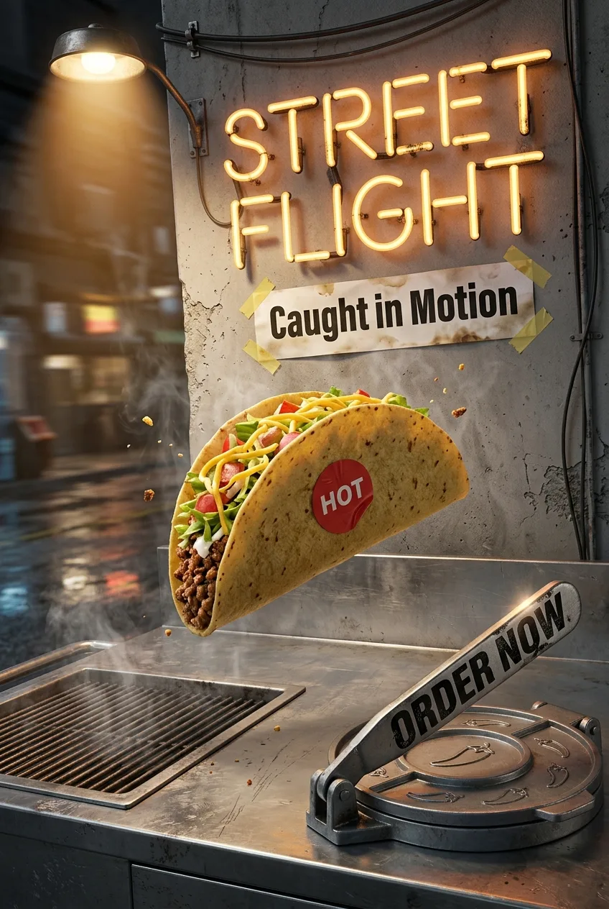

# '2:3' hyper-realistic, high-resolution poster featuring the attached taco image

[← Back to the collection](../../README.md) · Category: [Food & Drink](../../gallery/food-drink.md) · Model: `Vinano Image Pro` · ID: `vn-00707`

<a href="https://vinano.ai?utm_source=github&utm_medium=readme&utm_campaign=awesome-image-video-prompts-updating&utm_content=prompt-page-image"></a>

<sub>Preview generated with <a href="https://vinano.ai?utm_source=github&utm_medium=readme&utm_campaign=awesome-image-video-prompts-updating&utm_content=prompt-page-caption">vinano.ai</a></sub>

## Prompt

```text
Generate a '2:3' hyper-realistic, high-resolution poster featuring the attached taco image. Adjust its perspective if needed to match the scene’s perspective and blend naturally into the composition.

COMPOSITION:
Capture a dynamic freeze-frame moment of a taco mid-flip during a street-side catch, shot from a Dutch tilted low three-quarter angle that exaggerates motion and urgency. The camera is positioned slightly below the taco, angled upward, the taco large and dominant dead-center in the frame, sharply in focus, suspended just above a scarred stainless-steel street cart counter. A single harsh overhead streetlamp mounted top left casts a focused cone of warm light, carving crisp highlights and deep shadows that emphasize motion blur in the background while keeping the taco tack-sharp. The atmosphere is alive subtle steam rising from the cart grill at bottom left, faint oil smoke drifting upward, and tiny airborne crumbs frozen mid-air. The tone is clean, appetizing, cinematic, and urban. The food-signature prop is a custom round taco press stamped geometric chili patterns, resting closed on the counter in the lower right foreground beneath the airborne taco, its metal edges catching the lamp’s glare. The story-signature prop is a battered transit-station flip-clock timer mounted on the back wall at top right, showing '19 03' on split flip panels, implying split-second timing and street rhythm. Wet pavement reflections shimmer in the blurred background, grounding the scene in a late-night street setting. Keep visible wiring and cables subtly running along the wall toward the neon and props, a faint magenta/purple spill mixing into the neon glow on the wall and paper.

HEADER: 'STREET FLIGHT'
The header is physically formed from bent single neon tubing (no double tubes). Neon tubes are made of reflective glass neon gas inside, mounted on a chipped concrete wall in the upper center background behind the taco. The neon tubes glow 'warm amber', uneven brightness, faint buzzing, and soot-darkened mounting brackets. The header is stacked on two lines: 'STREET' above 'FLIGHT'. The letters cast soft neon spill and distorted shadows across the wall’s cracked surface, minimal grime dulling parts of the glow, and thin black power cables feeding into the neon from the right.

TAGLINE: 'Caught in Motion'
The tagline is printed in bold condensed sans-serif on a narrow strip of grease-stained receipt paper taped directly beneath the neon header four translucent yellow tape pieces. The paper sags slightly at the center, edges curled and darkened by oil, catching a softer secondary glow from the neon above a faint magenta/purple tint in the spill.

CALL TO ACTION: 'ORDER NOW'
The cta is integrated into the taco press hardware in the foreground as on an angled metal bar/handle element, reading as bold, worn black lettering slight chipping and grease settled into the letter edges, plus a hard specular highlight running along the metal.

STICKER: 'HOT'
A small circular red vinyl sticker is physically adhered directly to the taco shell, perfectly centered, slight white highlights. The sticker conforms to the taco curvature, shows tiny wrinkles under the adhesive, and tiny air pockets are trapped beneath the adhesive to reflect realism.

Emphasise material texture and natural light so the final frame feels tactile and premium.
```

## Try it on vinano.ai

1. Copy the prompt above.
2. Open **[vinano.ai](https://vinano.ai?utm_source=github&utm_medium=readme&utm_campaign=awesome-image-video-prompts-updating&utm_content=prompt-page-try)**, paste it into the image generator and pick a model.
3. Swap any placeholders (brand, product, city, person…) for your own details, then generate.

More prompts like this: [Food & Drink gallery](../../gallery/food-drink.md) · [all categories](../../README.md#contents)
