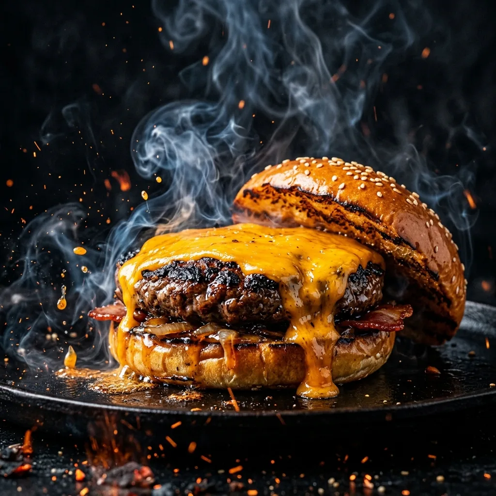

# Close-up of a sizzling gourmet cheeseburger

[← Back to the collection](../../README.md) · Category: [Food & Drink](../../gallery/food-drink.md) · Model: `Vinano Image v2` · ID: `vn-00718`

<a href="https://vinano.ai?utm_source=github&utm_medium=readme&utm_campaign=awesome-image-video-prompts-updating&utm_content=prompt-page-image"></a>

<sub>Preview generated with <a href="https://vinano.ai?utm_source=github&utm_medium=readme&utm_campaign=awesome-image-video-prompts-updating&utm_content=prompt-page-caption">vinano.ai</a></sub>

## Prompt

```text
A hyper-realistic, cinematic close-up of a sizzling gourmet cheeseburger. The thick, juicy beef patty features a heavy, glossy char and is blanketed in vibrant orange cheddar cheese that melts and oozes down the sides in thick, viscous streams over a toasted brioche bun. The atmosphere is dramatic and smoky, thick wisps of white and blue steam swirling upwards, surrounded by floating bright orange sparks, glowing embers, and frozen droplets of grease suspended in the air. The lighting is high-contrast and dramatic against a deep black background, emphasizing the glistening textures. Shot a macro lens, shallow depth of field, and 8k resolution commercial food photography style. Aim for an editorial, design-driven look with deliberate negative space.
```

## Try it on vinano.ai

1. Copy the prompt above.
2. Open **[vinano.ai](https://vinano.ai?utm_source=github&utm_medium=readme&utm_campaign=awesome-image-video-prompts-updating&utm_content=prompt-page-try)**, paste it into the image generator and pick a model.
3. Swap any placeholders (brand, product, city, person…) for your own details, then generate.

More prompts like this: [Food & Drink gallery](../../gallery/food-drink.md) · [all categories](../../README.md#contents)
