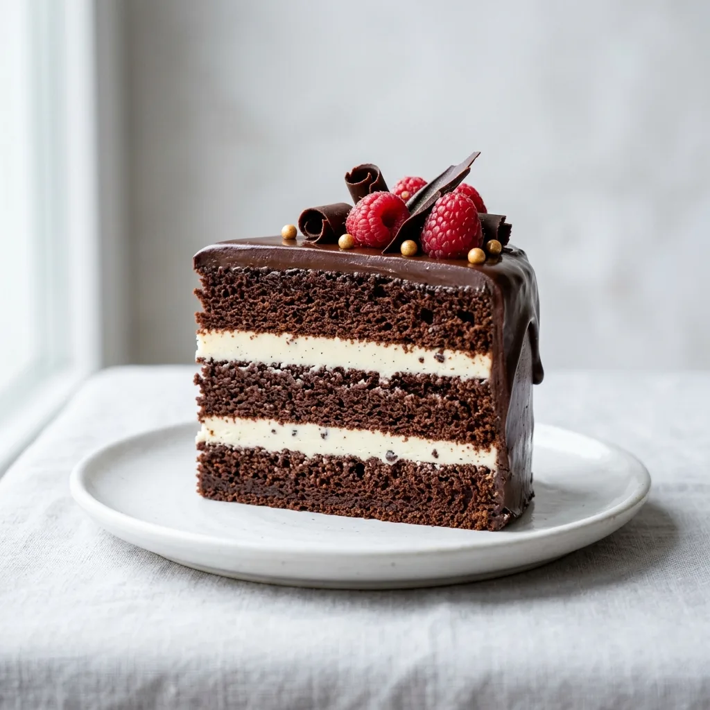

# Premium food photography of a layered chocolate cake

[← Back to the collection](../../README.md) · Category: [Food & Drink](../../gallery/food-drink.md) · Model: `Vinano Image v2` · ID: `vn-00728`

<a href="https://vinano.ai?utm_source=github&utm_medium=readme&utm_campaign=awesome-image-video-prompts-updating&utm_content=prompt-page-image"></a>

<sub>Preview generated with <a href="https://vinano.ai?utm_source=github&utm_medium=readme&utm_campaign=awesome-image-video-prompts-updating&utm_content=prompt-page-caption">vinano.ai</a></sub>

## Prompt

```text
Ultra-realistic premium food photography of a layered chocolate cake on a white plate, centered composition, three thick moist chocolate sponge layers a smooth white cream filling in the middle, topped glossy rich chocolate ganache frosting, decorated fresh raspberries, dark chocolate curls, shards, and small gold sugar pearls, clean minimal light grey studio background, soft diffused professional lighting, gentle natural shadows, ultra-sharp texture detail showing porous sponge and creamy layers, high-end bakery advertising style, shallow depth of field, macro food photography look, true-to-life photorealistic, 8K resolution, elegant dessert presentation, no text, no watermark
Negative prompt:
blurry, low resolution, cartoon style, CGI look, artificial textures, messy composition, oversaturated colors, harsh shadows, noise, watermark, text, extra objects, distorted cake shape.

Keep edges clean and the overall composition balanced for a polished, gallery-ready result.
```

## Try it on vinano.ai

1. Copy the prompt above.
2. Open **[vinano.ai](https://vinano.ai?utm_source=github&utm_medium=readme&utm_campaign=awesome-image-video-prompts-updating&utm_content=prompt-page-try)**, paste it into the image generator and pick a model.
3. Swap any placeholders (brand, product, city, person…) for your own details, then generate.

More prompts like this: [Food & Drink gallery](../../gallery/food-drink.md) · [all categories](../../README.md#contents)
