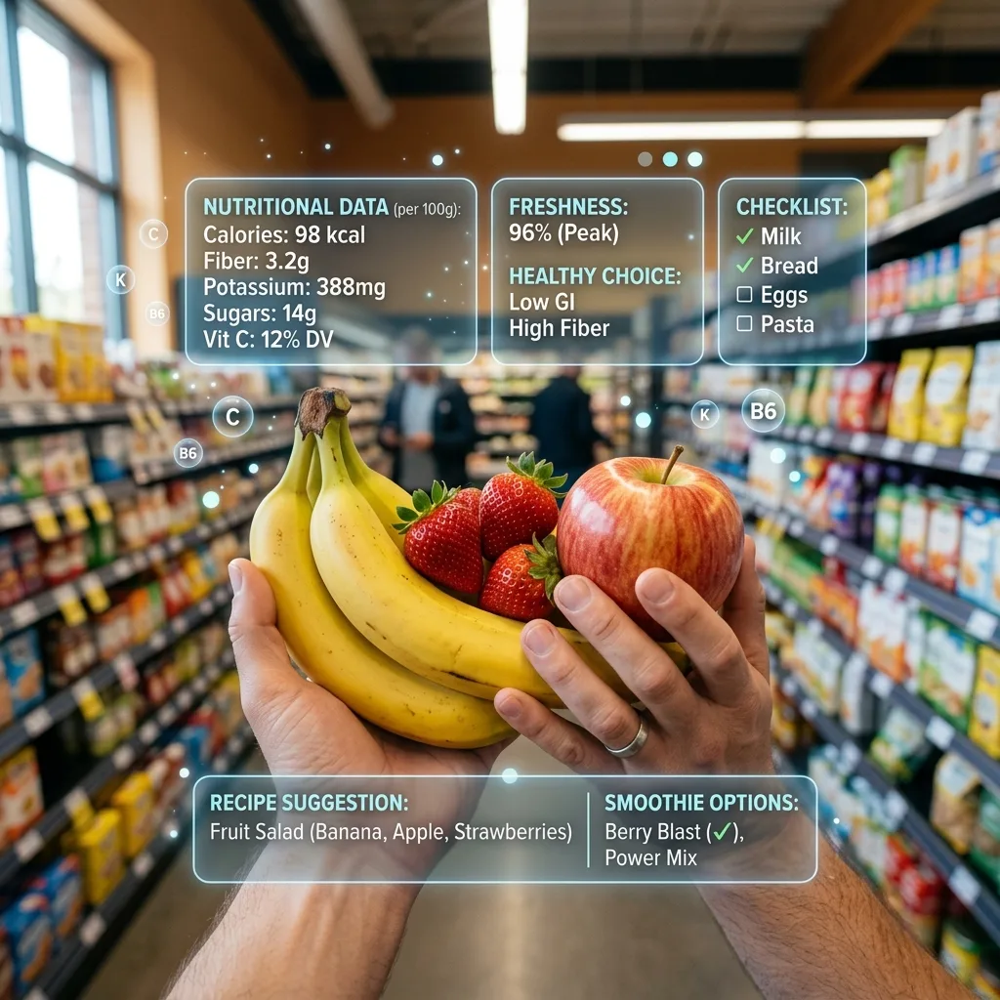

# Food & Drink prompt #757

[← Back to the collection](../../README.md) · Category: [Food & Drink](../../gallery/food-drink.md) · Model: `Vinano Image Pro` · ID: `vn-00757`

<a href="https://vinano.ai?utm_source=github&utm_medium=readme&utm_campaign=awesome-image-video-prompts-updating&utm_content=prompt-page-image"></a>

<sub>Preview generated with <a href="https://vinano.ai?utm_source=github&utm_medium=readme&utm_campaign=awesome-image-video-prompts-updating&utm_content=prompt-page-caption">vinano.ai</a></sub>

## Prompt

```text
{
 "image_prompt": {
 "viewpoint": "Realistic first-person view (FPV)",
 "action": "Person holding fresh fruit in their hands",
 "subject_variations": ["Banana",
 "Strawberries",
 "Apple"],
 "environment": {
 "location": "Modern supermarket aisle",
 "background": "Blurred grocery shelves",
 "lighting": "Bright commercial lighting"
 },
 "augmented_reality_hud": {
 "overlay_style": "Clean sci-fi interface, soft glow, glass-like UI elements",
 "data_display": ["Nutritional data (calories, vitamins, fiber, sugars, potassium)",
 "Freshness percentage",
 "Health indicators"],
 "ui_panels": ["Checklist items (milk, bread, eggs, pasta)",
 "Recipe suggestions",
 "Smoothie options",
 "Vitamin icons"],
 "visual_effects": "Subtle light particles, depth-aware AR placement"
 },
 "technical_specs": {
 "style": "Ultra-realistic photography blended futuristic AR technology",
 "aesthetic": "Modern health-tech",
 "focus": "Sharp focus on hands and fruit, shallow depth of field",
 "resolution": "8K",
 "realism": "Cinematic realism"
 }
 }
}

Emphasise material texture and natural light so the final frame feels tactile and premium.
```

## Try it on vinano.ai

1. Copy the prompt above.
2. Open **[vinano.ai](https://vinano.ai?utm_source=github&utm_medium=readme&utm_campaign=awesome-image-video-prompts-updating&utm_content=prompt-page-try)**, paste it into the image generator and pick a model.
3. Swap any placeholders (brand, product, city, person…) for your own details, then generate.

More prompts like this: [Food & Drink gallery](../../gallery/food-drink.md) · [all categories](../../README.md#contents)
