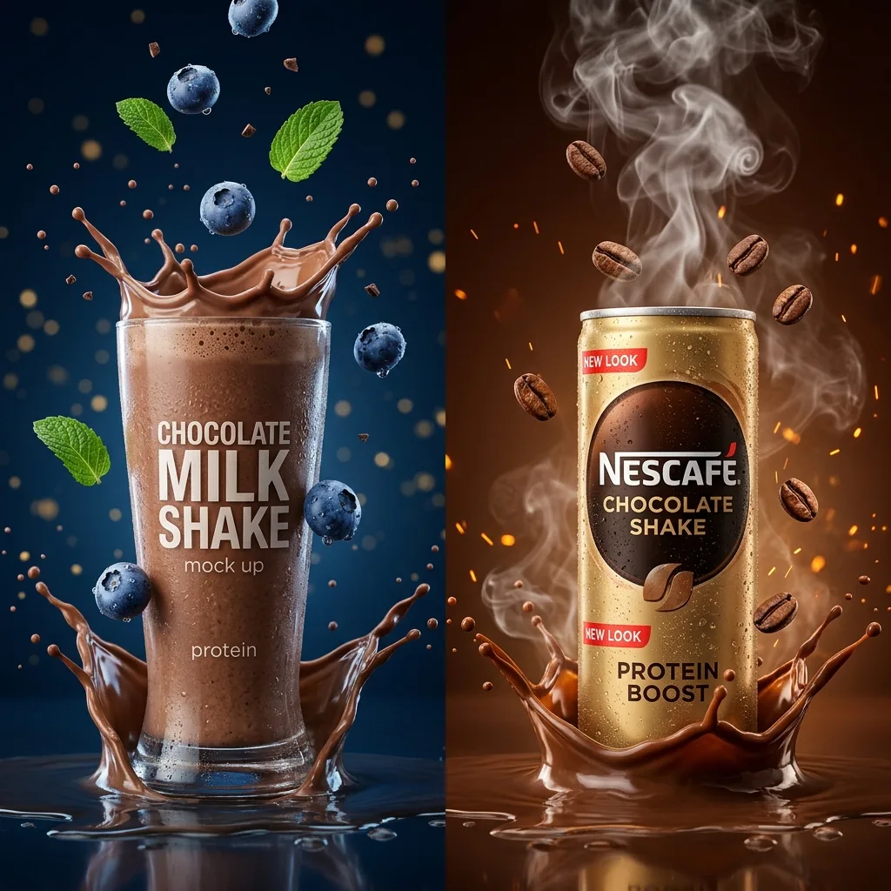

# Commercial product photography

[← Back to the collection](../../README.md) · Category: [Food & Drink](../../gallery/food-drink.md) · Model: `Vinano Image v2` · ID: `vn-00759`

<a href="https://vinano.ai?utm_source=github&utm_medium=readme&utm_campaign=awesome-image-video-prompts-updating&utm_content=prompt-page-image"></a>

<sub>Preview generated with <a href="https://vinano.ai?utm_source=github&utm_medium=readme&utm_campaign=awesome-image-video-prompts-updating&utm_content=prompt-page-caption">vinano.ai</a></sub>

## Prompt

```text
{
 "master_prompt": {
 "global_settings": {
 "style": "Hyper-realistic commercial product photography",
 "layout": "Vertical split-screen, two distinct modules",
 "resolution": "8K UHD, filmic, cinematic lighting",
 "details": "Extreme clarity, frozen motion splashes, micro-condensation"
 },
 "module_1_left": {
 "subject": {
 "type": "Clear tall glass of thick chocolate milkshake",
 "details": "Frothy texture, visible condensation on glass",
 "text_on_glass": ["CHOCOLATE MILK SHAKE", "mock up", "protein"]
 },
 "action": "Dynamic chocolate liquid splash erupting from the base and top",
 "floating_elements": ["Whole blueberries water droplets",
 "Fresh green mint leaves",
 "Tiny chocolate particles suspended in air"],
 "background": {
 "color": "Deep dark blue soft golden bokeh particles",
 "lighting": "Cool moonlight-style rim lighting"
 }
 },
 "module_2_right": {
 "subject": {
 "type": "Slim gold metallic Nescafé can",
 "details": "Heavy condensation, matte gold finish",
 "text_on_can": ["NESCAFÉ", "CHOCOLATE SHAKE", "NEW LOOK", "PROTEIN BOOST"]
 },
 "action": "Explosive chocolate liquid crown splash at the base",
 "floating_elements": ["Roasted coffee beans",
 "Swirling thick white steam/smoke rising from the top",
 "Glowing amber embers and sparks"],
 "background": {
 "color": "Warm chocolate brown to dark amber gradient",
 "atmosphere": "Moody, intense, and smoky"
 }
 },
 "surface_details": {
 "base": "Reflective dark wet surface liquid pooling",
 "shadows": "Soft separated realistic shadows"
 }
 }
}

Maintain consistent colour harmony and crisp focus across the whole frame.
```

## Try it on vinano.ai

1. Copy the prompt above.
2. Open **[vinano.ai](https://vinano.ai?utm_source=github&utm_medium=readme&utm_campaign=awesome-image-video-prompts-updating&utm_content=prompt-page-try)**, paste it into the image generator and pick a model.
3. Swap any placeholders (brand, product, city, person…) for your own details, then generate.

More prompts like this: [Food & Drink gallery](../../gallery/food-drink.md) · [all categories](../../README.md#contents)
