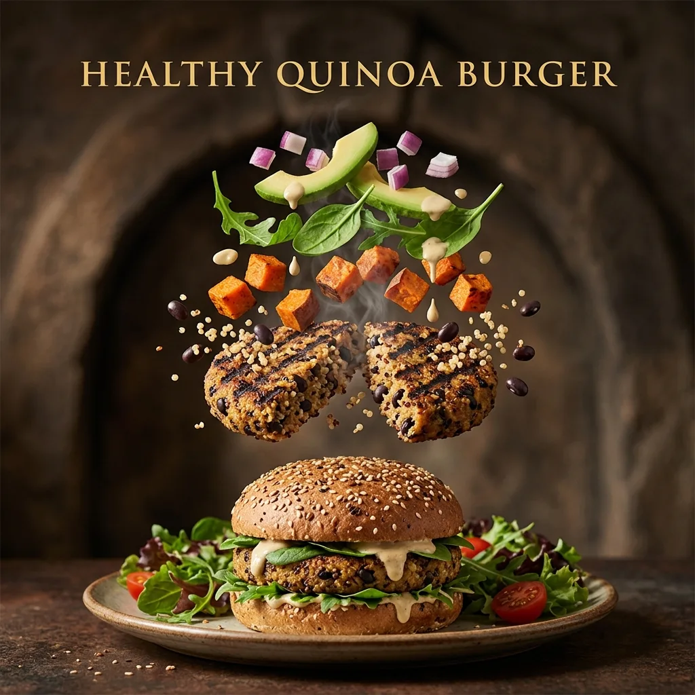

# Deconstructed exploded view floating in mid-air above a finished

[← Back to the collection](../../README.md) · Category: [Food & Drink](../../gallery/food-drink.md) · Model: `Vinano Image Pro` · ID: `vn-00768`

<a href="https://vinano.ai?utm_source=github&utm_medium=readme&utm_campaign=awesome-image-video-prompts-updating&utm_content=prompt-page-image"></a>

<sub>Preview generated with <a href="https://vinano.ai?utm_source=github&utm_medium=readme&utm_campaign=awesome-image-video-prompts-updating&utm_content=prompt-page-caption">vinano.ai</a></sub>

## Prompt

```text
{
"presentation": "Deconstructed exploded view floating in mid-air above a finished burger on a plate",
 "burger_paddy": "Grilled quinoa and black bean patty visible char marks, split in half steam rising",
 "floating_ingredients": ["Grains of cooked quinoa",
 "Whole black beans",
 "Roasted sweet potato cubes",
 "Fresh spinach and arugula leaves",
 "Slices of ripe avocado",
 "Drips of creamy tahini-lemon dressing",
 "Diced red onion"],
 "plated_item": "A complete burger on a seeded whole-grain bun fresh greens and dressing, served on a ceramic plate a side salad"
 },
 "style": {
 "aesthetic": "Professional commercial food photography",
 "lighting": "Warm, cinematic, moody lighting soft highlights on the textures of the food",
 "background": "Dark, rustic, textured stone or clay oven-like background a shallow depth of field (bokeh)",
 "color_palette": "Earthy tones, deep browns, vibrant greens, and warm oranges"
 },
 "composition": {
 "angle": "Eye-level, straight-on shot",
 "dynamic_elements": "Floating gravity-defying arrangement, wisps of steam, droplets of sauce",
 "text_overlay_optional": "Clean gold serif typography at the top reading 'HEALTHY QUINOA BURGER'"
 },
 "technical_specs": {
 "focus": "Sharp focus on the floating patty and ingredients",
 "lens": "Macro lens for high detail texture on grains and vegetables",
 "quality": "8k resolution, true-to-life photorealistic, commercial advertising quality"
 }
}

Render with rich micro-detail while keeping the layout uncluttered and intentional.
```

## Try it on vinano.ai

1. Copy the prompt above.
2. Open **[vinano.ai](https://vinano.ai?utm_source=github&utm_medium=readme&utm_campaign=awesome-image-video-prompts-updating&utm_content=prompt-page-try)**, paste it into the image generator and pick a model.
3. Swap any placeholders (brand, product, city, person…) for your own details, then generate.

More prompts like this: [Food & Drink gallery](../../gallery/food-drink.md) · [all categories](../../README.md#contents)
