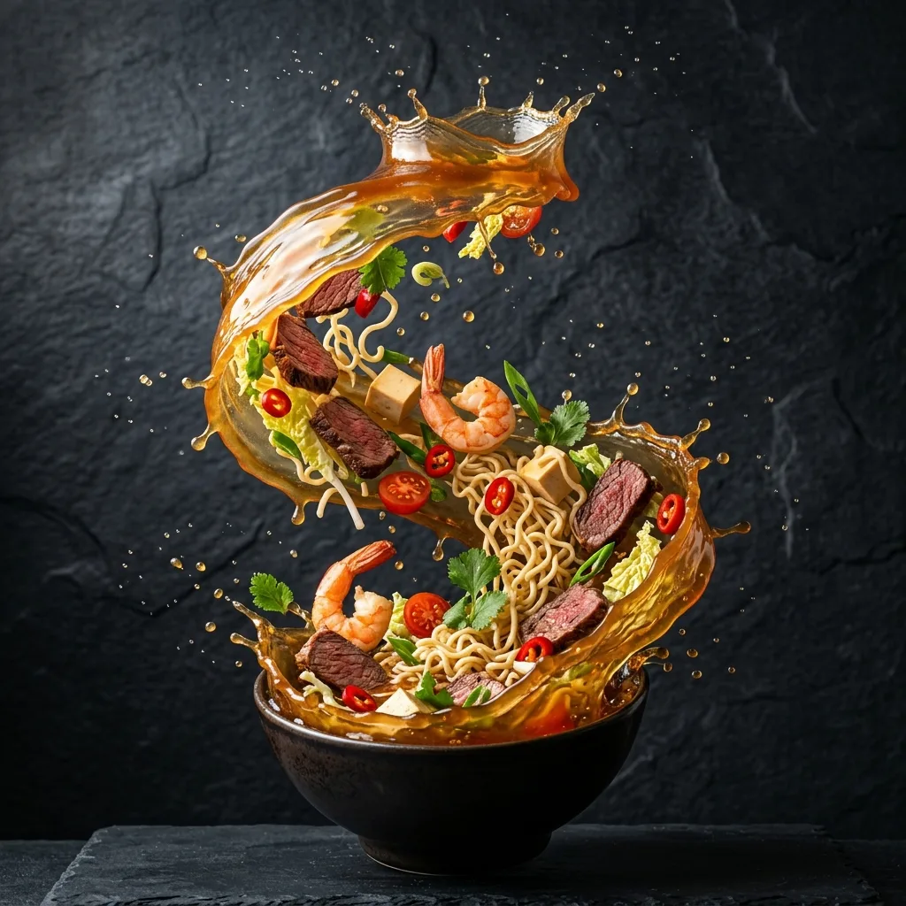

# Rich Asian soup

[← Back to the collection](../../README.md) · Category: [Food & Drink](../../gallery/food-drink.md) · Model: `Vinano Image v2` · ID: `vn-00779`

<a href="https://vinano.ai?utm_source=github&utm_medium=readme&utm_campaign=awesome-image-video-prompts-updating&utm_content=prompt-page-image"></a>

<sub>Preview generated with <a href="https://vinano.ai?utm_source=github&utm_medium=readme&utm_campaign=awesome-image-video-prompts-updating&utm_content=prompt-page-caption">vinano.ai</a></sub>

## Prompt

```text
{
 "image_prompt": {
 "subject": "Rich Asian soup",
 "action": "Ingredients exploding upward in mid-air, swirling spiral splash of broth forming a dynamic ribbon shape, liquid splash crown",
 "ingredients": ["Floating beef slices",
 "Shrimp",
 "Noodles",
 "Tofu cubes",
 "Chili",
 "Herbs",
 "Tomatoes",
 "Cabbage"],
 "environment": "Dramatic dark textured background",
 "lighting": "Studio lighting, strong rim light, glossy broth reflections, cinematic contrast",
 "photography_style": "Ultra-realistic food photography, high-speed photography, frozen motion, hyper realistic",
 "camera_settings": {
 "lens": "85mm",
 "aperture": "f/4",
 "focus": "Sharp focus, macro clarity",
 "resolution": "8K"
 }
 }
}

Preserve realistic proportions and depth for a confident, professional finish.
```

## Try it on vinano.ai

1. Copy the prompt above.
2. Open **[vinano.ai](https://vinano.ai?utm_source=github&utm_medium=readme&utm_campaign=awesome-image-video-prompts-updating&utm_content=prompt-page-try)**, paste it into the image generator and pick a model.
3. Swap any placeholders (brand, product, city, person…) for your own details, then generate.

More prompts like this: [Food & Drink gallery](../../gallery/food-drink.md) · [all categories](../../README.md#contents)
