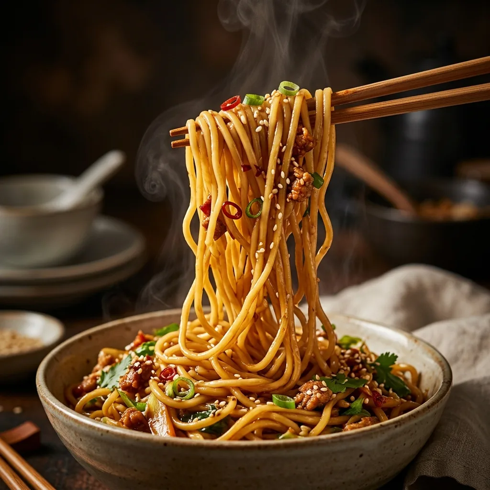

# Freshly prepared noodles captured at peak texture

[← Back to the collection](../../README.md) · Category: [Food & Drink](../../gallery/food-drink.md) · Model: `Vinano Image v2` · ID: `vn-00780`

<a href="https://vinano.ai?utm_source=github&utm_medium=readme&utm_campaign=awesome-image-video-prompts-updating&utm_content=prompt-page-image"></a>

<sub>Preview generated with <a href="https://vinano.ai?utm_source=github&utm_medium=readme&utm_campaign=awesome-image-video-prompts-updating&utm_content=prompt-page-caption">vinano.ai</a></sub>

## Prompt

```text
{
 "content_goal": "viral food visual high appetite appeal",
 "image_type": "ultra-true-to-life photorealistic food photography",
 "visual_style": {
 "aesthetic": "cinematic food editorial, premium street-food style",
 "vibe": "steamy, savory, irresistible",
 "realism": "high-end commercial food realism"
 },
 "composition": {
 "framing": "close-up or medium close-up",
 "camera_angle": "45-degree or slightly top-front angle",
 "subject_position": "centered hero bowl or lifted noodles",
 "perspective": "depth-rich strong foreground emphasis"
 },
 "subject": {
 "description": "freshly prepared noodles captured at peak texture",
 "presentation": "chopsticks or fork lifting noodles mid-air",
 "details": "long glossy strands visible sauce coating",
 "ingredients": "vegetables, protein, herbs, sesame seeds"
 },
 "texture_details": {
 "noodles": "silky, elastic strands sauce cling",
 "sauce": "rich, glossy, evenly coated",
 "steam": "visible rising steam for freshness",
 "garnish": "spring onions, chili flakes, sesame"
 },
 "styling": {
 "bowl": "ceramic or rustic bowl",
 "props": "chopsticks, linen napkin, subtle tableware",
 "messiness": "controlled, appetizing chaos"
 },
 "lighting": {
 "type": "warm directional food lighting",
 "quality": "soft yet contrast-rich",
 "direction": "side or top-side light",
 "highlight_focus": "noodle gloss and steam",
 "shadow_style": "soft shadows for depth"
 },
 "color_palette": {
 "primary": ["golden brown", "soy sauce tones", "warm amber"],
 "accent": ["chili red", "herb green"],
 "mood": "cozy, savory, indulgent"
 },
 "environment": {
 "location": "street-food stall, modern kitchen, or studio setup",
 "background": "dark or softly blurred background",
 "atmosphere": "warm, comforting, flavorful"
 },
 "camera_details": {
 "camera_type": "professional DSLR or mirrorless simulation",
 "lens": "85mm or macro food lens",
 "focus": "tack-sharp on lifted noodles",
 "depth_of_field": "shallow background blur",
 "resolution": "advertising-grade clarity"
 },
 "quality_control": {
 "food_realism": "hyper-real texture without plastic look",
 "steam_accuracy": "natural steam physics",
 "ai_artifacts": "none",
 "professional_finish": "commercial food photography quality"
 },
 "overall_mood": "comforting, rich, mouth-watering",
 "intended_use": {
 "primary": "viral food post on X",
 "secondary": "restaurant branding, food editorial, ads"
 }
}

Aim for an editorial, design-driven look with deliberate negative space.
```

## Try it on vinano.ai

1. Copy the prompt above.
2. Open **[vinano.ai](https://vinano.ai?utm_source=github&utm_medium=readme&utm_campaign=awesome-image-video-prompts-updating&utm_content=prompt-page-try)**, paste it into the image generator and pick a model.
3. Swap any placeholders (brand, product, city, person…) for your own details, then generate.

More prompts like this: [Food & Drink gallery](../../gallery/food-drink.md) · [all categories](../../README.md#contents)
