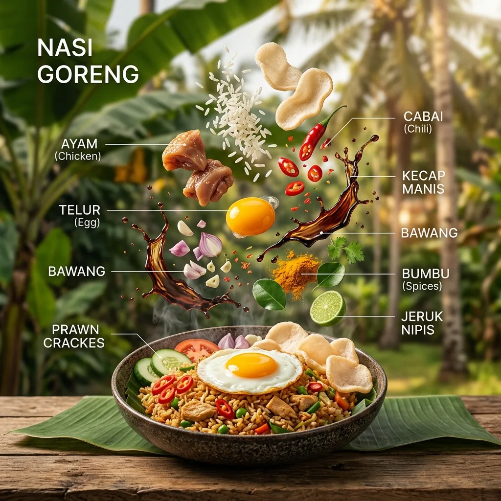

# Food photography of a traditional Indonesian dish, presented as

[← Back to the collection](../../README.md) · Category: [Food & Drink](../../gallery/food-drink.md) · Model: `Vinano Image Pro` · ID: `vn-00781`

<a href="https://vinano.ai?utm_source=github&utm_medium=readme&utm_campaign=awesome-image-video-prompts-updating&utm_content=prompt-page-image"></a>

<sub>Preview generated with <a href="https://vinano.ai?utm_source=github&utm_medium=readme&utm_campaign=awesome-image-video-prompts-updating&utm_content=prompt-page-caption">vinano.ai</a></sub>

## Prompt

```text
Ultra-realistic cinematic food photography of a traditional Indonesian dish, presented as a floating ingredients composition. Main dish placed at the bottom in a rustic ceramic bowl or banana leaf plate. Key ingredients suspended in mid-air above the dish, perfectly separated and labeled clean refined minimalist typography and thin pointer lines. Dynamic splashes of sauce and spices frozen in motion, high-speed food photography. Natural tropical setting banana leaves, palm trees, warm sunlight, shallow depth of field. Hyper-detailed textures, glossy sauces, steam and smoke effects, editorial food poster style, premium commercial quality, 8K resolution, soft filmic, cinematic lighting, realistic shadows, depth and realism. Aim for an editorial, design-driven look with deliberate negative space.
```

## Try it on vinano.ai

1. Copy the prompt above.
2. Open **[vinano.ai](https://vinano.ai?utm_source=github&utm_medium=readme&utm_campaign=awesome-image-video-prompts-updating&utm_content=prompt-page-try)**, paste it into the image generator and pick a model.
3. Swap any placeholders (brand, product, city, person…) for your own details, then generate.

More prompts like this: [Food & Drink gallery](../../gallery/food-drink.md) · [all categories](../../README.md#contents)
