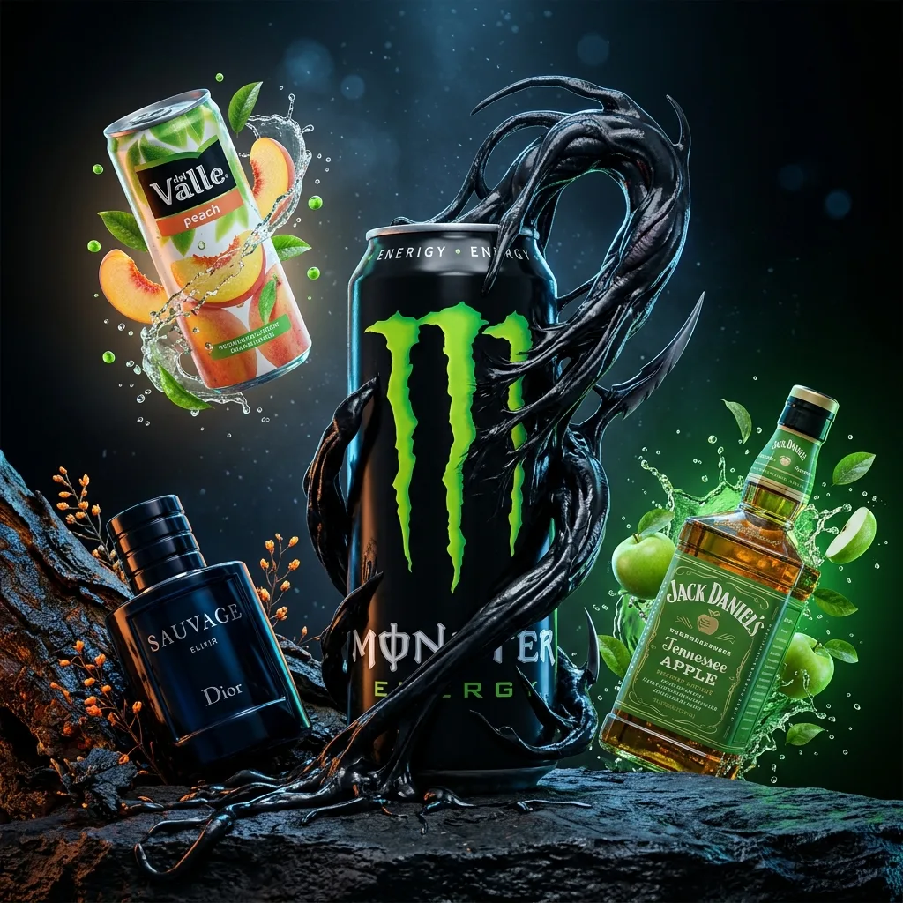

# Ultra-high-end product photography of an official Monster Energy drink

[← Back to the collection](../../README.md) · Category: [Food & Drink](../../gallery/food-drink.md) · Model: `Vinano Image v2` · ID: `vn-00787`

<a href="https://vinano.ai?utm_source=github&utm_medium=readme&utm_campaign=awesome-image-video-prompts-updating&utm_content=prompt-page-image"></a>

<sub>Preview generated with <a href="https://vinano.ai?utm_source=github&utm_medium=readme&utm_campaign=awesome-image-video-prompts-updating&utm_content=prompt-page-caption">vinano.ai</a></sub>

## Prompt

```text
Cinematic ultra-high-end product photography of an official Monster Energy drink can a standard vertical black aluminum energy drink can featuring the iconic neon
reen claw logo of Monster Energy - standing on a dark, rough, textured surface. The can is being engulfed and seemingly possessed by a thick, glossy, jet-black symbiotic liquid inspired by the organic alien symbiote from the 2018 film Venom, directed by Ruben Fleischer. The viscous substance behaves like a living entity - muscular,predatory, and semi-sentient— forming elongated, sinewy tendrils that stretch
upward and wrap tightly around the can as if claiming it. The texture must closely resemble Venom's cinematic symbiote: dense, oily, hyper-glossy, elastic, visible surface tension, micro ripples, sharp blade-like protrusions, and subtle vein-like striations. It should feel alive, aggressive, and biomechanical _ not random liquid splashes.The black symbiote appears to be merging the Monster can's aluminum surface crawling over it, partially fusing into the metal, as if infecting or possessing the product. Some tendrils anchor to the ground while others rise dynamically into the air, creating tension and controlled chaos. The green claw logo remains clearly visible and becomes the focal contrast element against the dark mass. Camera angle: dramatic low-angle hero shot, slightly tilted (Dutch angle) for cinematicintensity, captured a macro cinema lens at close range. Shallow depth of field, razor-sharp focus on the logo and the liquid interaction, extreme macro detail. Lighting: moody, high-contrast lighting strong cold blue rim light sculpting the wet reflective contours of the symbiote and enhancing the metallic sheen of the blackaluminum can. Subtle green light spill from the neon logo reflecting onto nearbyglossy tendrils. Deep shadows controlled specular highlights for a premium cinematic look.Atmosphere: floating micro-particles, dust, and fine mist suspended in the air,catching the rim light to create depth. Subtle volumetric haze and cinematic diffusion.Background: deep dark void faint cool blue bokeh and minimal gradient separation, reinforcing a mysterious, powerful, almost supernatural atmosphere. Ultra-realistic, true-to-life photorealistic, hyper-detailed textures, HDR, 8K resolution, cinematic color grading, dramatic tension, premium commercial advertising aesthetic.

IMAGE 2
premium-quality commercial photograph of a
sleek,thin aluminum Del Valle peach juice
can suspended diagonally in a dynamic,
gravity-defying composition. The scene
conveys a sense of freshness, featuring hyper-realistic slices of juicy peaches and vibrant green leaves spiraling around the can along splashes of crystal-clear water and delicate droplets. The lighting is bright and airy, creating a soft, refreshing glow throughout the image. The color palette consists of warm peach tones, soft corals and vibrant greens on a refined minimalist back ground a peach-toned gradient and shallow depth of field, showing blurred peaches in the background. Commercial aesthetic, macro detail, refreshing and vibrant atmosphere.

IMAGE 3
A close-up product photograph of a dark
blue glass bottle for "SAUVAGE ELIXIR Dior" perfume, nestled within dark, textured,wet-looking tree bark and small dried botanical sprigs glowing orange tips. Thelighting is low
moody warm
orange and deep blue highlights across the wet wood and the glossy bottle. The background is dark and natural.

IMAGE 4
A dynamic, high-speed photograph cap-
tures a bottle of Jack Daniel's Tennessee
Apple whiskey, its signature green
label and square glass shape, splashing of
green liquid. Water droplets and fresh green
apples leaves explode outwards
around the bottle. The scene is illuminated
by vibrant green light from background,
highlighting the texture of the glass, liquid,
and fruit against a dark green, gradient
background green and black green
ratio 4:5

Preserve realistic proportions and depth for a confident, professional finish.
```

## Try it on vinano.ai

1. Copy the prompt above.
2. Open **[vinano.ai](https://vinano.ai?utm_source=github&utm_medium=readme&utm_campaign=awesome-image-video-prompts-updating&utm_content=prompt-page-try)**, paste it into the image generator and pick a model.
3. Swap any placeholders (brand, product, city, person…) for your own details, then generate.

More prompts like this: [Food & Drink gallery](../../gallery/food-drink.md) · [all categories](../../README.md#contents)
