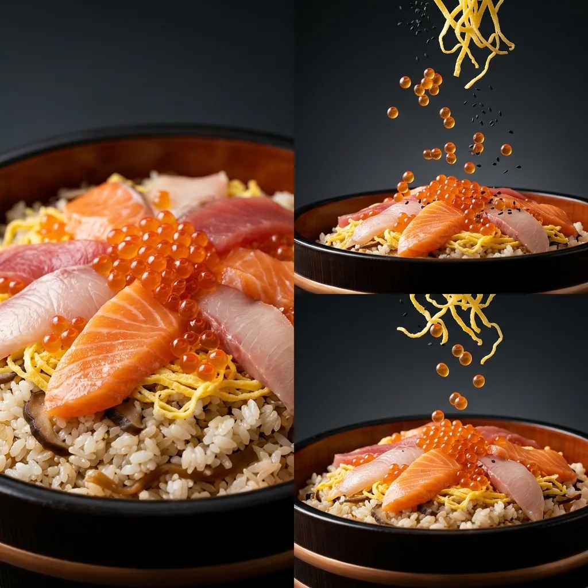

# Ultra-premium-quality, hyper-realistic commercial food photography of COUNTRY FOOD NAME

[← Back to the collection](../../README.md) · Category: [Food & Drink](../../gallery/food-drink.md) · Model: `Vinano Image v2` · ID: `vn-00798`

<a href="https://vinano.ai?utm_source=github&utm_medium=readme&utm_campaign=awesome-image-video-prompts-updating&utm_content=prompt-page-image"></a>

<sub>Preview generated with <a href="https://vinano.ai?utm_source=github&utm_medium=readme&utm_campaign=awesome-image-video-prompts-updating&utm_content=prompt-page-caption">vinano.ai</a></sub>

## Prompt

```text
Ultra-premium-quality, hyper-realistic commercial food photography of [COUNTRY FOOD NAME], rendered in 8K detail a (4:3 or 3:4) aspect ratio.

The food is shown in multiple premium visual variations, each highlighting texture, layers, and freshness in a cinematic way.

Food details:
– Authentic [COUNTRY] cuisine presentation
– Clearly visible layers, fillings, or structure specific to [FOOD TYPE]
– Rich, natural colors and realistic textures

Motion & drama:
– Subtle mid-air elements (crumbs, ingredients, sauce, or spices)
– Natural gravity realism, frozen motion
– No mess, clean and controlled composition

Lighting & camera:
– Controlled studio lighting emphasizing texture and shine
– High-speed photography look
– Shallow to medium depth of field

Background:
– Solid or soft gradient background in [BACKGROUND COLOR]
– Clean, seamless, distraction-free

Style & finish:
– Luxury food advertising aesthetic
– Rich contrast, warm natural tones
– Ultra-sharp focus, no artificial glow

Negative prompt:
Text, logos, branding, hands, people, utensils, plates, tables, cartoon style, burnt food, overexposure, low-detail textures, artificial shine.

Preserve realistic proportions and depth for a confident, professional finish.
```

## Try it on vinano.ai

1. Copy the prompt above.
2. Open **[vinano.ai](https://vinano.ai?utm_source=github&utm_medium=readme&utm_campaign=awesome-image-video-prompts-updating&utm_content=prompt-page-try)**, paste it into the image generator and pick a model.
3. Swap any placeholders (brand, product, city, person…) for your own details, then generate.

More prompts like this: [Food & Drink gallery](../../gallery/food-drink.md) · [all categories](../../README.md#contents)
