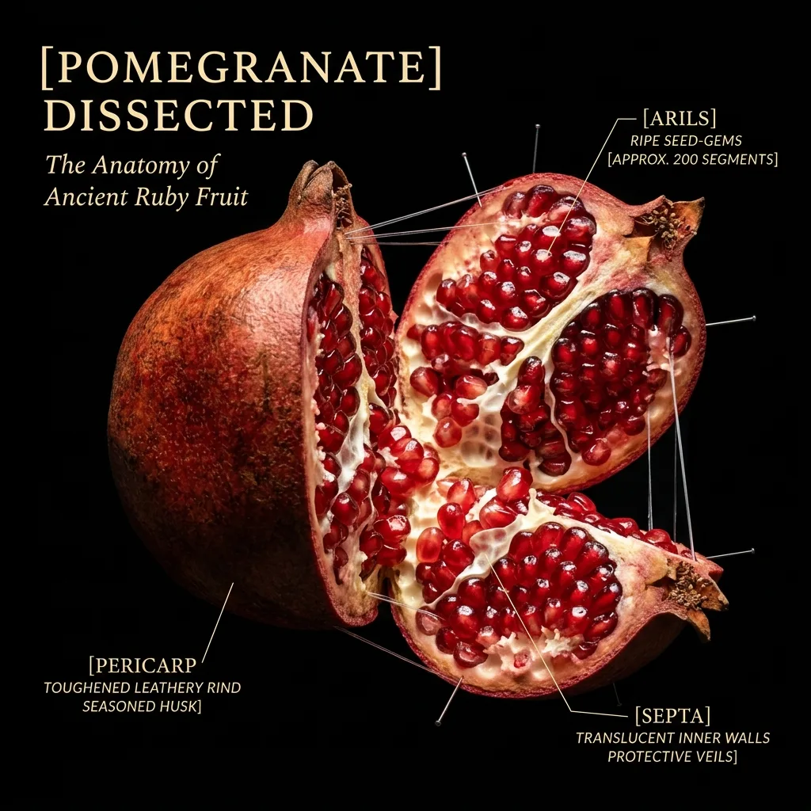

# NATURAL OBJECT dissected as if by a master naturalist

[← Back to the collection](../../README.md) · Category: [Food & Drink](../../gallery/food-drink.md) · Model: `Vinano Image v2` · ID: `vn-00819`

<a href="https://vinano.ai?utm_source=github&utm_medium=readme&utm_campaign=awesome-image-video-prompts-updating&utm_content=prompt-page-image"></a>

<sub>Preview generated with <a href="https://vinano.ai?utm_source=github&utm_medium=readme&utm_campaign=awesome-image-video-prompts-updating&utm_content=prompt-page-caption">vinano.ai</a></sub>

## Prompt

```text
[NATURAL OBJECT] dissected as if by a master naturalist who found it in the wild. Split and pinned open like a specimen, but lit as if Caravaggio worked for National Geographic.
Every internal structure glowing its own material truth. Cross-section so sharp it feels violent. Interior so beautiful it feels sacred. The full object present, one half intact, one half opened to its core, every layer at the resolution of obsession.
Background: pure black velvet. The object floats in it like something precious and dangerous.
Labels pressed close, handwritten-weight serif, never floating: "[STRUCTURE]" / "[MATERIAL TRUTH]" / "[AGE OR SCALE]"
"[OBJECT] DISSECTED" title in warm ivory caps, upper left. "[One line that makes you lean closer]" italic beneath.
Mood: Audubon illustration meets Caravaggio meets the most beautiful science photograph ever taken. 4K, specimen lighting, extraordinary interior detail, nothing clinical, everything alive.

Maintain consistent colour harmony and crisp focus across the whole frame.
```

## Try it on vinano.ai

1. Copy the prompt above.
2. Open **[vinano.ai](https://vinano.ai?utm_source=github&utm_medium=readme&utm_campaign=awesome-image-video-prompts-updating&utm_content=prompt-page-try)**, paste it into the image generator and pick a model.
3. Swap any placeholders (brand, product, city, person…) for your own details, then generate.

More prompts like this: [Food & Drink gallery](../../gallery/food-drink.md) · [all categories](../../README.md#contents)
