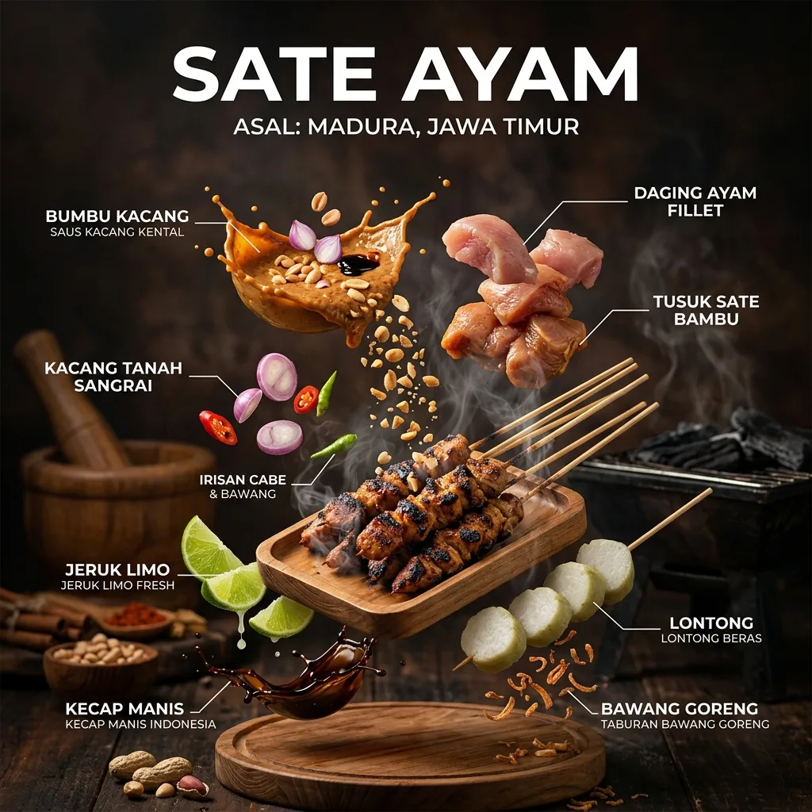

# Indonesian food infographic poster dramatic floating ingredients

[← Back to the collection](../../README.md) · Category: [Food & Drink](../../gallery/food-drink.md) · Model: `Vinano Image Pro` · ID: `vn-00832`

<a href="https://vinano.ai?utm_source=github&utm_medium=readme&utm_campaign=awesome-image-video-prompts-updating&utm_content=prompt-page-image"></a>

<sub>Preview generated with <a href="https://vinano.ai?utm_source=github&utm_medium=readme&utm_campaign=awesome-image-video-prompts-updating&utm_content=prompt-page-caption">vinano.ai</a></sub>

## Prompt

```text
A hyper-realistic Indonesian food infographic poster dramatic floating ingredients. Vertical composition, bold title text at the top showing the dish name and origin (ASAL). Ingredients levitating in mid-air clean white label lines and Indonesian text. Cinematic food photography style, ultra-detailed textures, glossy sauces, charred meat, fresh vegetables, steam and smoke effects. Strong contrast lighting, editorial layout, modern typography, professional food magazine look, motion-frozen splashes, realistic shadows, studio lighting, shallow depth of field, 8K ultra-realistic, DSLR quality. Keep edges clean and the overall composition balanced for a polished, gallery-ready result.
```

## Try it on vinano.ai

1. Copy the prompt above.
2. Open **[vinano.ai](https://vinano.ai?utm_source=github&utm_medium=readme&utm_campaign=awesome-image-video-prompts-updating&utm_content=prompt-page-try)**, paste it into the image generator and pick a model.
3. Swap any placeholders (brand, product, city, person…) for your own details, then generate.

More prompts like this: [Food & Drink gallery](../../gallery/food-drink.md) · [all categories](../../README.md#contents)
