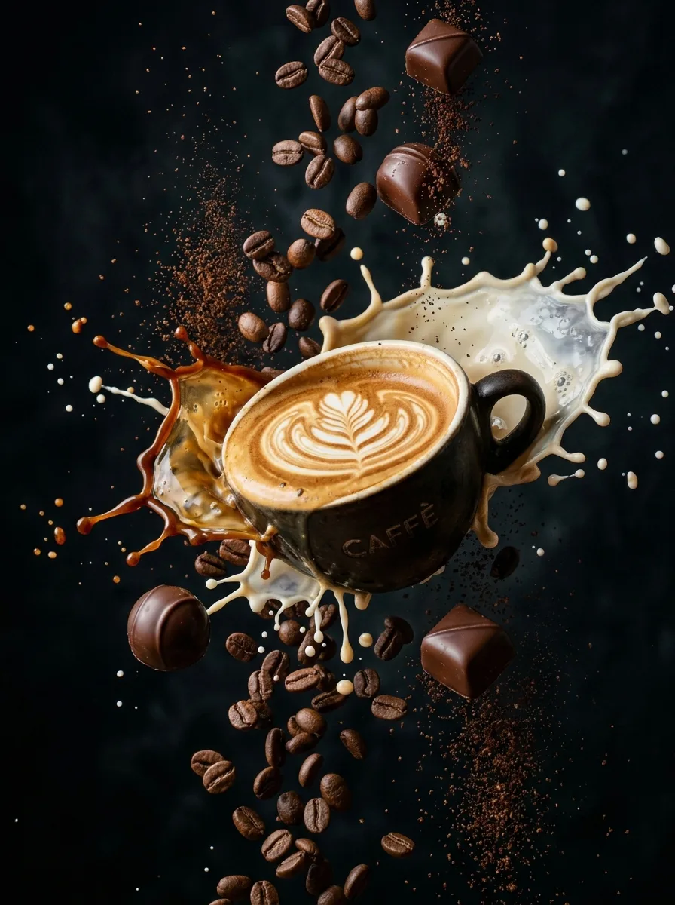

# Cascading roasted coffee beans

[← Back to the collection](../../README.md) · Category: [Food & Drink](../../gallery/food-drink.md) · Model: `Vinano Image v2` · ID: `vn-00834`

<a href="https://vinano.ai?utm_source=github&utm_medium=readme&utm_campaign=awesome-image-video-prompts-updating&utm_content=prompt-page-image"></a>

<sub>Preview generated with <a href="https://vinano.ai?utm_source=github&utm_medium=readme&utm_campaign=awesome-image-video-prompts-updating&utm_content=prompt-page-caption">vinano.ai</a></sub>

## Prompt

```text
{
 "composition": {
 "orientation": "vertical",
 "style": "ultra-cinematic",
 "scene_type": "mid-air suspended elements",
 "depth_of_field": "cinematic shallow depth"
 },
 "subject": {
 "main_elements": ["cascading roasted coffee beans",
 "floating chocolate bonbons",
 "mid-air coffee cup swirling latte art",
 "splashes of milk frozen in motion",
 "splashes of espresso frozen in motion",
 "fine coffee grounds dusting through the air"],
 "motion_state": "frozen action splash photography"
 },
 "color_palette": {
 "primary_colors": ["rich coffee brown",
 "warm cream",
 "espresso black"],
 "background": "deep velvety black"
 },
 "lighting": {
 "type": "dramatic high-contrast studio lighting",
 "highlights": "glossy reflections on liquids",
 "shadows": "deep cinematic shadows"
 },
 "texture_detail": {
 "liquids": ["glossy milk splashes",
 "glossy espresso splashes",
 "crema bubbles micro-detail"],
 "solids": ["matte roasted coffee beans",
 "smooth chocolate bonbon surfaces",
 "fine granular coffee grounds"]
 },
 "photography_style": {
 "genre": "premium café advertising",
 "aesthetic": "editorial splash photography",
 "clarity": "crisp ultra-detailed"
 },
 "camera": {
 "camera_model": "Nikon D850 (virtual)",
 "lens": "105mm macro",
 "aperture": "f/4.0",
 "focus": "sharp subject focus background falloff"
 },
 "render_quality": {
 "detail_level": "hyper-detailed",
 "realism": "true-to-life photorealistic",
 "finish": "high-end commercial output"
 }
}

Emphasise material texture and natural light so the final frame feels tactile and premium.
```

## Try it on vinano.ai

1. Copy the prompt above.
2. Open **[vinano.ai](https://vinano.ai?utm_source=github&utm_medium=readme&utm_campaign=awesome-image-video-prompts-updating&utm_content=prompt-page-try)**, paste it into the image generator and pick a model.
3. Swap any placeholders (brand, product, city, person…) for your own details, then generate.

More prompts like this: [Food & Drink gallery](../../gallery/food-drink.md) · [all categories](../../README.md#contents)
