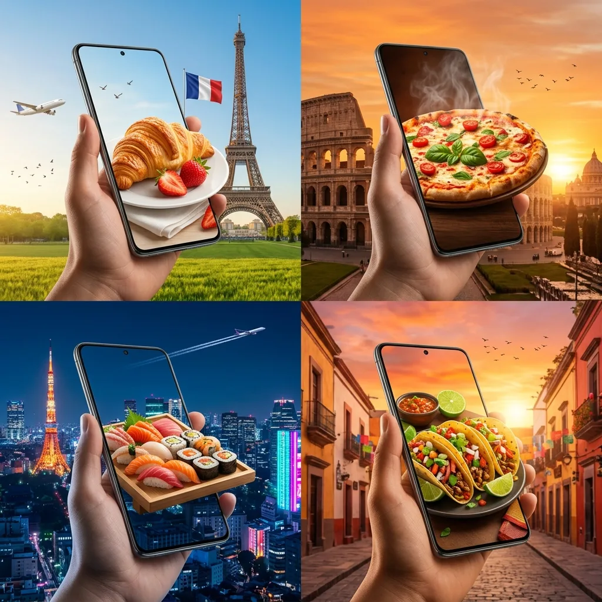

# Tourism advertisement collage in a single 1:1 image divided

[← Back to the collection](../../README.md) · Category: [Food & Drink](../../gallery/food-drink.md) · Model: `Vinano Image Pro` · ID: `vn-00869`

<a href="https://vinano.ai?utm_source=github&utm_medium=readme&utm_campaign=awesome-image-video-prompts-updating&utm_content=prompt-page-image"></a>

<sub>Preview generated with <a href="https://vinano.ai?utm_source=github&utm_medium=readme&utm_campaign=awesome-image-video-prompts-updating&utm_content=prompt-page-caption">vinano.ai</a></sub>

## Prompt

```text
{
 "Create a hyper-realistic tourism advertisement collage in a single 1:1 image divided into a 2x2 grid. Each section shows a hand holding a sleek, ultra-thin smartphone in portrait orientation, slightly tilted to create a strong 3D portal effect where iconic national food emerges out of the phone screen into the real world. Consistent hand, phone design, and lighting style across all four panels.",
 "layout": {
 "type": "grid",
 "rows": 2,
 "columns": 2,
 "aspect_ratio": "1:1"
 },
 "scenes": [{
 "position": "top-left",
 "country": "France",
 "text": "France",
 "food": "Golden buttery croissant on a white plate strawberries",
 "background": "Eiffel Tower, green fields, bright blue sky",
 "elements": ["flying birds", "commercial airplane", "French flag"],
 "lighting": "warm natural daylight",
 "mood": "fresh, elegant, classic"
 },
 {
 "position": "top-right",
 "country": "Italy",
 "text": "Italy",
 "food": "Hot Italian pizza basil leaves and visible steam",
 "background": "Colosseum, Rome skyline at sunset",
 "elements": ["orange sky", "flying birds"],
 "lighting": "golden sunset light",
 "mood": "warm, passionate, flavorful"
 },
 {
 "position": "bottom-left",
 "country": "Japan",
 "text": "Japan",
 "food": "Assorted sushi and sashimi platter on wooden tray",
 "background": "Tokyo skyline at night Tokyo Tower and neon lights",
 "elements": ["airplane trail", "city glow"],
 "lighting": "cool night lighting neon highlights",
 "mood": "modern, clean, refined"
 },
 {
 "position": "bottom-right",
 "country": "Mexico",
 "text": "Mexico",
 "food": "Colorful street tacos lime and salsa",
 "background": "Colonial Mexican street warm sunset tones",
 "elements": ["birds flying", "festive atmosphere"],
 "lighting": "warm cinematic sunset",
 "mood": "vibrant, festive, energetic"
 }],
 "style": {
 "realism": "ultra-true-to-life photorealistic",
 "lighting": "cinematic",
 "depth": "strong depth of field and realistic shadows",
 "colors": "vibrant but natural tourism-ad palette",
 "quality": "4K ultra-sharp"
 },
 "constraints": {
 "no_watermark": true,
 "no_brand_logos": true,
 "no_extra_text": true,
 "clean_composition": true
 }
}

Render with rich micro-detail while keeping the layout uncluttered and intentional.
```

## Try it on vinano.ai

1. Copy the prompt above.
2. Open **[vinano.ai](https://vinano.ai?utm_source=github&utm_medium=readme&utm_campaign=awesome-image-video-prompts-updating&utm_content=prompt-page-try)**, paste it into the image generator and pick a model.
3. Swap any placeholders (brand, product, city, person…) for your own details, then generate.

More prompts like this: [Food & Drink gallery](../../gallery/food-drink.md) · [all categories](../../README.md#contents)
