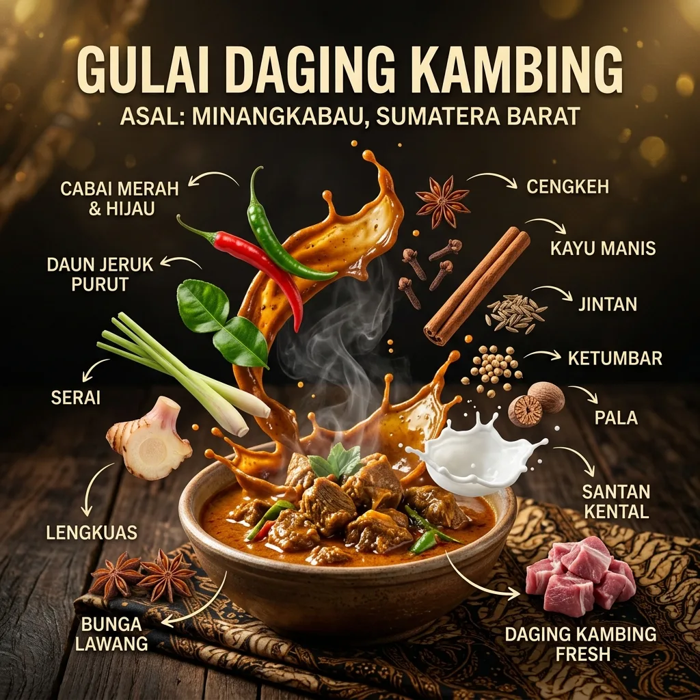

# Floating ingredients suspended in mid-air

[← Back to the collection](../../README.md) · Category: [Food & Drink](../../gallery/food-drink.md) · Model: `Vinano Image Pro` · ID: `vn-00877`

<a href="https://vinano.ai?utm_source=github&utm_medium=readme&utm_campaign=awesome-image-video-prompts-updating&utm_content=prompt-page-image"></a>

<sub>Preview generated with <a href="https://vinano.ai?utm_source=github&utm_medium=readme&utm_campaign=awesome-image-video-prompts-updating&utm_content=prompt-page-caption">vinano.ai</a></sub>

## Prompt

```text
{
 "image_prompt": {
 "type": "Ultra-realistic Indonesian traditional food infographic poster",
 "layout_and_composition": {
 "orientation": "Vertical composition",
 "style": "Modern culinary infographic design, editorial layout",
 "background": "Dramatic but clean background"
 },
 "typography_elements": {
 "headline": {
 "position": "Top",
 "style": "Bold text showing dish name and origin (ASAL)"
 },
 "labels": {
 "style": "Clean Indonesian typography",
 "connectors": "Curved label arrows pointing to ingredients"
 }
 },
 "visual_content": {
 "main_action": "Cinematic floating ingredients suspended in mid-air",
 "details": ["Glossy curry splash",
 "Fresh herbs",
 "Spices",
 "Steam rising from the bowl"],
 "textures": "Hyper-detailed, glossy, appetizing"
 },
 "lighting_and_atmosphere": {
 "lighting_style": "Rich golden lighting, studio lighting",
 "mood": "Professional, appetizing, high-end"
 },
 "technical_specs": {
 "quality": "8K ultra-realistic, DSLR quality",
 "focus": "Shallow depth of field",
 "style": "Professional food photography"
 }
 }
}

Keep edges clean and the overall composition balanced for a polished, gallery-ready result.
```

## Try it on vinano.ai

1. Copy the prompt above.
2. Open **[vinano.ai](https://vinano.ai?utm_source=github&utm_medium=readme&utm_campaign=awesome-image-video-prompts-updating&utm_content=prompt-page-try)**, paste it into the image generator and pick a model.
3. Swap any placeholders (brand, product, city, person…) for your own details, then generate.

More prompts like this: [Food & Drink gallery](../../gallery/food-drink.md) · [all categories](../../README.md#contents)
