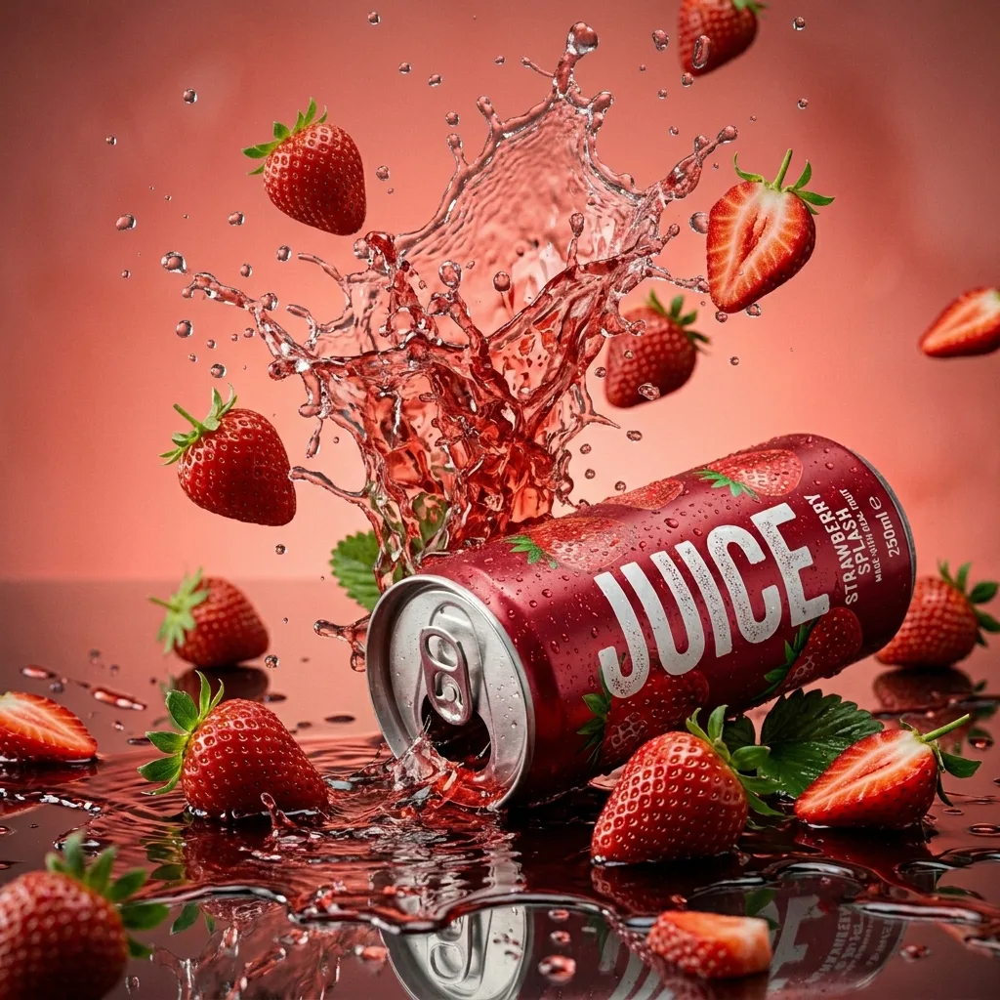

# Beverage product photography of a vibrant red aluminum juice

[← Back to the collection](../../README.md) · Category: [Food & Drink](../../gallery/food-drink.md) · Model: `Vinano Image Pro` · ID: `vn-00893`

<a href="https://vinano.ai?utm_source=github&utm_medium=readme&utm_campaign=awesome-image-video-prompts-updating&utm_content=prompt-page-image"></a>

<sub>Preview generated with <a href="https://vinano.ai?utm_source=github&utm_medium=readme&utm_campaign=awesome-image-video-prompts-updating&utm_content=prompt-page-caption">vinano.ai</a></sub>

## Prompt

```text
Ultra-realistic cinematic beverage product photography of a vibrant red aluminum juice can captured from a dramatic top-down three-quarter angle, the can lying diagonally on its side as if just knocked over, the opening facing toward the camera and a burst of clear liquid splashing outward in a sweeping arc across the frame; the can features bold white “Juice” typography and strawberry illustrations, partially wet condensation and splash residue; glossy liquid spreads across a reflective surface below, forming dynamic ripples and elongated reflections that lead the eye through the composition; fresh ripe strawberries—whole, sliced, and halved—are scattered asymmetrically around the can, some resting in the liquid pool, others frozen mid-air as if tossed, varying scale and depth for cinematic layering; background is a smooth coral-to-rose gradient studio backdrop viewed at an angle, enhancing depth and motion; lighting is dramatic filmic, cinematic lighting a strong side key light creating sharp highlights on the can rim and liquid splash, rim lighting separating strawberries from the background, and deep soft shadows adding contrast and mood; color palette is bold and saturated strawberry red, crimson liquid, fresh green leaves, and warm pink tones; composition is dynamic and off-center diagonal energy, shallow depth of field isolating the can while foreground splashes remain crisp and background elements softly fall off; mood is energetic, high-impact, and cinematic, evoking premium blockbuster-style beverage advertising hyper-realistic fluid dynamics, ultra-detailed textures, dramatic contrast, and 8K ultra-high-definition realism. Keep edges clean and the overall composition balanced for a polished, gallery-ready result.
```

## Try it on vinano.ai

1. Copy the prompt above.
2. Open **[vinano.ai](https://vinano.ai?utm_source=github&utm_medium=readme&utm_campaign=awesome-image-video-prompts-updating&utm_content=prompt-page-try)**, paste it into the image generator and pick a model.
3. Swap any placeholders (brand, product, city, person…) for your own details, then generate.

More prompts like this: [Food & Drink gallery](../../gallery/food-drink.md) · [all categories](../../README.md#contents)
