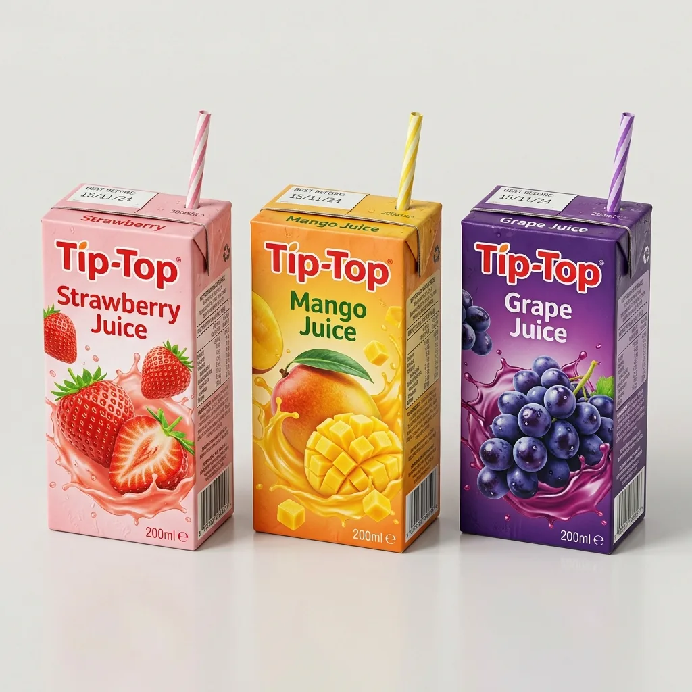

# Strawberry juice ripe strawberries

[← Back to the collection](../../README.md) · Category: [Food & Drink](../../gallery/food-drink.md) · Model: `Vinano Image v2` · ID: `vn-01035`

<a href="https://vinano.ai?utm_source=github&utm_medium=readme&utm_campaign=awesome-image-video-prompts-updating&utm_content=prompt-page-image"></a>

<sub>Preview generated with <a href="https://vinano.ai?utm_source=github&utm_medium=readme&utm_campaign=awesome-image-video-prompts-updating&utm_content=prompt-page-caption">vinano.ai</a></sub>

## Prompt

```text
{
 "juice_boxes": [{
 "id": 1,
 "product": {
 "brand": "Tip-Top",
 "flavor": "Strawberry",
 "image": {
 "description": "strawberry juice ripe strawberries",
 "background": {
 "color": "fresh pastel pink",
 "elements": ["strawberry halves",
 "juice splashes",
 "dynamic swirling around the pack"]
 }
 }
 },
 "design": {
 "style": {
 "detail": "premium-quality detail",
 "texture": "commercial-grade photorealism"
 },
 "aspect_ratio": "2:3"
 }
 },
 {
 "id": 2,
 "product": {
 "brand": "Tip-Top",
 "flavor": "Mango",
 "image": {
 "description": "mango juice ripe golden mangoes",
 "background": {
 "color": "tropical orange-yellow gradient",
 "elements": ["mango cubes",
 "swirling juice streams",
 "energetic and appetizing scene"]
 }
 }
 },
 "design": {
 "style": {
 "texture": "ultra-realistic packaging material texture"
 },
 "aspect_ratio": "2:3"
 }
 },
 {
 "id": 3,
 "product": {
 "brand": "Tip-Top",
 "flavor": "Grape",
 "image": {
 "description": "grape juice purple grapes",
 "background": {
 "color": "deep purple gradient",
 "elements": ["grape bunches",
 "glossy juice splashes",
 "surrounding the carton"]
 }
 }
 },
 "design": {
 "style": {
 "tone": "elegant",
 "mood": "lively commercial promotion style"
 },
 "aspect_ratio": "2:3"
 }
 }]
}

Render with rich micro-detail while keeping the layout uncluttered and intentional.
```

## Try it on vinano.ai

1. Copy the prompt above.
2. Open **[vinano.ai](https://vinano.ai?utm_source=github&utm_medium=readme&utm_campaign=awesome-image-video-prompts-updating&utm_content=prompt-page-try)**, paste it into the image generator and pick a model.
3. Swap any placeholders (brand, product, city, person…) for your own details, then generate.

More prompts like this: [Food & Drink gallery](../../gallery/food-drink.md) · [all categories](../../README.md#contents)
