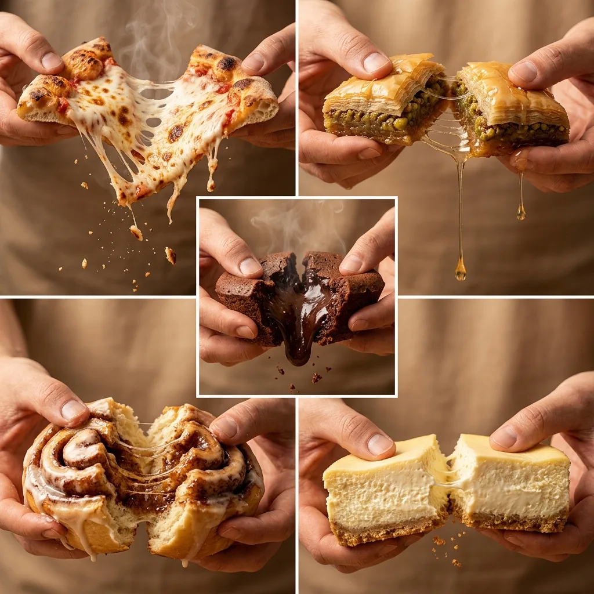

# Two hands pulling apart a hot freshly baked pizza

[← Back to the collection](../../README.md) · Category: [Food & Drink](../../gallery/food-drink.md) · Model: `Vinano Image v2` · ID: `vn-01051`

<a href="https://vinano.ai?utm_source=github&utm_medium=readme&utm_campaign=awesome-image-video-prompts-updating&utm_content=prompt-page-image"></a>

<sub>Preview generated with <a href="https://vinano.ai?utm_source=github&utm_medium=readme&utm_campaign=awesome-image-video-prompts-updating&utm_content=prompt-page-caption">vinano.ai</a></sub>

## Prompt

```text
{
 "aspect_ratio": "3:4",
 "render_mode": "raw",
 "series": [{
 "index": "1/5",
 "prompt": "two hands pulling apart a hot freshly baked pizza slice, long elastic mozzarella cheese stretch between the slice and the pie, blistered crust edges, steam rising, crumbs falling mid-air, warm cinematic light, ultra high-detail food action photography",
 "category": "cheese pull",
 "lighting": "warm cinematic oven light",
 "detail_level": "ultra-detailed"
 },
 {
 "index": "2/5",
 "prompt": "two hands pulling apart a syrup-soaked baklava piece, thin crispy phyllo layers cracking, rich pistachio filling visible, thick honey syrup stretching and dripping mid-air, golden warm light, cinematic dessert action photography",
 "category": "syrup & crunch",
 "lighting": "golden warm light",
 "detail_level": "ultra-detailed"
 },
 {
 "index": "3/5",
 "prompt": "two hands breaking a molten chocolate lava cake in half, glossy dark chocolate flowing out from the center, steam rising gently, crumbs suspended mid-air, soft warm spotlight, cinematic dessert action photography",
 "category": "molten chocolate",
 "lighting": "soft warm spotlight",
 "detail_level": "ultra-detailed"
 },
 {
 "index": "4/5",
 "prompt": "two hands tearing a glazed cinnamon roll apart, sticky cinnamon sugar filling stretching in glossy strands, icing dripping slowly, fluffy dough texture visible, cozy warm bakery light, high-detail cinematic food photography",
 "category": "sticky pull",
 "lighting": "warm bakery light",
 "detail_level": "ultra-detailed"
 },
 {
 "index": "5/5",
 "prompt": "two hands splitting a classic New York-style cheesecake slice, ultra-creamy interior slowly separating, crumbly biscuit base breaking apart, subtle cream stretch, soft studio warm light, cinematic high-detail dessert photography",
 "category": "creamy separation",
 "lighting": "soft warm studio light",
 "detail_level": "ultra-detailed"
 }]
}

Maintain consistent colour harmony and crisp focus across the whole frame.
```

## Try it on vinano.ai

1. Copy the prompt above.
2. Open **[vinano.ai](https://vinano.ai?utm_source=github&utm_medium=readme&utm_campaign=awesome-image-video-prompts-updating&utm_content=prompt-page-try)**, paste it into the image generator and pick a model.
3. Swap any placeholders (brand, product, city, person…) for your own details, then generate.

More prompts like this: [Food & Drink gallery](../../gallery/food-drink.md) · [all categories](../../README.md#contents)
