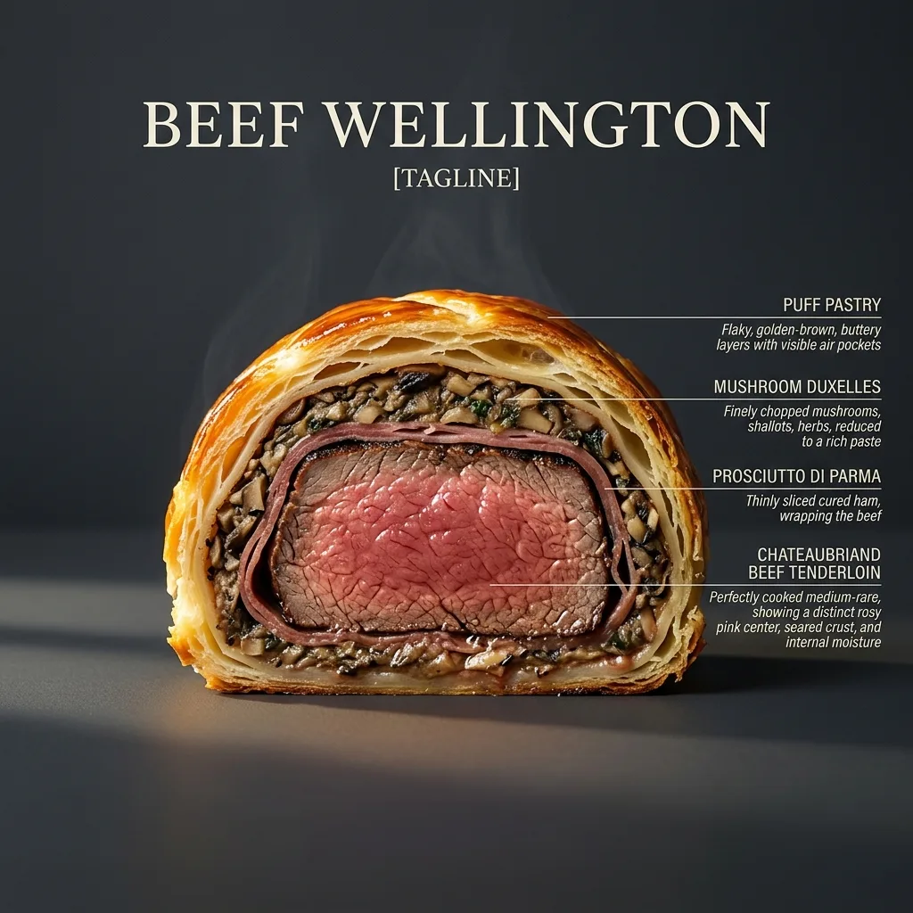

# Perfect cinematic cross-section cut through DISH , sliced cleanly

[← Back to the collection](../../README.md) · Category: [Food & Drink](../../gallery/food-drink.md) · Model: `Vinano Image Pro` · ID: `vn-01068`

<a href="https://vinano.ai?utm_source=github&utm_medium=readme&utm_campaign=awesome-image-video-prompts-updating&utm_content=prompt-page-image"></a>

<sub>Preview generated with <a href="https://vinano.ai?utm_source=github&utm_medium=readme&utm_campaign=awesome-image-video-prompts-updating&utm_content=prompt-page-caption">vinano.ai</a></sub>

## Prompt

```text
Perfect cinematic cross-section cut through [DISH], sliced cleanly down the center revealing every internal layer in full detail. The cut face is facing the camera straight-on, like a geological diagram of flavor. Each visible layer is labeled a thin horizontal line extending to the right — uppercase sans-serif "[INGREDIENT NAME]" italic descriptor below. Background: flat matte [COLOR]. Lighting: dramatic side light from left casting long shadows, single warm spotlight on the cut face. Every texture hyperreal — visible moisture, air pockets, char, glaze, and steam. Mood: architectural food photography meets scientific illustration. Dish name "[DISH NAME]" in large elegant type at top. Subtitle: "[TAGLINE]". 4K, tack sharp, Style ref: Wes Anderson symmetry meets Michelin-star kitchen. Preserve realistic proportions and depth for a confident, professional finish.
```

## Try it on vinano.ai

1. Copy the prompt above.
2. Open **[vinano.ai](https://vinano.ai?utm_source=github&utm_medium=readme&utm_campaign=awesome-image-video-prompts-updating&utm_content=prompt-page-try)**, paste it into the image generator and pick a model.
3. Swap any placeholders (brand, product, city, person…) for your own details, then generate.

More prompts like this: [Food & Drink gallery](../../gallery/food-drink.md) · [all categories](../../README.md#contents)
