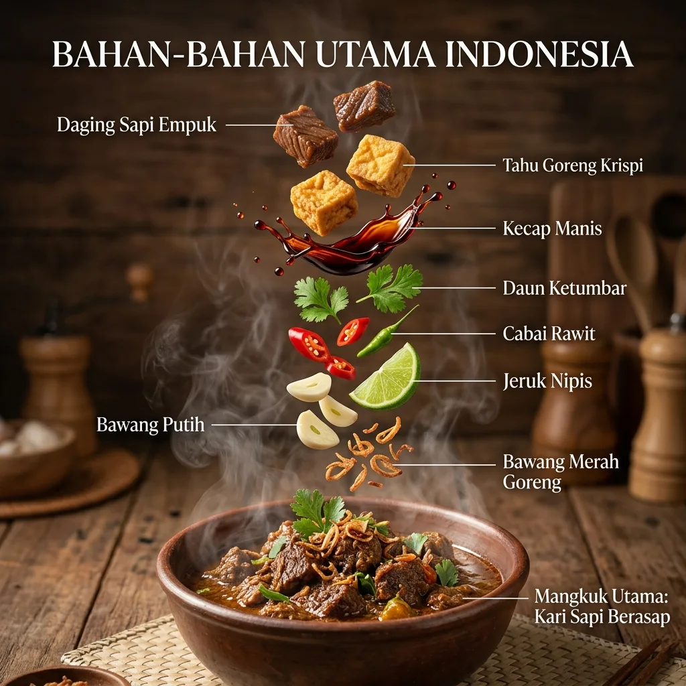

# Traditional bowl steaming hot dish at the bottom

[← Back to the collection](../../README.md) · Category: [Food & Drink](../../gallery/food-drink.md) · Model: `Vinano Image Pro` · ID: `vn-01139`

<a href="https://vinano.ai?utm_source=github&utm_medium=readme&utm_campaign=awesome-image-video-prompts-updating&utm_content=prompt-page-image"></a>

<sub>Preview generated with <a href="https://vinano.ai?utm_source=github&utm_medium=readme&utm_campaign=awesome-image-video-prompts-updating&utm_content=prompt-page-caption">vinano.ai</a></sub>

## Prompt

```text
{
 "image_prompt": {
 "type": "Hyper-realistic food infographic",
 "subject": {
 "cuisine": "Indonesian",
 "base_element": "Traditional bowl steaming hot dish at the bottom",
 "levitating_ingredients": ["Juicy meat",
 "Crispy tofu",
 "Glossy sauce splashes",
 "Fresh herbs",
 "Chilies",
 "Lime",
 "Garlic",
 "Fried shallots"]
 },
 "composition": {
 "layout": "Clean vertical composition",
 "arrangement": "Realistic gravity-defying/floating elements",
 "background": "Rustic wooden surface",
 "visual_hierarchy": "Bowl anchored at bottom, ingredients rising vertically"
 },
 "graphic_design_elements": {
 "labels": "Clear Indonesian text",
 "lines": "Thin white pointing lines",
 "style": "Editorial infographic layout, professional food magazine style"
 },
 "lighting_and_mood": {
 "lighting": "Cinematic studio lighting",
 "color_palette": "Warm tones",
 "effects": "Dramatic steam, motion-frozen ingredients"
 },
 "technical_specs": {
 "camera_settings": "Shallow depth of field, sharp focus, DSLR look",
 "details": "Ultra-detailed textures",
 "resolution": "8K ultra-realistic"
 }
 }
}

Preserve realistic proportions and depth for a confident, professional finish.
```

## Try it on vinano.ai

1. Copy the prompt above.
2. Open **[vinano.ai](https://vinano.ai?utm_source=github&utm_medium=readme&utm_campaign=awesome-image-video-prompts-updating&utm_content=prompt-page-try)**, paste it into the image generator and pick a model.
3. Swap any placeholders (brand, product, city, person…) for your own details, then generate.

More prompts like this: [Food & Drink gallery](../../gallery/food-drink.md) · [all categories](../../README.md#contents)
