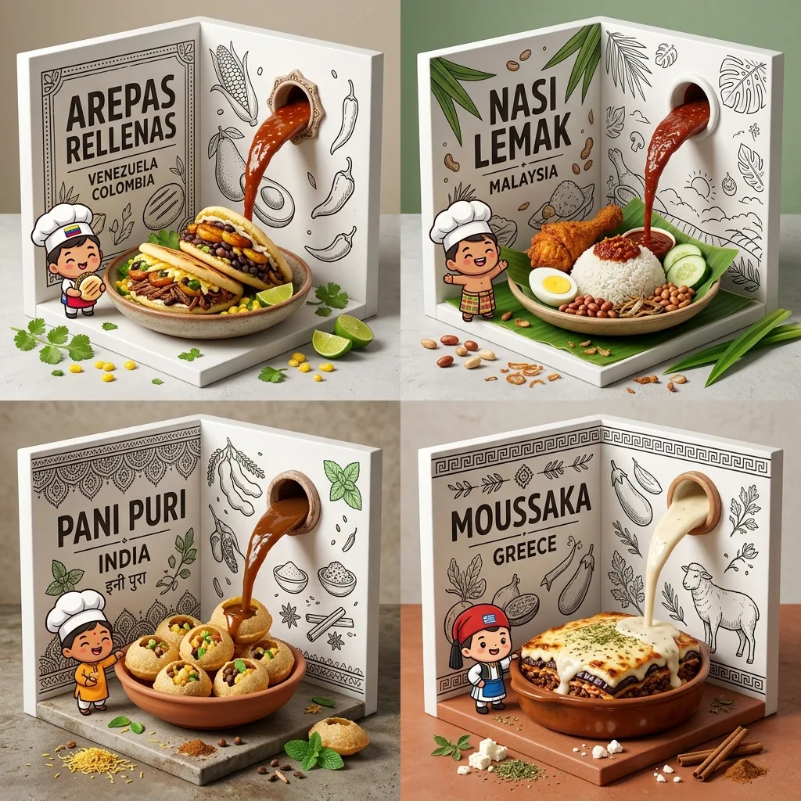

# 2x2 grid, do this for 4 hidden gem international

[← Back to the collection](../../README.md) · Category: [Food & Drink](../../gallery/food-drink.md) · Model: `Vinano Image Pro` · ID: `vn-01173`

<a href="https://vinano.ai?utm_source=github&utm_medium=readme&utm_campaign=awesome-image-video-prompts-updating&utm_content=prompt-page-image"></a>

<sub>Preview generated with <a href="https://vinano.ai?utm_source=github&utm_medium=readme&utm_campaign=awesome-image-video-prompts-updating&utm_content=prompt-page-caption">vinano.ai</a></sub>

## Prompt

```text
2x2 grid, do this for 4 hidden gem international foods select * from popup_recipe_visualizer where recipe_target = '[dish_name]' and structural_base = 'l-shaped_open_box_white_interior' and wall_layer_2d = (select line_art, typography, botanical_drawings from ingredient_inference_db where dish = '[dish_name]') and foreground_layer_3d = array['bowl_of_completed_[dish_name]', 'kawaii_chibi_mascot_interacting_with_food', 'scattered_3d_garnishes_on_floor'] and dynamic_action = 'thick_glossy_sauce_pouring_from_2d_wall_hole_into_3d_bowl' and render_engine = 'octane_render_soft_studio_lighting'; Emphasise material texture and natural light so the final frame feels tactile and premium.
```

## Try it on vinano.ai

1. Copy the prompt above.
2. Open **[vinano.ai](https://vinano.ai?utm_source=github&utm_medium=readme&utm_campaign=awesome-image-video-prompts-updating&utm_content=prompt-page-try)**, paste it into the image generator and pick a model.
3. Swap any placeholders (brand, product, city, person…) for your own details, then generate.

More prompts like this: [Food & Drink gallery](../../gallery/food-drink.md) · [all categories](../../README.md#contents)
