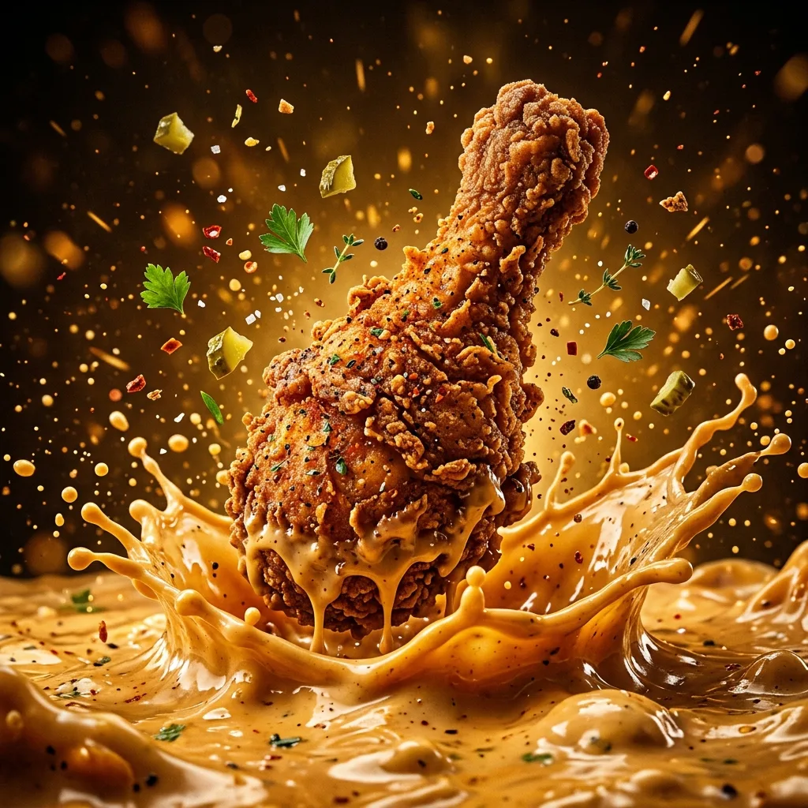

# Epic 8K cinematic fantasy food scene

[← Back to the collection](../../README.md) · Category: [Food & Drink](../../gallery/food-drink.md) · Model: `Vinano Image v2` · ID: `vn-01181`

<a href="https://vinano.ai?utm_source=github&utm_medium=readme&utm_campaign=awesome-image-video-prompts-updating&utm_content=prompt-page-image"></a>

<sub>Preview generated with <a href="https://vinano.ai?utm_source=github&utm_medium=readme&utm_campaign=awesome-image-video-prompts-updating&utm_content=prompt-page-caption">vinano.ai</a></sub>

## Prompt

```text
Epic 8K cinematic fantasy food scene: a colossal crispy fried chicken leg rising like a legendary artifact through a tidal explosion of molten creamy sauce. Sauce behaves like liquid clouds, forming waves and splashes in mid-air. Pickle chunks, herb leaves, and seasoning particles float like asteroids in a food universe. Extreme macro texture on the crust—cracks, bubbles, and crunch visible. Powerful dramatic lighting deep shadows and glowing highlights. Vibrant golden-yellow background cinematic depth and atmospheric particles. Hyper-realistic yet mythic, bold surreal advertising masterpiece. Aim for an editorial, design-driven look with deliberate negative space.
```

## Try it on vinano.ai

1. Copy the prompt above.
2. Open **[vinano.ai](https://vinano.ai?utm_source=github&utm_medium=readme&utm_campaign=awesome-image-video-prompts-updating&utm_content=prompt-page-try)**, paste it into the image generator and pick a model.
3. Swap any placeholders (brand, product, city, person…) for your own details, then generate.

More prompts like this: [Food & Drink gallery](../../gallery/food-drink.md) · [all categories](../../README.md#contents)
