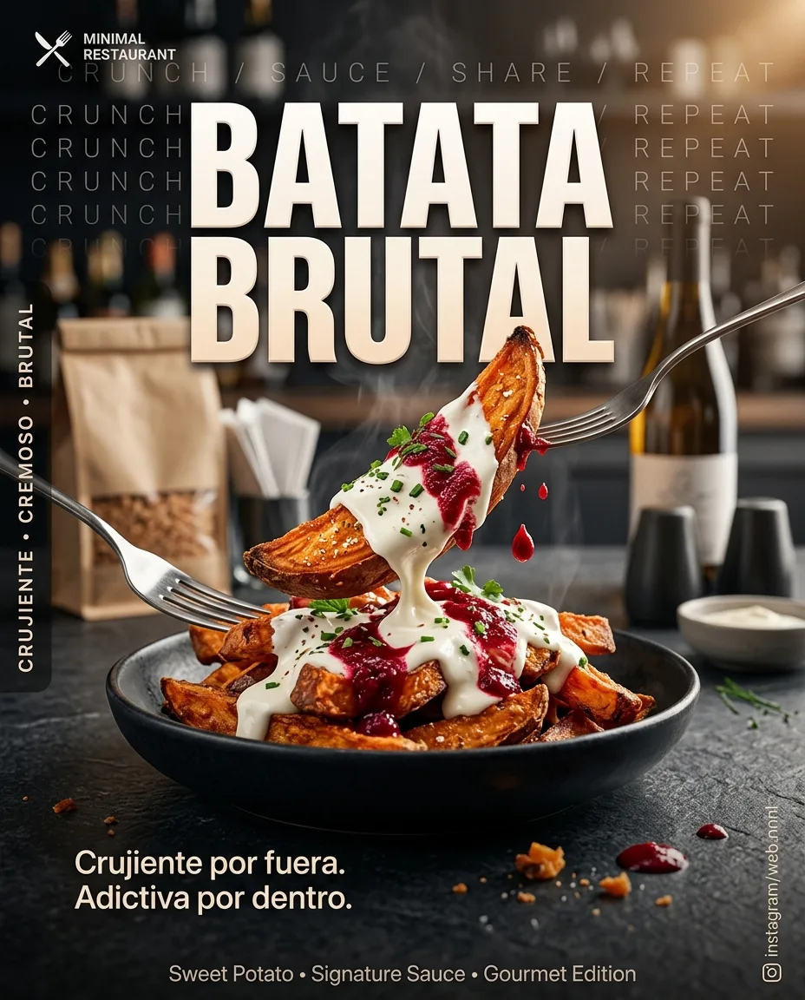

# Póster social premium 4:5 vertical para Instagram, ultra alta

[← Back to the collection](../../README.md) · Category: [Food & Drink](../../gallery/food-drink.md) · Model: `Vinano Image v2` · ID: `vn-01216`

<a href="https://vinano.ai?utm_source=github&utm_medium=readme&utm_campaign=awesome-image-video-prompts-updating&utm_content=prompt-page-image"></a>

<sub>Preview generated with <a href="https://vinano.ai?utm_source=github&utm_medium=readme&utm_campaign=awesome-image-video-prompts-updating&utm_content=prompt-page-caption">vinano.ai</a></sub>

## Prompt

```text
FORMATO:
Póster social premium 4:5 vertical para Instagram, ultra alta resolución, 8K, nitidez extrema, calidad publicitaria, aspecto gourmet editorial, composición impactante y moderna

⸻

ESCENA / FONDO:

Bar gastronómico moderno y elegante, ambiente urbano sofisticado, mesa de piedra oscura con textura premium, profundidad cinematográfica

Entorno:

* Superficie de mármol negro con reflejos suaves y elegantes
* Fondo desenfocado con ambiente de restaurante moderno
* Sutil presencia de botellas, servilletas y barra de fondo
* Bokeh cálido y elegante, sin distraer del plato
* Estética de restaurante trendy de ciudad

Atmósfera:

* Ambiente acogedor y premium
* Sensación de comida recién servida
* Ligero vapor saliendo del plato
* Energía social, experiencia compartida
* Estilo casual-lujo gastronómico

Iluminación:

* Luz principal cálida lateral superior derecha
* Luz de relleno suave para resaltar texturas
* Brillos naturales en la salsa cremosa
* Contraste elegante entre sombras profundas y luces cálidas
* Reflejos delicados sobre la batata caramelizada

Paleta de color:

* Dominante: negro piedra, gris carbón, marrón tostado
* Acentos: naranja batata, blanco crema, rojo remolacha/frutos rojos
* Toques verdes frescos de hierbas

⸻

PRODUCTO (HERO SHOT):

Plato protagonista de batatas fritas crujientes servidas en vajilla artesanal negra, cubiertas con crema blanca abundante, salsa roja intensa y hierbas frescas

Acción:

* Batatas elevándose ligeramente en el aire para efecto dinámico
* Una batata principal en foco absoluto con textura crujiente visible
* Salsa cremosa cayendo lentamente en movimiento
* Gotas de salsa roja suspendidas en el aire
* Sensación irresistible y adictiva

Interacción:

* Dos tenedores entrando desde los laterales, capturando comida
* Representa deseo, compartir y experiencia real
* Movimiento natural y espontáneo

Detalle de texturas:

* Exterior crujiente y caramelizado de la batata
* Interior suave y cremoso
* Salsa blanca espesa y brillante
* Salsa roja vibrante con intensidad visual
* Microdetalles de sal, especias y cebollino fresco

⸻

ELEMENTOS SECUNDARIOS:

Fondo superior:

* Bolsa kraft desenfocada
* Botella elegante fuera de foco
* Vajilla minimalista moderna

Primer plano:

* Tenedores metálicos con brillo sutil
* Migas pequeñas y gotas de salsa para realismo

⸻

TIPOGRAFÍA:

TITULAR PRINCIPAL:

“BATATA BRUTAL”

Estilo:

* Tipografía sans serif ultra bold condensada
* Moderna, premium, agresiva visualmente
* Kerning ajustado
* Impacto publicitario

Color:

* Blanco roto con ligero degradado cálido

Efectos:

* Sombra suave
* Relieve sutil
* Ligero glow premium

Ubicación:

* Centro superior, integrado con el plato

⸻

SUBTÍTULO:

Crujiente por fuera.
Adictiva por dentro.

Estilo:

* Sans serif bold limpia
* Elegante y minimalista

Color:

* Blanco al 85% opacidad

Ubicación:

* Parte inferior izquierda

⸻

CAPA TIPOGRÁFICA DE FONDO:

CRUNCH / SAUCE / SHARE / REPEAT

Estilo:

* Mayúsculas finas
* Tracking amplio
* Repetición modular

Color:

* Gris claro al 15%

Función:

* Textura visual sin distraer

⸻

BRANDING:

Parte superior izquierda:

Logo minimalista del restaurante o marca

Parte inferior:

Sweet Potato • Signature Sauce • Gourmet Edition

Esquina inferior derecha:

Instagram / web minimalista

Banda lateral vertical:

CRUJIENTE • CREMOSO • BRUTAL

⸻

CÁMARA:

Lente:

50mm gastronómico cinematográfico

Ángulo:

Picado suave de 45 grados con presencia heroica

Profundidad de campo:

* Enfoque extremo en batata central
* Fondo con caída progresiva cremosa

Sensación:

Fotografía real de campaña premium Michelin casual food

⸻

POSTPRODUCCIÓN:

* Contraste alto pero elegante
* Nitidez localizada solo en comida
* Glow suave en salsas
* Color grading cálido premium
* Sombras profundas sofisticadas
* Micro film grain 2%
* Texturas hiperrealistas
* Detalle extremo en comida
* Acabado de anuncio internacional

Emphasise material texture and natural light so the final frame feels tactile and premium.
```

## Try it on vinano.ai

1. Copy the prompt above.
2. Open **[vinano.ai](https://vinano.ai?utm_source=github&utm_medium=readme&utm_campaign=awesome-image-video-prompts-updating&utm_content=prompt-page-try)**, paste it into the image generator and pick a model.
3. Swap any placeholders (brand, product, city, person…) for your own details, then generate.

More prompts like this: [Food & Drink gallery](../../gallery/food-drink.md) · [all categories](../../README.md#contents)
