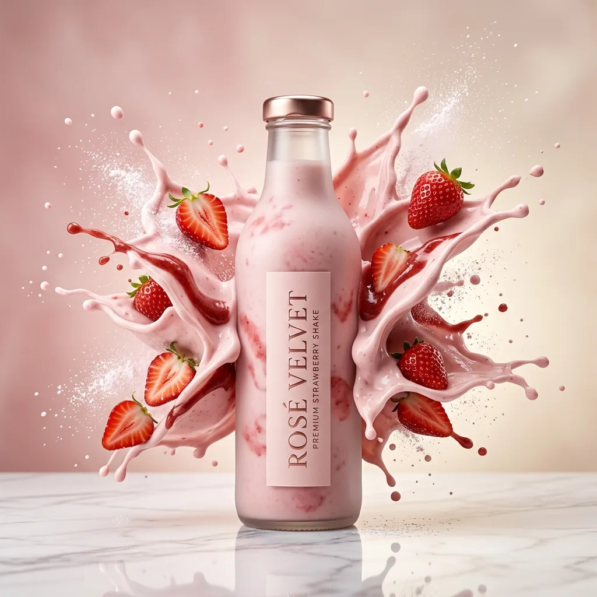

# Elegant frosted glass bottle filled velvety strawberry shake

[← Back to the collection](../../README.md) · Category: [Food & Drink](../../gallery/food-drink.md) · Model: `Vinano Image Pro` · ID: `vn-01253`

<a href="https://vinano.ai?utm_source=github&utm_medium=readme&utm_campaign=awesome-image-video-prompts-updating&utm_content=prompt-page-image"></a>

<sub>Preview generated with <a href="https://vinano.ai?utm_source=github&utm_medium=readme&utm_campaign=awesome-image-video-prompts-updating&utm_content=prompt-page-caption">vinano.ai</a></sub>

## Prompt

```text
{
 "master_prompt": {
 "scene_type": "high-speed commercial luxury shake photography",
 "product": {
 "type": "elegant frosted glass bottle filled velvety strawberry shake",
 "brand_name": "ROSÉ VELVET",
 "label_design": "refined minimalist vertical blush label embossed rose-gold serif typography",
 "liquid_color": "creamy pastel pink natural strawberry swirls"
 },
 "composition": {
 "action": "dynamic high-velocity creamy splash explosion",
 "surrounding_elements": ["sculptural waves of thick strawberry shake splashing outward",
 "silky ribbons of strawberry puree suspended mid-air",
 "floating fresh strawberry halves visible seeds and juicy texture",
 "soft dusting of powdered sugar diffusing delicately",
 "fine droplets of creamy pink mist catching the light"],
 "placement": "centered hero bottle a crisp reflection on a polished white marble surface"
 },
 "lighting": {
 "style": "luxury glossy studio product lighting",
 "effects": ["sharp rim lighting to define bottle silhouette",
 "brilliant highlights on creamy splashes and glossy strawberry surfaces",
 "soft rosy glow in the background for warmth and elegance"]
 },
 "color_palette": {
 "background": "smooth gradient of blush pink fading into soft champagne ivory",
 "accents": "fresh strawberry red, rose gold, and creamy vanilla tones"
 },
 "technical_specs": {
 "camera": "macro lens, eye-level angle",
 "shutter": "ultra-fast freeze-motion capture",
 "depth_of_field": "shallow focus on the label, gentle blur on dynamic splash elements",
 "quality": "8K resolution, ultra-true-to-life photorealistic texture"
 }
 }
}

Preserve realistic proportions and depth for a confident, professional finish.
```

## Try it on vinano.ai

1. Copy the prompt above.
2. Open **[vinano.ai](https://vinano.ai?utm_source=github&utm_medium=readme&utm_campaign=awesome-image-video-prompts-updating&utm_content=prompt-page-try)**, paste it into the image generator and pick a model.
3. Swap any placeholders (brand, product, city, person…) for your own details, then generate.

More prompts like this: [Food & Drink gallery](../../gallery/food-drink.md) · [all categories](../../README.md#contents)
