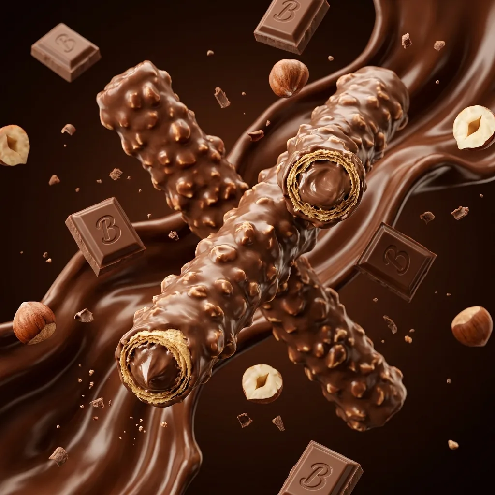

# Food & Drink prompt #1257

[← Back to the collection](../../README.md) · Category: [Food & Drink](../../gallery/food-drink.md) · Model: `Vinano Image v2` · ID: `vn-01257`

<a href="https://vinano.ai?utm_source=github&utm_medium=readme&utm_campaign=awesome-image-video-prompts-updating&utm_content=prompt-page-image"></a>

<sub>Preview generated with <a href="https://vinano.ai?utm_source=github&utm_medium=readme&utm_campaign=awesome-image-video-prompts-updating&utm_content=prompt-page-caption">vinano.ai</a></sub>

## Prompt

```text
{
 "ENVIRONMENT": {
 "Background": "Gradient(Dark_Warm_Brown)",
 "Atmospheric_FX": ["Floating_Particles", "Depth_Blur", "Cinematic_Bokeh"],
 "Lighting": {
 "Type": "Directional_Studio_Warmer",
 "Highlights": "Specular_Glossy_Reflections",
 "Shadow_Softness": "High"
 }
 },

 "CORE_ASSETS": {
 "Primary_Subject": "Wafer_Rolls",
 "Physics": "Zero_Gravity_Diagonal_X_Composition",
 "Material_Properties": {
 "Outer": "Milk_Chocolate_Coating",
 "Surface_Texture": "Irregular_Nut_Clusters_Embedded",
 "Interior_Cross_Section": {
 "Structure": "Crispy_Hollow_Wafer",
 "Core": "Silky_Chocolate_Cream_Filling"
 }
 }
 },

 "PARTICLE_SYSTEMS": [{
 "Object": "Chocolate_Blocks",
 "Detail": "Rectangular_Embossed_Letter_B",
 "State": "Floating"
 },
 {
 "Object": "Hazelnuts",
 "State": "Halved_and_Fragmented",
 "Distribution": "Random_Orbit"
 }],

 "FLUID_DYNAMICS": {
 "Element": "Chocolate_Splash",
 "Behavior": "Dynamic_Backdrop_Flow",
 "Viscosity": "Thick_Glossy"
 },

 "RENDER_OUTPUT": {
 "Resolution": "8K_UHD",
 "Aspect_Ratio": "3:4",
 "Quality_Flags": ["Hyper_Realistic", "Sharp_Foreground", "Indulgent_Mood"]
 }
}

Emphasise material texture and natural light so the final frame feels tactile and premium.
```

## Try it on vinano.ai

1. Copy the prompt above.
2. Open **[vinano.ai](https://vinano.ai?utm_source=github&utm_medium=readme&utm_campaign=awesome-image-video-prompts-updating&utm_content=prompt-page-try)**, paste it into the image generator and pick a model.
3. Swap any placeholders (brand, product, city, person…) for your own details, then generate.

More prompts like this: [Food & Drink gallery](../../gallery/food-drink.md) · [all categories](../../README.md#contents)
