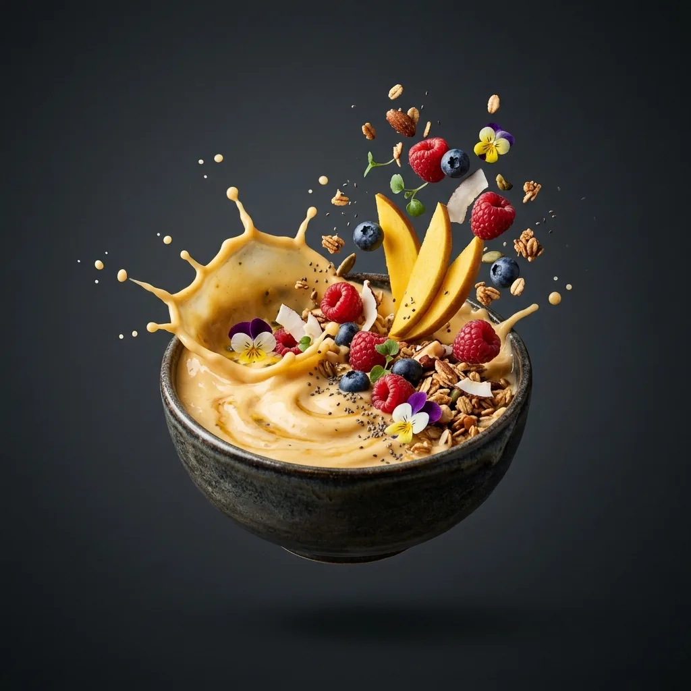

# Ultra-premium cinematic food photography, 8K UHD, 3:4 aspect ratio

[← Back to the collection](../../README.md) · Category: [Food & Drink](../../gallery/food-drink.md) · Model: `Vinano Image v2` · ID: `vn-01258`

<a href="https://vinano.ai?utm_source=github&utm_medium=readme&utm_campaign=awesome-image-video-prompts-updating&utm_content=prompt-page-image"></a>

<sub>Preview generated with <a href="https://vinano.ai?utm_source=github&utm_medium=readme&utm_campaign=awesome-image-video-prompts-updating&utm_content=prompt-page-caption">vinano.ai</a></sub>

## Prompt

```text
Ultra-premium cinematic food photography, 8K UHD, 3:4 aspect ratio.
A high-end studio composition featuring a single floating bowl as the hero subject, captured in a high-speed moment ingredients suspended mid-air. The image conveys controlled energy, freshness, and indulgence.
Lighting is soft, directional, and studio-grade, sculpting textures clean highlights and natural shadows. Depth of field is shallow-to-medium, isolating the subject while maintaining dimensional realism.
Colors are rich yet natural, balanced contrast and refined saturation. No artificial glow or exaggerated effects.
The background is a seamless solid or smooth gradient, carefully chosen to complement the ingredients and enhance visual separation.
The bowl is centered, weightless, and dominant. Liquids form elegant arcs and droplets; solid ingredients float naturally believable physics. Textures are hyper-realistic — creamy bases show organic swirls, crunchy elements appear crisp, herbs look fresh and vibrant.
Shot a luxury commercial food advertising aesthetic — modern, clean, minimal, bold, and premium.

Preserve realistic proportions and depth for a confident, professional finish.
```

## Try it on vinano.ai

1. Copy the prompt above.
2. Open **[vinano.ai](https://vinano.ai?utm_source=github&utm_medium=readme&utm_campaign=awesome-image-video-prompts-updating&utm_content=prompt-page-try)**, paste it into the image generator and pick a model.
3. Swap any placeholders (brand, product, city, person…) for your own details, then generate.

More prompts like this: [Food & Drink gallery](../../gallery/food-drink.md) · [all categories](../../README.md#contents)
