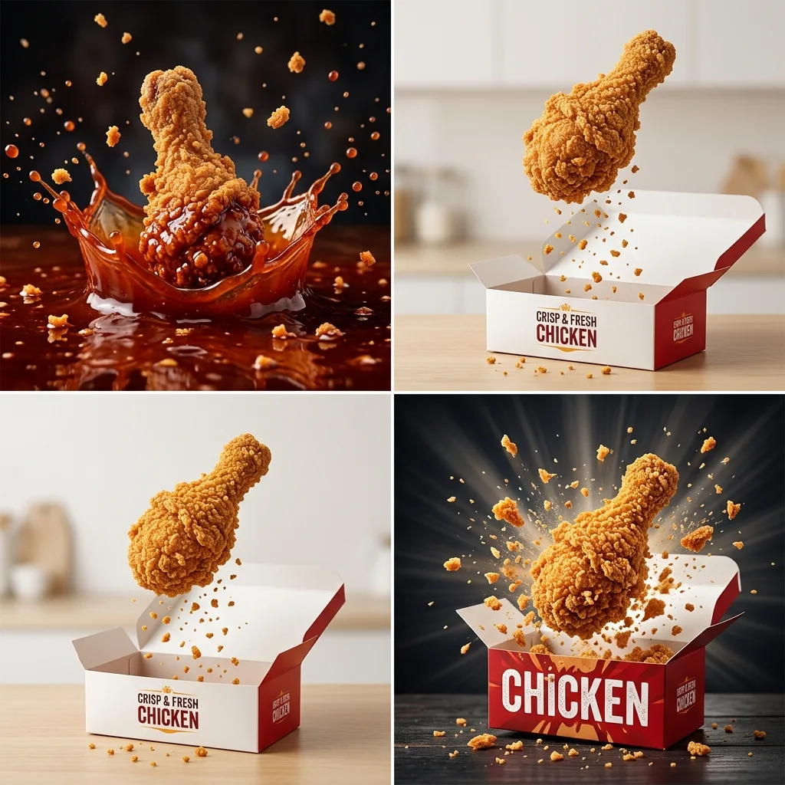

# Hyper-Visual Fried Chicken Action Series , output quality

[← Back to the collection](../../README.md) · Category: [Food & Drink](../../gallery/food-drink.md) · Model: `Vinano Image v2` · ID: `vn-01271`

<a href="https://vinano.ai?utm_source=github&utm_medium=readme&utm_campaign=awesome-image-video-prompts-updating&utm_content=prompt-page-image"></a>

<sub>Preview generated with <a href="https://vinano.ai?utm_source=github&utm_medium=readme&utm_campaign=awesome-image-video-prompts-updating&utm_content=prompt-page-caption">vinano.ai</a></sub>

## Prompt

```text
{
 "project": {
 "title": "Hyper-Visual Fried Chicken Action Series",
 "output_quality": "8K Ultra-HD",
 "aspect_ratio": "2:3",
 "style_intent": "High-end commercial food photography",
 "consistency_rule": "Each module shares structure but maintains unique visual dynamics"
 },

 "global_camera_and_rendering": {
 "camera_perspective": "Close-up to extreme macro",
 "focus_behavior": "Crisp subject focus controlled depth falloff",
 "shutter_effect": "High-speed freeze-frame",
 "texture_priority": "Ultra-detailed crispy breading and crumbs",
 "color_profile": "Warm golden browns, deep reds, high contrast",
 "lighting_quality": "Studio-grade directional lighting rim highlights",
 "rendering_clarity": "No blur, no softness, no painterly effects"
 },

 "negative_prompt": ["motion blur",
 "plastic textures",
 "smooth or waxy food",
 "flat lighting",
 "low detail crumbs",
 "muddy colors",
 "overexposed highlights",
 "cartoon style",
 "unrealistic food physics",
 "oil fog",
 "text artifacts"],

 "modules": {

 "module_1_image_1_style": {
 "scene_type": "Liquid impact action shot",
 "subject": "Single fried chicken drumstick",
 "positioning": "Centered, upright",
 "action": "Drumstick impacting or emerging from liquid splash",
 "liquid_properties": {
 "color": "Deep red-brown",
 "viscosity": "Thick, glossy",
 "behavior": "High splash crown upward droplets"
 },
 "particle_details": {
 "crumbs": "Small to medium golden crumbs suspended mid-air",
 "distribution": "Surrounding the subject evenly"
 },
 "lighting": {
 "key_light": "Strong frontal light emphasizing texture",
 "rim_light": "Subtle edge highlights on liquid and crust"
 },
 "background": "Dark, nearly black, softly blurred",
 "surface_reflections": "Glossy reflections visible in liquid surface",
 "mood": "Intense, dramatic, high-impact"
 },

 "module_2_image_2_style": {
 "scene_type": "Mid-air food reveal",
 "subject": "Single fried chicken drumstick",
 "action": "Drumstick suspended above an open food box",
 "crumb_motion": "Crumbs falling downward from drumstick",
 "container": {
 "type": "Cardboard food box",
 "color": "White exterior red interior accents",
 "state": "Open lid, visible interior"
 },
 "lighting": {
 "style": "Soft studio light",
 "effect": "Even illumination gentle highlights"
 },
 "background": {
 "tone": "Bright, light neutral",
 "depth": "Shallow depth of field, softly blurred"
 },
 "texture_visibility": "Highly defined crunchy coating",
 "mood": "Clean, fresh, appetizing, modern"
 },

 "module_3_image_3_style": {
 "scene_type": "Explosive reveal action shot",
 "subject": "Single fried chicken drumstick",
 "action": "Drumstick bursting upward from food box",
 "explosion_elements": {
 "crumbs": "Large and small fragments radiating outward",
 "direction": "Radial burst from center"
 },
 "lighting": {
 "backlight": "Strong radial backlight creating light rays",
 "contrast": "High contrast between subject and background"
 },
 "container": {
 "type": "Cardboard food box",
 "color": "Red and white",
 "text_visibility": "Visible word 'CHICKEN' on front"
 },
 "background": "Dark bright light rays emanating behind subject",
 "surface": "Dark tabletop scattered crumbs",
 "mood": "Energetic, bold, cinematic"
 }

Preserve realistic proportions and depth for a confident, professional finish.
```

## Try it on vinano.ai

1. Copy the prompt above.
2. Open **[vinano.ai](https://vinano.ai?utm_source=github&utm_medium=readme&utm_campaign=awesome-image-video-prompts-updating&utm_content=prompt-page-try)**, paste it into the image generator and pick a model.
3. Swap any placeholders (brand, product, city, person…) for your own details, then generate.

More prompts like this: [Food & Drink gallery](../../gallery/food-drink.md) · [all categories](../../README.md#contents)
