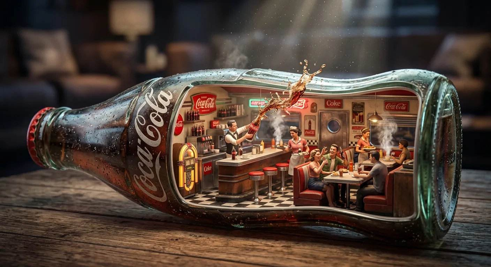

# 3D miniature diorama of a BRAND NAME environment built

[← Back to the collection](../../README.md) · Category: [Food & Drink](../../gallery/food-drink.md) · Model: `Vinano Image Pro` · ID: `vn-01276`

<a href="https://vinano.ai?utm_source=github&utm_medium=readme&utm_campaign=awesome-image-video-prompts-updating&utm_content=prompt-page-image"></a>

<sub>Preview generated with <a href="https://vinano.ai?utm_source=github&utm_medium=readme&utm_campaign=awesome-image-video-prompts-updating&utm_content=prompt-page-caption">vinano.ai</a></sub>

## Prompt

```text
Ultra-realistic 3D miniature diorama of a [BRAND NAME] environment built inside a giant [ICONIC OBJECT OF BRAND], shown in a clean cross-section or partially cut-open view revealing a detailed interior world.

Inside the structure, a fully detailed miniature [brand-specific environment: store / café / restaurant / showroom] exists, realistic human activity such as staff working, customers interacting, and natural storytelling moments.

The [object] acts as both container and environment, its materials and elements integrated into the architecture (e.g., layers, textures, surfaces forming terrain and structure).

Add dynamic storytelling elements: objects or particles suspended mid-air, subtle motion frozen in time (liquid splashes, falling elements, steam, crumbs, etc.).

Include volumetric atmosphere such as steam, fog, or light rays interacting particles in the air to enhance cinematic depth.

Surfaces must be hyper-realistic micro details: imperfections, condensation, reflections, dust, oil sheen, texture variations depending on the material.

Lighting should follow a cinematic high-end advertising style, strong contrast between warm and cool tones, soft rim lighting outlining the subject, and natural light direction enhancing depth and realism.

Composition: slightly angled hero shot, clear cross-section visibility, centered subject, minimal but cinematic background soft bokeh.

Shot on a macro lens, shallow depth of field, creamy bokeh background, ultra-detailed textures, 8K resolution, filmic color grading, luxury commercial photography style.

Preserve realistic proportions and depth for a confident, professional finish.
```

## Try it on vinano.ai

1. Copy the prompt above.
2. Open **[vinano.ai](https://vinano.ai?utm_source=github&utm_medium=readme&utm_campaign=awesome-image-video-prompts-updating&utm_content=prompt-page-try)**, paste it into the image generator and pick a model.
3. Swap any placeholders (brand, product, city, person…) for your own details, then generate.

More prompts like this: [Food & Drink gallery](../../gallery/food-drink.md) · [all categories](../../README.md#contents)
