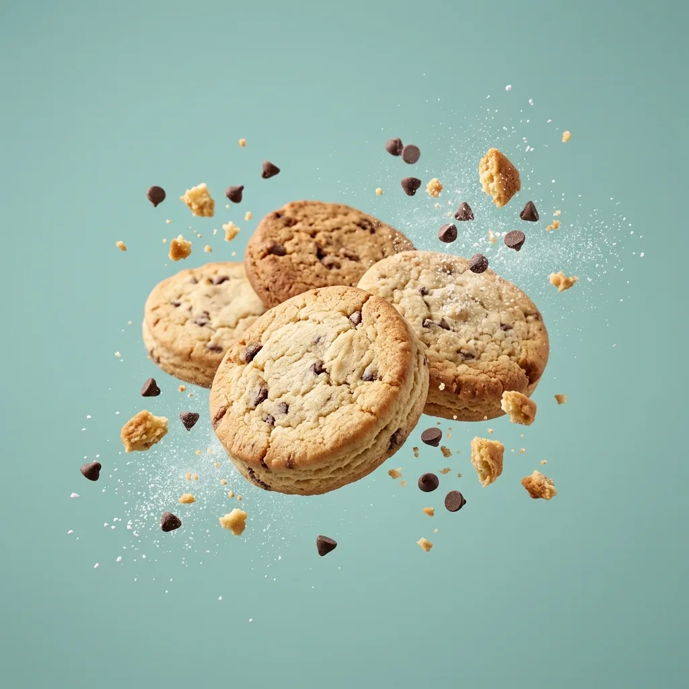

# Assorted biscuit-style cookies

[← Back to the collection](../../README.md) · Category: [Food & Drink](../../gallery/food-drink.md) · Model: `Vinano Image Pro` · ID: `vn-01297`

<a href="https://vinano.ai?utm_source=github&utm_medium=readme&utm_campaign=awesome-image-video-prompts-updating&utm_content=prompt-page-image"></a>

<sub>Preview generated with <a href="https://vinano.ai?utm_source=github&utm_medium=readme&utm_campaign=awesome-image-video-prompts-updating&utm_content=prompt-page-caption">vinano.ai</a></sub>

## Prompt

```text
{
 "global_settings": {
 "resolution": "8K ultra-high-definition",
 "aspect_ratio": "3:4 vertical",
 "render_style": "true-to-life photorealistic high-end biscuit photography",
 "quality": "luxury advertising standard",
 "clarity": "ultra-sharp visible fine textures",
 "grain": "zero",
 "visual_artifacts": "none",
 "depth_of_field": "selective focus soft background falloff",
 "motion_capture": "ingredients suspended in mid-air",
 "background_style": "clean monochrome studio backdrop"
 },

 "subject": {
 "main_food": "assorted biscuit-style cookies",
 "quantity": 4,
 "appearance": ["uniform baked biscuits refined edges",
 "lightly toasted surface subtle cracks",
 "visible chocolate bits and butter layers",
 "dry-crisp texture typical of premium biscuits",
 "precise handcrafted finish"],
 "branding_rules": ["no typography",
 "no logos",
 "no imprints",
 "no decorative marks",
 "no symbols"]
 },

 "secondary_elements": {
 "ingredients_floating": ["mini chocolate chips",
 "biscuit crumbs",
 "powdered sugar dust"],
 "motion_style": "controlled burst natural spread",
 "distribution": "organic scatter surrounding the biscuits",
 "particle_detail": "high-speed frozen motion layered depth"
 },

 "composition": {
 "camera_angle": "slightly elevated three-quarter angle",
 "framing": "central hero focus visual breathing space",
 "spacing": "ample negative space for premium feel",
 "focus_priority": "foreground biscuit in extreme sharp focus"
 },

 "lighting": {
 "type": "studio-grade filmic, cinematic lighting",
 "key_light": "soft diffused directional light",
 "fill_light": "low-intensity fill to reveal surface detail",
 "rim_light": "delicate edge glow for separation",
 "shadows": "smooth and realistic gentle falloff"
 },

 "color_palette": {
 "background_color": "muted pastel teal",
 "biscuit_tones": "light golden beige and toasted browns",
 "accent_colors": "deep cocoa browns, soft sugar whites",
 "contrast": "strong subject isolation from background"
 },

 "photography_style": {
 "genre": "premium biscuit advertising",
 "mood": "clean, refined, indulgent",
 "cleanliness": "immaculate studio finish",
 "post_processing": "subtle professional retouching, natural tones"
 },

 "exclusions": ["text",
 "branding",
 "watermarks",
 "hands",
 "serving ware",
 "props",
 "wrappers",
 "environmental elements",
 "illustration",
 "cartoon rendering"]
}

Aim for an editorial, design-driven look with deliberate negative space.
```

## Try it on vinano.ai

1. Copy the prompt above.
2. Open **[vinano.ai](https://vinano.ai?utm_source=github&utm_medium=readme&utm_campaign=awesome-image-video-prompts-updating&utm_content=prompt-page-try)**, paste it into the image generator and pick a model.
3. Swap any placeholders (brand, product, city, person…) for your own details, then generate.

More prompts like this: [Food & Drink gallery](../../gallery/food-drink.md) · [all categories](../../README.md#contents)
