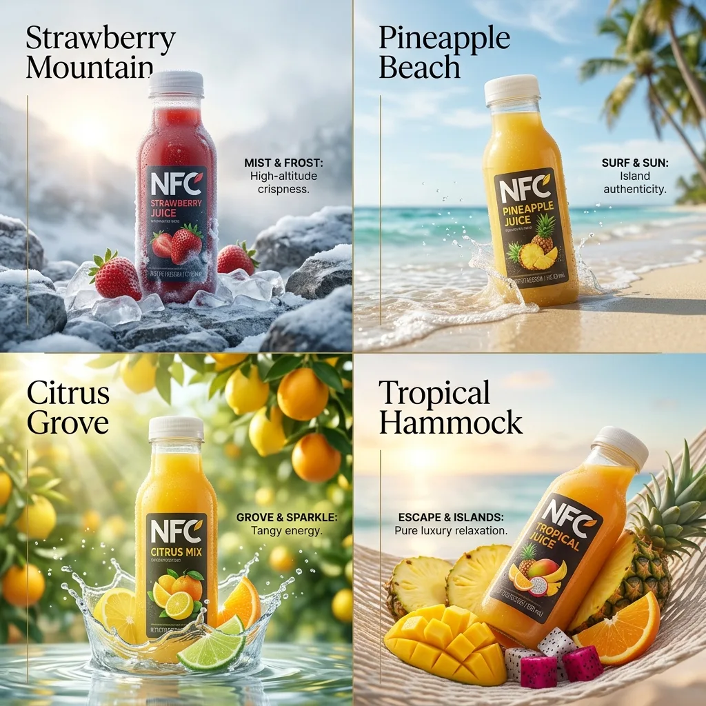

# Pineapple beach v2 , type

[← Back to the collection](../../README.md) · Category: [Food & Drink](../../gallery/food-drink.md) · Model: `Vinano Image v2` · ID: `vn-01303`

<a href="https://vinano.ai?utm_source=github&utm_medium=readme&utm_campaign=awesome-image-video-prompts-updating&utm_content=prompt-page-image"></a>

<sub>Preview generated with <a href="https://vinano.ai?utm_source=github&utm_medium=readme&utm_campaign=awesome-image-video-prompts-updating&utm_content=prompt-page-caption">vinano.ai</a></sub>

## Prompt

```text
[{
 "id": "pineapple_beach_v2",
 "type": "true-to-life photorealistic advertising shot",
 "subject": {
 "item": "pineapple juice bottle",
 "label_text": "NFC Pineapple Juice",
 "pose": "slightly tilted forward"
 },
 "environment": {
 "location": "tropical beach",
 "ground": "sunlit wet tropical sand",
 "background_elements": ["gently swaying palm trees",
 "clear turquoise ocean soft waves",
 "bright blue sky thin clouds"],
 "interactions": "a small wave splashes lightly against the bottle base"
 },
 "surrounding_elements": ["fresh pineapple slices visible texture",
 "sparkling seawater droplets in mid-air"],
 "lighting": {
 "description": "golden sunlight",
 "effects": "soft reflections on glass bottle"
 }
 },

 {
 "id": "strawberry_mountain_v2",
 "type": "true-to-life photorealistic advertising shot",
 "subject": {
 "item": "strawberry juice bottle",
 "label_text": "NFC Strawberry Juice",
 "details": "heavy condensation frost accents"
 },
 "environment": {
 "location": "high-altitude mountains",
 "ground": "icy rocks light snow patches",
 "atmosphere": "crisp cold air drifting mist"
 },
 "surrounding_elements": ["fresh strawberries partially resting on ice"],
 "lighting": {
 "description": "soft sunrise light cutting through fog",
 "effects": "subtle glow around the bottle"
 },
 "style_descriptors": ["cinematic macro shot",
 "ultra high detail",
 "cold-meets-warm contrast",
 "deep red highlights",
 "fresh and premium feel",
 "hyper-realistic surface details"],
 "parameters": "--ar 9:16 --stylize 250"
 },

 {
 "id": "citrus_grove_v2",
 "type": "true-to-life photorealistic advertising shot",
 "subject": {
 "item": "citrus blend juice bottle",
 "label_text": "NFC Citrus Mix",
 "pose": "centered upright"
 },
 "environment": {
 "location": "lush citrus grove",
 "background_elements": ["sunlit yellow and orange fruits hanging above",
 "soft green leaves framing the bottle"]
 },
 "action_elements": {
 "description": "fresh splash of clear water rising around the base",
 "items": ["thin lemon slices",
 "juicy lime wedges",
 "bright orange segments"]
 },
 "lighting": {
 "description": "sun rays filtering through leaves",
 "tone": "vibrant citrus warmth"
 },
 "parameters": "--ar 9:16 --stylize 250"
 },

 {
 "id": "tropical_hammock_v2",
 "type": "true-to-life photorealistic advertising shot",
 "subject": {
 "item": "tropical mixed Nestle juice bottle",
 "label_text": "NFC Tropical Juice",
 "pose": "relaxed tilt as if resting"
 },
 "environment": {
 "location": "sunlit hammock between palm trees",
 "background": "soft-focus ocean horizon glowing sunlight"
 },
 "surrounding_elements": ["fresh pineapple slices",
 "ripe mango slices",
 "orange wedges",
 "dragonfruit cubes"],
 "mood_and_style": {
 "atmosphere": "luxury vacation vibe",
 "colors": "rich tropical saturation",
 "lighting": "warm cinematic highlights soft shadows"
 },
 "parameters": "--ar 9:16 --stylize 250"
 }]

Aim for an editorial, design-driven look with deliberate negative space.
```

## Try it on vinano.ai

1. Copy the prompt above.
2. Open **[vinano.ai](https://vinano.ai?utm_source=github&utm_medium=readme&utm_campaign=awesome-image-video-prompts-updating&utm_content=prompt-page-try)**, paste it into the image generator and pick a model.
3. Swap any placeholders (brand, product, city, person…) for your own details, then generate.

More prompts like this: [Food & Drink gallery](../../gallery/food-drink.md) · [all categories](../../README.md#contents)
