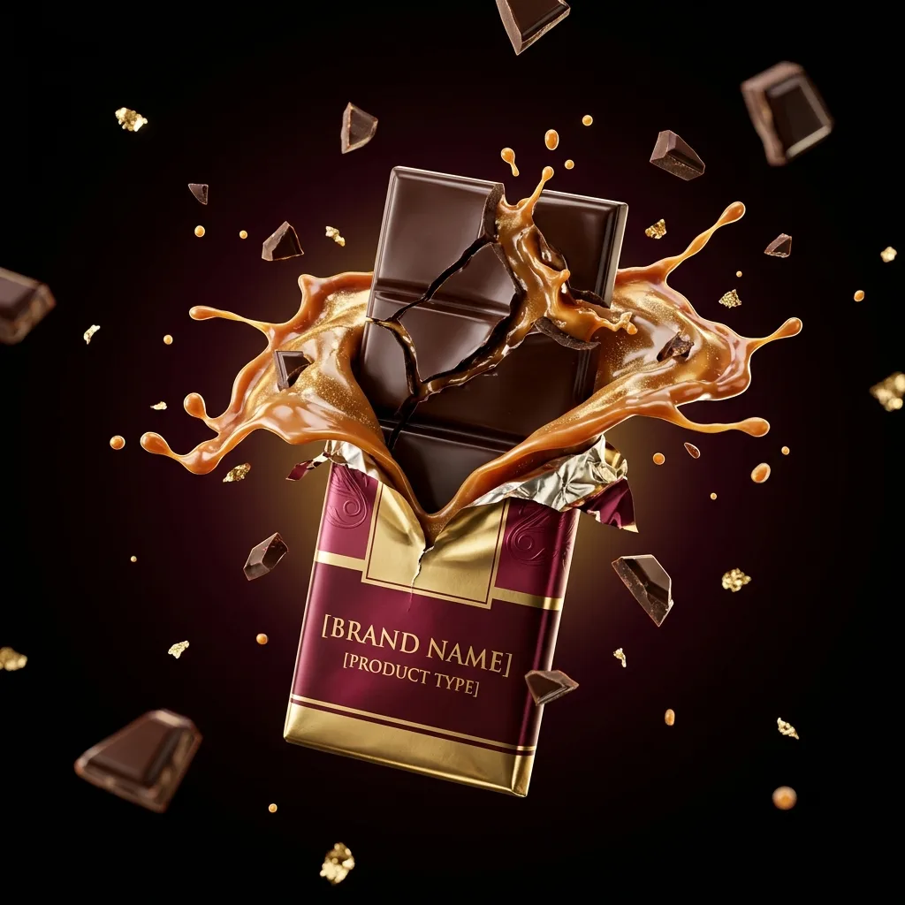

# Premium BRAND NAME PRODUCT TYPE centered in the frame

[← Back to the collection](../../README.md) · Category: [Food & Drink](../../gallery/food-drink.md) · Model: `Vinano Image v2` · ID: `vn-01306`

<a href="https://vinano.ai?utm_source=github&utm_medium=readme&utm_campaign=awesome-image-video-prompts-updating&utm_content=prompt-page-image"></a>

<sub>Preview generated with <a href="https://vinano.ai?utm_source=github&utm_medium=readme&utm_campaign=awesome-image-video-prompts-updating&utm_content=prompt-page-caption">vinano.ai</a></sub>

## Prompt

```text
A premium [BRAND NAME] [PRODUCT TYPE] centered in the frame, iconic [BRAND COLOR / PACKAGING STYLE] packaging partially unwrapped, emerging from darkness like a legendary luxury artifact, rich [PRODUCT MATERIAL – chocolate / cream / liquid / filling] cracking open and transforming in slow motion, surreal transformation in progress, [CORE INGREDIENT / FLAVOR ELEMENT] flowing, melting, or bursting outward in cinematic waves, fragments and droplets levitating in zero gravity, slow-motion splash frozen mid-air, ultra-detailed glossy textures, realistic material physics, rich highlights and reflections, dramatic cinematic rim lighting, deep shadows, luxury advertising aesthetic, dreamlike surreal atmosphere, hyper-real product photography blended fantasy, macro depth of field, clean dark background subtle [BRAND COLOR] glow, product dominant and razor-sharp, brand name clearly visible on packaging, no extra text, no watermark, no extra logos, 8K ultra-HD, HDR, global illumination, unreal engine style, viral commercial look, high contrast, premium composition Maintain consistent colour harmony and crisp focus across the whole frame.
```

## Try it on vinano.ai

1. Copy the prompt above.
2. Open **[vinano.ai](https://vinano.ai?utm_source=github&utm_medium=readme&utm_campaign=awesome-image-video-prompts-updating&utm_content=prompt-page-try)**, paste it into the image generator and pick a model.
3. Swap any placeholders (brand, product, city, person…) for your own details, then generate.

More prompts like this: [Food & Drink gallery](../../gallery/food-drink.md) · [all categories](../../README.md#contents)
