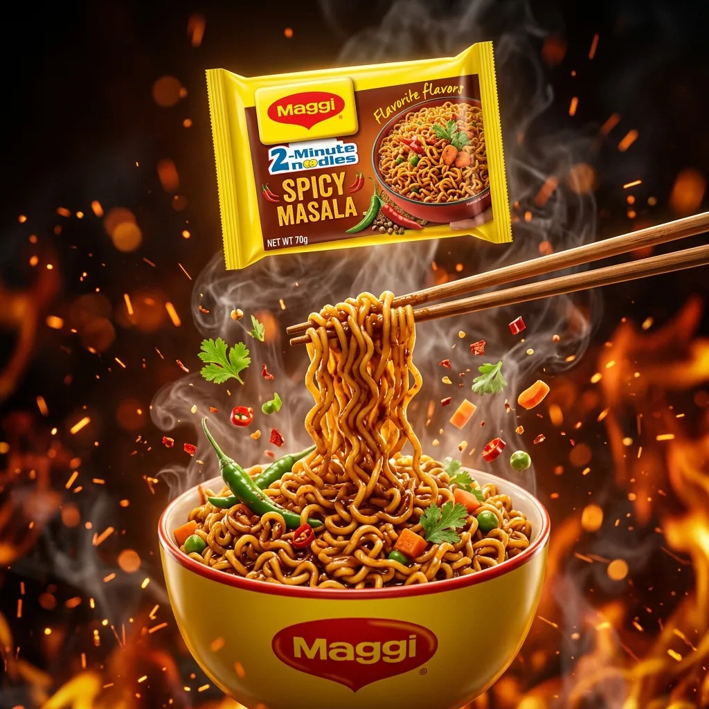

# Ultra-high-resolution 8K cinematic commercial food advertisement of BRAND NAME

[← Back to the collection](../../README.md) · Category: [Food & Drink](../../gallery/food-drink.md) · Model: `Vinano Image v2` · ID: `vn-01307`

<a href="https://vinano.ai?utm_source=github&utm_medium=readme&utm_campaign=awesome-image-video-prompts-updating&utm_content=prompt-page-image"></a>

<sub>Preview generated with <a href="https://vinano.ai?utm_source=github&utm_medium=readme&utm_campaign=awesome-image-video-prompts-updating&utm_content=prompt-page-caption">vinano.ai</a></sub>

## Prompt

```text
Ultra-high-resolution 8K cinematic commercial food advertisement of **[BRAND NAME] instant noodles**, vertical 3:4 aspect ratio.

A bold hero composition featuring the **[BRAND NAME] noodle packet** floating in the upper frame, front-facing and perfectly lit, crisp edges, realistic packaging texture, and clear branding. Below it, a steaming bowl branded **[BRAND NAME]**, filled glossy, curly noodles lifted dramatically mid-air chopsticks, noodles stretching naturally under gravity.

Noodles appear richly coated in **[FLAVOR / SAUCE TYPE]**, visible ingredients such as **[VEGETABLES / CHILIES / GARNISH]** suspended mid-air around the bowl. Steam rises dynamically, interacting floating spice particles and food fragments.

Background is a **completely new cinematic environment** (not copied from reference), abstract and high-energy, filled swirling flames, sparks, embers, smoke, and motion blur, creating depth and intensity while keeping the food in sharp focus.

Lighting is premium studio filmic, cinematic lighting:
warm golden key light, soft fill light, strong rim light outlining the packet and noodles, high contrast glowing highlights and deep shadows.

Color palette dominated by **[PRIMARY BRAND COLORS]**, enhanced warm orange-gold food tones and contrasting greens from vegetables. Hyper-realistic textures on noodles, sauce, packaging, and bowl.

Shallow depth of field, dramatic bokeh in background, extreme sharpness on hero elements, true-to-life photorealistic yet stylized for advertising impact.

Mood: bold, energetic, spicy, indulgent, mouth-watering, premium commercial look.

No people, no clutter, no copied backgrounds. Designed for high-impact food advertising, posters, and social media hero visuals.

[BRAND NAME] → Maggi
[FLAVOR / SAUCE TYPE] → spicy masala
[PRIMARY BRAND COLORS] → yellow and red

Preserve realistic proportions and depth for a confident, professional finish.
```

## Try it on vinano.ai

1. Copy the prompt above.
2. Open **[vinano.ai](https://vinano.ai?utm_source=github&utm_medium=readme&utm_campaign=awesome-image-video-prompts-updating&utm_content=prompt-page-try)**, paste it into the image generator and pick a model.
3. Swap any placeholders (brand, product, city, person…) for your own details, then generate.

More prompts like this: [Food & Drink gallery](../../gallery/food-drink.md) · [all categories](../../README.md#contents)
