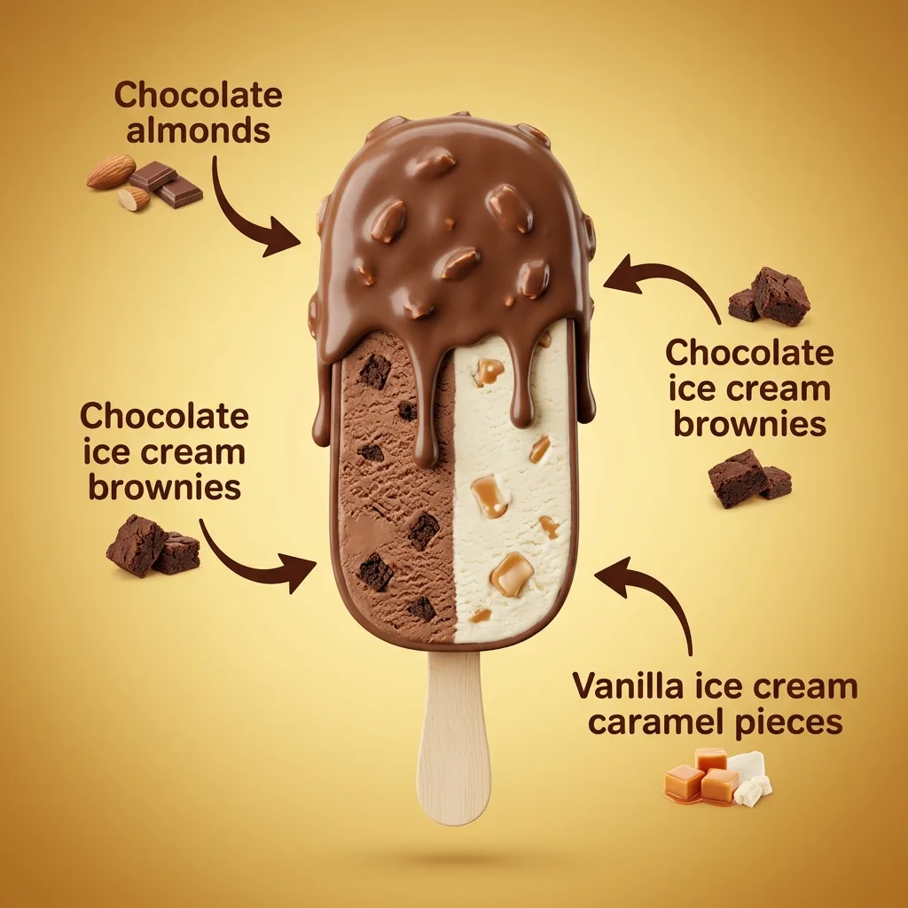

# Vertically centered ice cream bar on a wooden stick

[← Back to the collection](../../README.md) · Category: [Food & Drink](../../gallery/food-drink.md) · Model: `Vinano Image v2` · ID: `vn-01309`

<a href="https://vinano.ai?utm_source=github&utm_medium=readme&utm_campaign=awesome-image-video-prompts-updating&utm_content=prompt-page-image"></a>

<sub>Preview generated with <a href="https://vinano.ai?utm_source=github&utm_medium=readme&utm_campaign=awesome-image-video-prompts-updating&utm_content=prompt-page-caption">vinano.ai</a></sub>

## Prompt

```text
{
 "resolution": "8K",
 "aspect_ratio": "3:4",
 "image_type": "true-to-life photorealistic commercial product render",
 "scene_description": {
 "main_subject": "A vertically centered ice cream bar on a wooden stick",
 "orientation": "upright, front-facing, slightly elevated perspective",
 "composition": "single product centered surrounding ingredient callouts and curved arrows"
 },
 "background": {
 "color": "warm golden-yellow gradient",
 "texture": "smooth, matte, evenly lit",
 "lighting_falloff": "subtle vignette, darker towards edges"
 },
 "lighting": {
 "type": "studio lighting",
 "key_light": "soft frontal light highlighting chocolate gloss",
 "fill_light": "balanced fill to preserve texture detail",
 "specular_highlights": "visible on melted chocolate coating",
 "shadows": "soft shadow beneath ice cream stick"
 },
 "ice_cream_bar": {
 "shape": "rounded rectangular bar",
 "surface": "smooth visible embedded inclusions",
 "layers": [{
 "layer_position": "top coating",
 "material": "milk chocolate",
 "state": "melted and dripping",
 "texture": "glossy, thick, fluid",
 "details": ["multiple chocolate drips flowing downward",
 "irregular almond pieces embedded in coating",
 "rounded drip edges gravity pull"]
 },
 {
 "layer_position": "left interior",
 "material": "chocolate ice cream",
 "texture": "dense, creamy",
 "details": ["small dark brownie chunks evenly dispersed",
 "matte finish compared to outer chocolate"]
 },
 {
 "layer_position": "right interior",
 "material": "vanilla ice cream",
 "texture": "smooth and creamy",
 "details": ["visible caramel pieces",
 "light beige caramel chunks rounded edges"]
 }]
 },
 "stick": {
 "material": "light natural wood",
 "texture": "smooth subtle grain",
 "shape": "rounded edges, flat profile",
 "visibility": "fully visible below ice cream bar"
 },
 "ingredient_callouts": {
 "style": {
 "arrows": "curved, thick, dark brown",
 "text_color": "dark brown",
 "font_style": "clean sans-serif",
 "layout": "balanced around product"
 },
 "labels": [{
 "text": "Chocolate almonds",
 "position": "top-left",
 "visual_aid": ["whole almonds",
 "small chocolate squares"]
 },
 {
 "text": "Chocolate ice cream brownies",
 "position": "left-middle",
 "visual_aid": ["brownie chunks"]
 },
 {
 "text": "Chocolate ice cream brownies",
 "position": "right-middle",
 "visual_aid": ["brownie chunks"]
 },
 {
 "text": "Vanilla ice cream caramel pieces",
 "position": "bottom-right",
 "visual_aid": ["caramel cubes",
 "white vanilla pieces"]
 }]
 },
 "color_palette": {
 "primary_colors": ["milk chocolate brown",
 "golden yellow",
 "cream white"],
 "secondary_colors": ["dark brownie brown",
 "light caramel orange",
 "almond beige"]
 },
 "render_quality": {
 "sharpness": "extreme micro-detail visibility",
 "texture_fidelity": "high realism",
 "noise": "none",
 "depth_of_field": "moderate, product fully in focus"
 },
 "style_tags": ["luxury dessert advertising",
 "hyper-realistic food photography",
 "commercial product render",
 "clean studio composition"]
}

Keep edges clean and the overall composition balanced for a polished, gallery-ready result.
```

## Try it on vinano.ai

1. Copy the prompt above.
2. Open **[vinano.ai](https://vinano.ai?utm_source=github&utm_medium=readme&utm_campaign=awesome-image-video-prompts-updating&utm_content=prompt-page-try)**, paste it into the image generator and pick a model.
3. Swap any placeholders (brand, product, city, person…) for your own details, then generate.

More prompts like this: [Food & Drink gallery](../../gallery/food-drink.md) · [all categories](../../README.md#contents)
