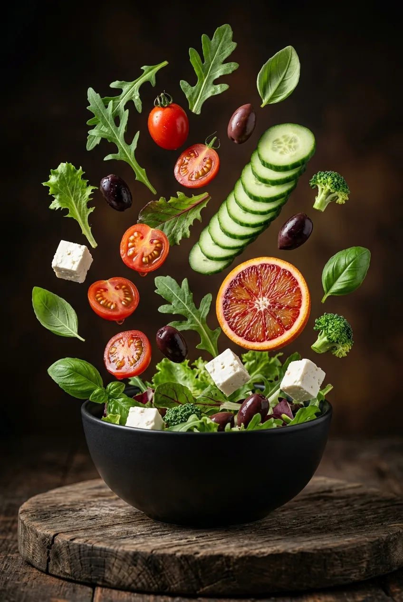

# 2:3 vertical , style

[← Back to the collection](../../README.md) · Category: [Food & Drink](../../gallery/food-drink.md) · Model: `Vinano Image v2` · ID: `vn-01310`

<a href="https://vinano.ai?utm_source=github&utm_medium=readme&utm_campaign=awesome-image-video-prompts-updating&utm_content=prompt-page-image"></a>

<sub>Preview generated with <a href="https://vinano.ai?utm_source=github&utm_medium=readme&utm_campaign=awesome-image-video-prompts-updating&utm_content=prompt-page-caption">vinano.ai</a></sub>

## Prompt

```text
{
 "global_settings": {
 "resolution": "8K ultra high definition",
 "aspect_ratio": "2:3 vertical",
 "style": "hyper-realistic AI-edited food photography",
 "clarity": "extreme sharpness, micro-texture visibility",
 "motion": "frozen action suspended ingredients",
 "lighting_quality": "studio-grade, high-contrast, cinematic",
 "background_separation": "strong subject isolation clean depth"
 },

 "module_1_image_1_style": {
 "scene_description": "A dynamic salad explosion emerging from a matte black bowl placed on a round wooden surface. Ingredients are mid-air, scattered upward and outward.",
 "ingredients_visible": ["green lettuce leaves",
 "cherry tomatoes (whole and sliced)",
 "cucumber slices arranged in a curved stack",
 "black olives",
 "white cheese cubes",
 "orange citrus slice",
 "small broccoli florets",
 "fresh green basil leaves"],
 "motion_details": {
 "ingredients":

Render with rich micro-detail while keeping the layout uncluttered and intentional.
```

## Try it on vinano.ai

1. Copy the prompt above.
2. Open **[vinano.ai](https://vinano.ai?utm_source=github&utm_medium=readme&utm_campaign=awesome-image-video-prompts-updating&utm_content=prompt-page-try)**, paste it into the image generator and pick a model.
3. Swap any placeholders (brand, product, city, person…) for your own details, then generate.

More prompts like this: [Food & Drink gallery](../../gallery/food-drink.md) · [all categories](../../README.md#contents)
