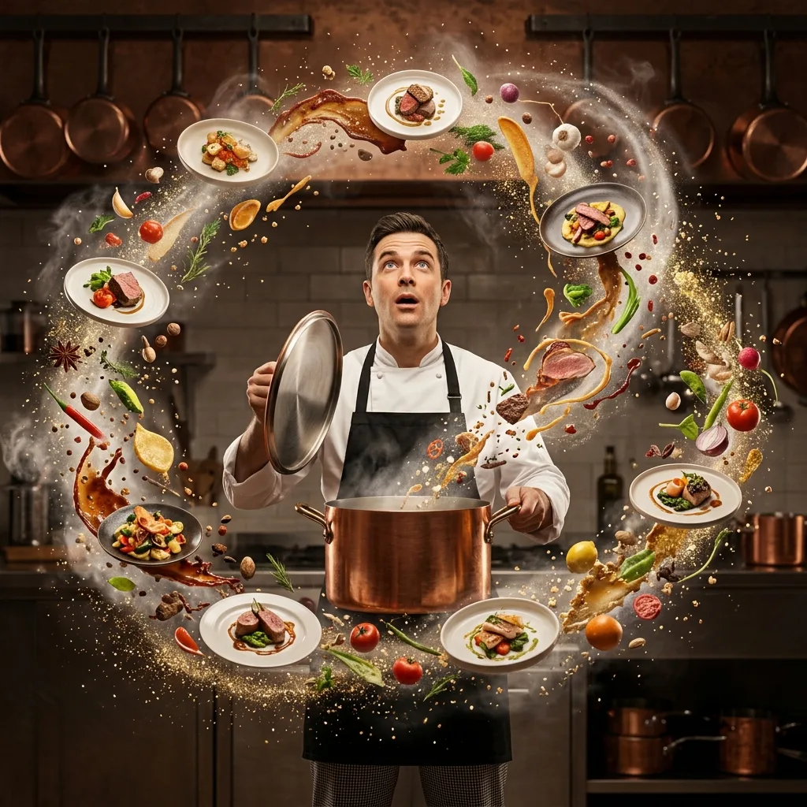

# High-speed commercial photograph featuring a man uploaded face as

[← Back to the collection](../../README.md) · Category: [Food & Drink](../../gallery/food-drink.md) · Model: `Vinano Image v2` · ID: `vn-01320`

<a href="https://vinano.ai?utm_source=github&utm_medium=readme&utm_campaign=awesome-image-video-prompts-updating&utm_content=prompt-page-image"></a>

<sub>Preview generated with <a href="https://vinano.ai?utm_source=github&utm_medium=readme&utm_campaign=awesome-image-video-prompts-updating&utm_content=prompt-page-caption">vinano.ai</a></sub>

## Prompt

```text
A hyper-realistic, high-speed commercial photograph featuring a man uploaded face as reference in a chef's jacket, apron, and checkered trousers. He stands in a rustic, high-end kitchen, lifting the lid off a large, steaming copper pot a look of pure amazement. From the pot, a literal galaxy of gourmet food explodes upwards and outwards in suspended animation: whole roasted spices, vibrant vegetables, splashes of rich sauces, floating plates of intricately plated fine dining dishes,and swirling clouds of aromatic steam filled golden glitter. The ingredients form spiral nebulae around him. The background is a warm, blurred professional kitchen copper cookware hanging. The lighting is warm, cinematic, and focused, highlighting the textures of the flying food macro-level detail. Shot a fast shutter speed to freeze motion, 8k resolution, Octane Render culinary aesthetic. 100% use my real face. Maintain consistent colour harmony and crisp focus across the whole frame.
```

## Try it on vinano.ai

1. Copy the prompt above.
2. Open **[vinano.ai](https://vinano.ai?utm_source=github&utm_medium=readme&utm_campaign=awesome-image-video-prompts-updating&utm_content=prompt-page-try)**, paste it into the image generator and pick a model.
3. Swap any placeholders (brand, product, city, person…) for your own details, then generate.

More prompts like this: [Food & Drink gallery](../../gallery/food-drink.md) · [all categories](../../README.md#contents)
