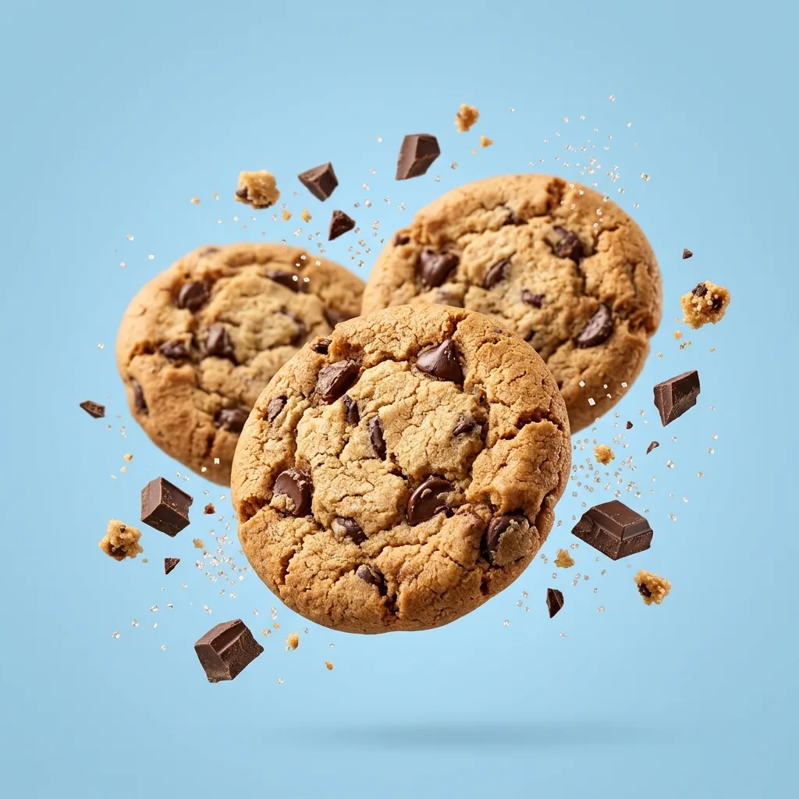

# Chocolate chip cookies

[← Back to the collection](../../README.md) · Category: [Food & Drink](../../gallery/food-drink.md) · Model: `Vinano Image v2` · ID: `vn-01332`

<a href="https://vinano.ai?utm_source=github&utm_medium=readme&utm_campaign=awesome-image-video-prompts-updating&utm_content=prompt-page-image"></a>

<sub>Preview generated with <a href="https://vinano.ai?utm_source=github&utm_medium=readme&utm_campaign=awesome-image-video-prompts-updating&utm_content=prompt-page-caption">vinano.ai</a></sub>

## Prompt

```text
{
 "global_settings": {
 "resolution": "8K ultra-high-definition",
 "aspect_ratio": "3:4 vertical",
 "render_style": "hyper-realistic commercial food photography",
 "quality": "premium advertising grade",
 "sharpness": "extreme micro-detail, crisp edges",
 "noise": "none",
 "artifacts": "none",
 "depth_of_field": "shallow, subject-focused",
 "motion": "frozen mid-air ingredients",
 "background_style": "solid single-color studio backdrop"
 },

 "subject": {
 "main_food": "chocolate chip cookies",
 "quantity": 3,
 "appearance": ["golden-brown freshly baked cookies",
 "soft cracked surface",
 "visible melted chocolate chips",
 "slightly crisp edges",
 "natural handmade texture"],
 "branding_rules": ["no text",
 "no logo",
 "no embossing",
 "no patterns",
 "no symbols"]
 },

 "secondary_elements": {
 "ingredients_flying": ["dark chocolate chunks",
 "cookie crumbs",
 "fine sugar crystals"],
 "motion_style": "dynamic floating explosion",
 "distribution": "balanced around the cookies, natural randomness",
 "particle_detail": "sharp, frozen motion depth separation"
 },

 "composition": {
 "camera_angle": "slightly low angle",
 "framing": "center-weighted hero composition",
 "spacing": "clean negative space around subject",
 "focus_priority": "front cookie in razor-sharp focus"
 },

 "lighting": {
 "type": "professional studio lighting",
 "key_light": "soft directional key light",
 "fill_light": "gentle fill for texture clarity",
 "rim_light": "subtle rim highlight for separation",
 "shadows": "soft and natural, no harsh contrast"
 },

 "color_palette": {
 "background_color": "pastel blue",
 "cookie_tones": "warm golden browns",
 "accent_colors": "rich chocolate browns, crystal sugar whites",
 "contrast": "high subject-background separation"
 },

 "photography_style": {
 "genre": "luxury food advertising",
 "mood": "fresh, indulgent, premium",
 "cleanliness": "spotless studio look",
 "post_processing": "minimal, natural, high-end retouching"
 },

 "exclusions": ["text",
 "logos",
 "watermarks",
 "hands",
 "plates",
 "props",
 "packaging",
 "background objects",
 "cartoon style",
 "illustration style"]
}

Maintain consistent colour harmony and crisp focus across the whole frame.
```

## Try it on vinano.ai

1. Copy the prompt above.
2. Open **[vinano.ai](https://vinano.ai?utm_source=github&utm_medium=readme&utm_campaign=awesome-image-video-prompts-updating&utm_content=prompt-page-try)**, paste it into the image generator and pick a model.
3. Swap any placeholders (brand, product, city, person…) for your own details, then generate.

More prompts like this: [Food & Drink gallery](../../gallery/food-drink.md) · [all categories](../../README.md#contents)
