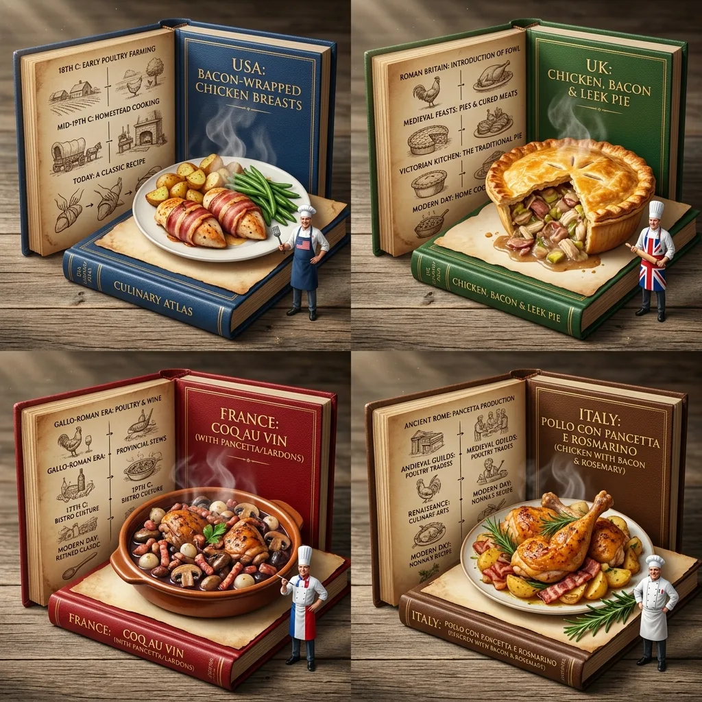

# Food & Drink prompt #1333

[← Back to the collection](../../README.md) · Category: [Food & Drink](../../gallery/food-drink.md) · Model: `Vinano Image Pro` · ID: `vn-01333`

<a href="https://vinano.ai?utm_source=github&utm_medium=readme&utm_campaign=awesome-image-video-prompts-updating&utm_content=prompt-page-image"></a>

<sub>Preview generated with <a href="https://vinano.ai?utm_source=github&utm_medium=readme&utm_campaign=awesome-image-video-prompts-updating&utm_content=prompt-page-caption">vinano.ai</a></sub>

## Prompt

```text
<instruction>
Inputs: Ingredients = [User Choice, e.g., Chicken, Bacon]

Step 1: Global Analysis
Analyze the ingredients.
Select 4 Distinct Countries a famous dish these ingredients

Goal: A "Culinary Atlas" Grid showing 4 different cultural variations of the ingredients.

Layout Rule:
Output Format: A 2x2 Grid.
Content per Panel: Each of the 4 panels must show a Single Open Book Spread for that specific country.

Inside Each Panel (The Book Spread Rule):
Left Page (The History): 2D Vintage Sepia Sketches. A visual timeline or illustrated recipe of the dish (e.g., "1850 -> 1920 -> Today"). Flat, ink-drawn style.
Right Page (The Reality): 3D Pop-up Diorama. The finished, steaming meal emerges physically from the page. A tiny miniature chef from that country is standing on the page next to the massive food.
Consistency: All 4 books should look like part of the same series, but different cultural contents.

Lighting: Cinematic top-down lighting, highlighting the depth difference between the flat left page and the 3D right page.
Output: 2x2 Grid, High Definition, Macro Detail.
</instruction>

Emphasise material texture and natural light so the final frame feels tactile and premium.
```

## Try it on vinano.ai

1. Copy the prompt above.
2. Open **[vinano.ai](https://vinano.ai?utm_source=github&utm_medium=readme&utm_campaign=awesome-image-video-prompts-updating&utm_content=prompt-page-try)**, paste it into the image generator and pick a model.
3. Swap any placeholders (brand, product, city, person…) for your own details, then generate.

More prompts like this: [Food & Drink gallery](../../gallery/food-drink.md) · [all categories](../../README.md#contents)
