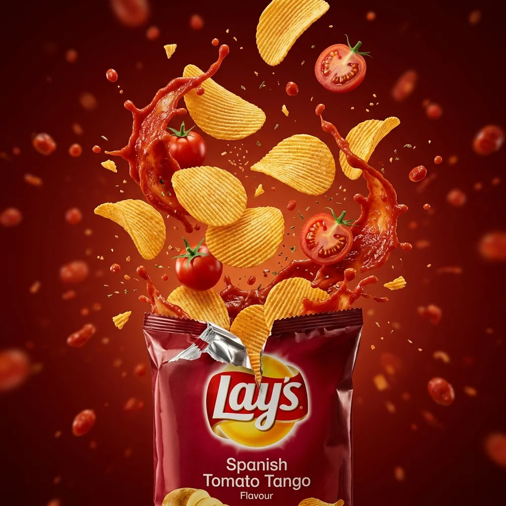

# Commercial food photography showing a red Lay’s snack packet

[← Back to the collection](../../README.md) · Category: [Food & Drink](../../gallery/food-drink.md) · Model: `Vinano Image v2` · ID: `vn-01343`

<a href="https://vinano.ai?utm_source=github&utm_medium=readme&utm_campaign=awesome-image-video-prompts-updating&utm_content=prompt-page-image"></a>

<sub>Preview generated with <a href="https://vinano.ai?utm_source=github&utm_medium=readme&utm_campaign=awesome-image-video-prompts-updating&utm_content=prompt-page-caption">vinano.ai</a></sub>

## Prompt

```text
{
 "prompt_name": "Lays_Spanish_Tomato_Tango_Explosion",
 "description": "Ultra-realistic commercial food photography showing a red Lay’s snack packet torn open from the top, positioned at the bottom center of the frame. Golden ridged potato chips are explosively bursting upward in frozen mid-air motion. Thick red tomato sauce splashes dynamically around the chips, forming arcs and droplets. Fresh whole tomatoes and halved tomatoes visible seeds are flying around. Small crispy crumbs and seasoning particles are suspended in the air. The Lay’s logo is clearly visible on the packet, readable text: 'Spanish Tomato Tango Flavour'. The packet surface is glossy and reflective realistic wrinkles. Background is a deep red gradient filled floating sauce droplets and particles, creating intense energy.",
 "lighting": "Dramatic warm studio lighting strong highlights, deep shadows, and high contrast",
 "color_palette": ["deep red", "tomato red", "golden yellow", "dark orange"],
 "motion": "High-energy explosive upward motion frozen splashes and flying fragments",
 "focus": "Ultra-sharp focus on chips, sauce splashes, and packet branding",
 "texture_detail": "Highly detailed ridged chip texture, glossy liquid splashes, realistic foil reflections",
 "style": "Premium FMCG commercial advertising, cinematic realism",
 "resolution": "8K",
 "aspect_ratio": "3:4"
}

Maintain consistent colour harmony and crisp focus across the whole frame.
```

## Try it on vinano.ai

1. Copy the prompt above.
2. Open **[vinano.ai](https://vinano.ai?utm_source=github&utm_medium=readme&utm_campaign=awesome-image-video-prompts-updating&utm_content=prompt-page-try)**, paste it into the image generator and pick a model.
3. Swap any placeholders (brand, product, city, person…) for your own details, then generate.

More prompts like this: [Food & Drink gallery](../../gallery/food-drink.md) · [all categories](../../README.md#contents)
