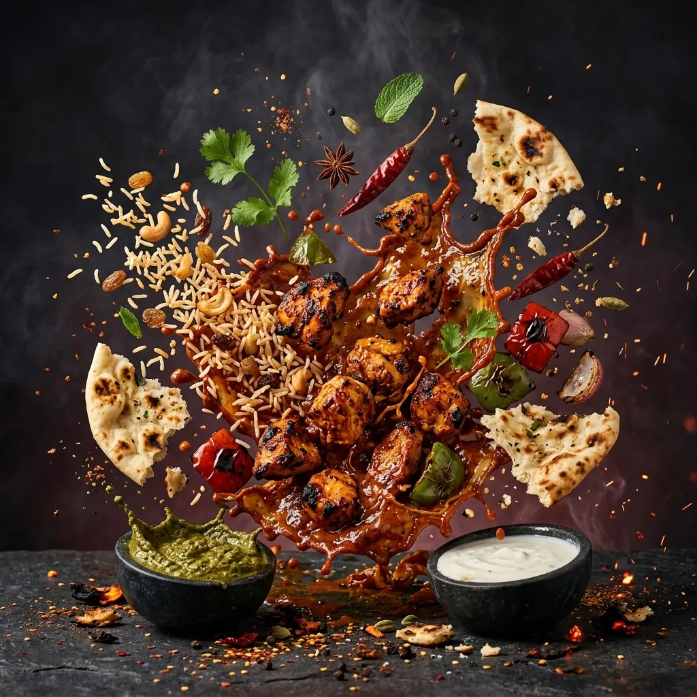

# Cooked food pieces

[← Back to the collection](../../README.md) · Category: [Food & Drink](../../gallery/food-drink.md) · Model: `Vinano Image v2` · ID: `vn-01345`

<a href="https://vinano.ai?utm_source=github&utm_medium=readme&utm_campaign=awesome-image-video-prompts-updating&utm_content=prompt-page-image"></a>

<sub>Preview generated with <a href="https://vinano.ai?utm_source=github&utm_medium=readme&utm_campaign=awesome-image-video-prompts-updating&utm_content=prompt-page-caption">vinano.ai</a></sub>

## Prompt

```text
{
 "image_type": "Hyper-realistic cinematic food photography",
 "resolution": "8K",
 "aspect_ratio": "3:4",
 "camera": {
 "shot_type": "Hero shot",
 "angle": "Slightly low-angle central focus",
 "focus": "Ultra-sharp foreground controlled depth of field",
 "motion_capture": "Frozen mid-air action splash dynamics"
 },
 "lighting": {
 "style": "Cinematic studio lighting",
 "highlights": "Strong specular highlights emphasizing oil, glaze, and moisture",
 "shadows": "Deep, dramatic shadows for contrast and depth",
 "rim_light": "Visible edge lighting outlining food elements",
 "ambient": "Low-key lighting environment"
 },
 "background": {
 "color": "Dark charcoal to deep maroon tones",
 "texture": "Smoky, atmospheric backdrop",
 "elements": ["Rising steam",
 "Spice-infused smoke",
 "Floating embers and sparks"]
 },
 "primary_subjects": [{
 "item": "Cooked food pieces",
 "position": "Suspended mid-air",
 "surface_detail": "Charred edges, textured crust, glossy coating",
 "motion": "Erupting upward dynamic splash behavior"
 }],
 "secondary_elements": [{
 "item": "Sauce or gravy",
 "state": "Thick and glossy",
 "motion": "Explosive splash visible droplets and arcs",
 "detail": "Oil separation visible as shimmering droplets"
 },
 {
 "item": "Herbs",
 "types": ["Fresh coriander leaves",
 "Mint leaves"],
 "motion": "Scattered and floating naturally"
 },
 {
 "item": "Spices",
 "types": ["Whole dried red chilies",
 "Whole spices (clearly visible star-shaped and pod-like forms)",
 "Crushed spice particles"],
 "behavior": "Suspended mid-air, dispersed unevenly"
 },
 {
 "item": "Vegetables",
 "types": ["Bell peppers (green and red)",
 "Onion chunks"],
 "cut": "Large rustic chunks",
 "surface": "Light char and gloss"
 }],
 "supporting_food_items": [{
 "item": "Rice grains",
 "detail": "Individual grains clearly visible, mid-air dispersion",
 "motion": "Erupting outward spices"
 },
 {
 "item": "Nuts and dry fruits",
 "types": ["Cashews",
 "Raisins"],
 "position": "Mixed rice and floating"
 },
 {
 "item": "Flatbread pieces",
 "detail": "Torn edges, soft interior texture, char marks visible",
 "motion": "Suspended mid-air crumbs"
 }],
 "condiments": [{
 "item": "Green chutney",
 "texture": "Thick, coarse",
 "motion": "Upward splash from a bowl",
 "container": "Dark stone bowl matte finish"
 },
 {
 "item": "White yogurt-based sauce",
 "texture": "Smooth and creamy",
 "container": "Dark stone bowl"
 }],
 "surface_environment": {
 "base": "Dark textured surface",
 "elements": ["Scattered spice flakes",
 "Burnt crumbs",
 "Small glowing embers",
 "Charcoal-like stones"]
 },
 "color_palette": ["Deep reds",
 "Burnt orange",
 "Charcoal black",
 "Smoky maroon",
 "Herb green",
 "Creamy white highlights"],
 "mood": "Bold, intense, premium, cinematic, high-impact food commercial aesthetic",
 "realism_level": "Extreme hyper-realism tactile textures and moisture detail",
 "post_processing": {
 "contrast": "High",
 "clarity": "Very high",
 "sharpening": "Selective sharpening on food textures",
 "noise": "Minimal",
 "color_grading": "Warm highlights deep shadows"
 }
}

Keep edges clean and the overall composition balanced for a polished, gallery-ready result.
```

## Try it on vinano.ai

1. Copy the prompt above.
2. Open **[vinano.ai](https://vinano.ai?utm_source=github&utm_medium=readme&utm_campaign=awesome-image-video-prompts-updating&utm_content=prompt-page-try)**, paste it into the image generator and pick a model.
3. Swap any placeholders (brand, product, city, person…) for your own details, then generate.

More prompts like this: [Food & Drink gallery](../../gallery/food-drink.md) · [all categories](../../README.md#contents)
