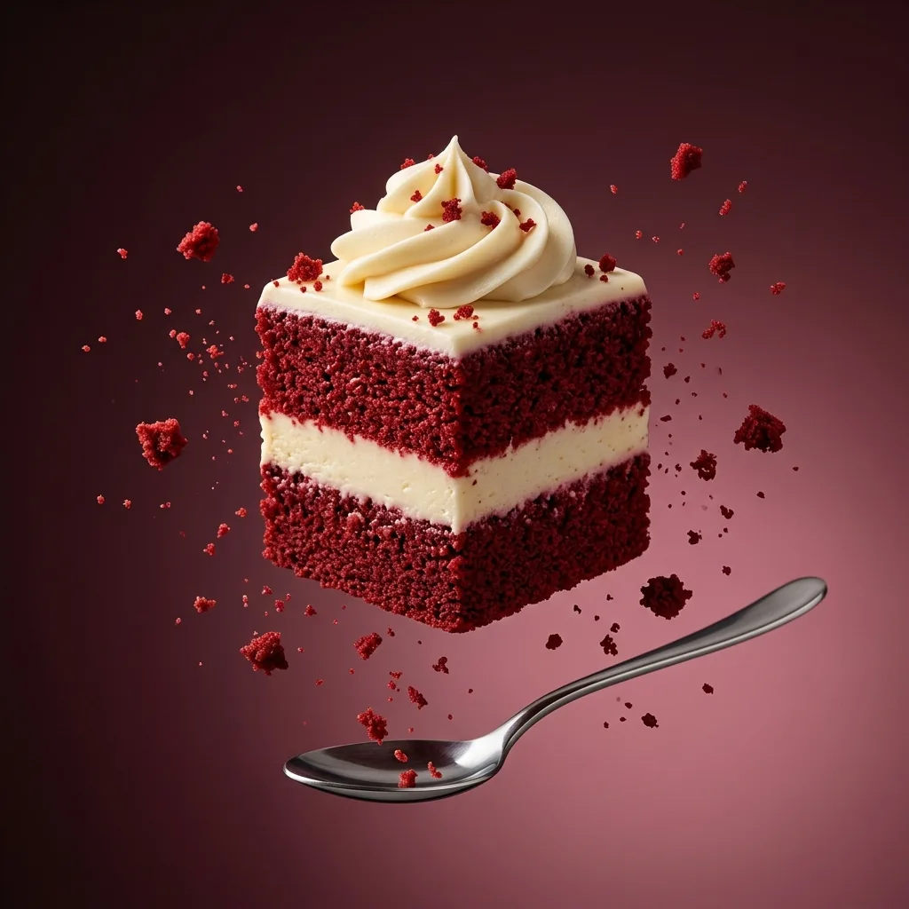

# Single cube-shaped red velvet cake piece

[← Back to the collection](../../README.md) · Category: [Food & Drink](../../gallery/food-drink.md) · Model: `Vinano Image v2` · ID: `vn-01351`

<a href="https://vinano.ai?utm_source=github&utm_medium=readme&utm_campaign=awesome-image-video-prompts-updating&utm_content=prompt-page-image"></a>

<sub>Preview generated with <a href="https://vinano.ai?utm_source=github&utm_medium=readme&utm_campaign=awesome-image-video-prompts-updating&utm_content=prompt-page-caption">vinano.ai</a></sub>

## Prompt

```text
{
 "image_type": "high-detail food photography, AI-edited surreal composition",
 "resolution": "8K ultra-high-definition",
 "aspect_ratio": "3:4",
 "main_subject": {
 "object": "single cube-shaped red velvet cake piece",
 "position": "floating in mid-air",
 "orientation": "slightly angled, front face visible, top frosting facing upward",
 "texture": {
 "cake": "fine, dense crumb texture visible granules",
 "frosting": "smooth, creamy, thick layer soft ridges"
 }
 },
 "cake_details": {
 "layers": [{
 "type": "red velvet sponge",
 "color": "deep red",
 "count": 2
 },
 {
 "type": "cream filling",
 "color": "pale off-white",
 "count": 1,
 "position": "center layer"
 }],
 "top_frosting": {
 "style": "swirled frosting peak",
 "color": "off-white / cream",
 "surface_detail": "soft curved piping lines",
 "toppings": "small red velvet crumbs scattered on top"
 }
 },
 "motion_elements": {
 "crumbs": {
 "presence": true,
 "distribution": "scattered around the cake in mid-air",
 "size_variation": "fine dust to small chunks",
 "motion": "frozen mid-flight"
 }
 },
 "secondary_object": {
 "object": "metal spoon",
 "material": "polished stainless steel",
 "position": "below the cake",
 "orientation": "slightly tilted upward",
 "reflection": "subtle reflections visible on spoon surface",
 "interaction": "crumbs falling toward spoon"
 },
 "lighting": {
 "style": "studio lighting",
 "direction": "soft directional light from upper side",
 "highlights": "gentle highlights on frosting and spoon",
 "shadows": "soft shadows, no harsh edges",
 "contrast": "moderate contrast emphasizing texture"
 },
 "background": {
 "color_palette": ["dark maroon",
 "deep burgundy",
 "muted pink gradient"],
 "style": "smooth gradient backdrop",
 "depth": "shallow depth of field",
 "noise": "clean, minimal grain"
 },
 "color_profile": {
 "dominant_colors": ["deep red",
 "cream white",
 "dark maroon"],
 "saturation": "rich but controlled",
 "tone": "luxurious and dramatic"
 },
 "composition": {
 "framing": "centered subject vertical emphasis",
 "visual_balance": "cake centered, spoon offset below",
 "negative_space": "ample empty space around subject"
 },
 "style_tags": ["hyper-realistic",
 "AI-edited look",
 "surreal food photography",
 "freeze-motion effect",
 "premium dessert aesthetic"],
 "camera_simulation": {
 "focus": "sharp focus on cake",
 "background_blur": "smooth bokeh-like gradient",
 "angle": "eye-level to slightly low angle"
 },
 "post_processing": {
 "clarity": "high",
 "sharpness": "very high",
 "color_grading": "cinematic dessert tones",
 "artifacts": "none visible"
 }
}

Maintain consistent colour harmony and crisp focus across the whole frame.
```

## Try it on vinano.ai

1. Copy the prompt above.
2. Open **[vinano.ai](https://vinano.ai?utm_source=github&utm_medium=readme&utm_campaign=awesome-image-video-prompts-updating&utm_content=prompt-page-try)**, paste it into the image generator and pick a model.
3. Swap any placeholders (brand, product, city, person…) for your own details, then generate.

More prompts like this: [Food & Drink gallery](../../gallery/food-drink.md) · [all categories](../../README.md#contents)
