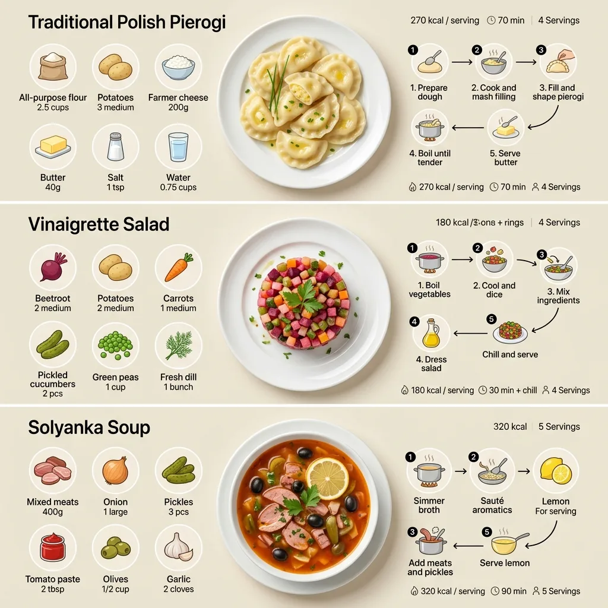

# Top-down / 3-quarter angle food photography

[← Back to the collection](../../README.md) · Category: [Food & Drink](../../gallery/food-drink.md) · Model: `Vinano Image Pro` · ID: `vn-01360`

<a href="https://vinano.ai?utm_source=github&utm_medium=readme&utm_campaign=awesome-image-video-prompts-updating&utm_content=prompt-page-image"></a>

<sub>Preview generated with <a href="https://vinano.ai?utm_source=github&utm_medium=readme&utm_campaign=awesome-image-video-prompts-updating&utm_content=prompt-page-caption">vinano.ai</a></sub>

## Prompt

```text
{
 "style": "refined minimalist modern recipe infographic",
 "visual_aesthetic": {
 "photography_style": "Top-down / 3-quarter angle food photography",
 "design_language": "Scandinavian, editorial cookbook layout",
 "background": "Soft neutral beige / cream",
 "lighting": "Soft diffused light gentle shadows",
 "detail_level": "Ultra-realistic, ultra-sharp, 8K resolution"
 },
 "layout": {
 "composition": "Finished dish centered on a white ceramic plate or bowl",
 "elements": ["Floating ingredient icons in soft circular frames",
 "Clean vector-style ingredient illustrations",
 "Clear ingredient labels quantities",
 "Curved step-by-step flow numbered cooking icons"],
 "typography": "High readability, modern sans-serif",
 "spacing": "Balanced, airy, uncluttered"
 },
 "recipes": [{
 "dish_name": "Traditional Polish Pierogi",
 "dish_presentation": "Golden boiled dumplings filled potato and cheese, lightly buttered and garnished fresh chives",
 "ingredients": [{ "name": "All-purpose flour", "quantity": "2.5 cups" },
 { "name": "Potatoes", "quantity": "3 medium" },
 { "name": "Farmer cheese", "quantity": "200g" },
 { "name": "Onion", "quantity": "1 medium" },
 { "name": "Butter", "quantity": "40g" },
 { "name": "Salt", "quantity": "1 tsp" },
 { "name": "Water", "quantity": "0.75 cups" }],
 "steps": ["Prepare dough",
 "Cook and mash filling",
 "Fill and shape pierogi",
 "Boil until tender",
 "Serve butter"],
 "meta": {
 "calories": "270 kcal / serving",
 "time": "70 min",
 "servings": 4
 }
 },
 {
 "dish_name": "Vinaigrette Salad",
 "dish_presentation": "Colorful diced vegetables mixed light dressing, neatly molded and topped fresh herbs",
 "ingredients": [{ "name": "Beetroot", "quantity": "2 medium" },
 { "name": "Potatoes", "quantity": "2 medium" },
 { "name": "Carrots", "quantity": "1 medium" },
 { "name": "Pickled cucumbers", "quantity": "2 pcs" },
 { "name": "Green peas", "quantity": "1 cup" },
 { "name": "Sunflower oil", "quantity": "2 tbsp" },
 { "name": "Fresh dill", "quantity": "1 bunch" }],
 "steps": ["Boil vegetables",
 "Cool and dice",
 "Mix ingredients",
 "Dress salad",
 "Chill and serve"],
 "meta": {
 "calories": "180 kcal / serving",
 "time": "30 min + chill",
 "servings": 4
 }
 },
 {
 "dish_name": "Solyanka Soup",
 "dish_presentation": "Rich hearty soup sliced meats, olives, lemon, and herbs, served steaming in a ceramic bowl",
 "ingredients": [{ "name": "Mixed meats", "quantity": "400g" },
 { "name": "Onion", "quantity": "1 large" },
 { "name": "Pickles", "quantity": "3 pcs" },
 { "name": "Tomato paste", "quantity": "2 tbsp" },
 { "name": "Olives", "quantity": "1/2 cup" },
 { "name": "Garlic", "quantity": "2 cloves" },
 { "name": "Bay leaf", "quantity": "1 pc" },
 { "name": "Lemon", "quantity": "For serving" }],
 "steps": ["Simmer broth",
 "Sauté aromatics",
 "Add meats and pickles",
 "Season and simmer",
 "Serve lemon"],
 "meta": {
 "calories": "320 kcal / serving",
 "time": "90 min",
 "servings": 5
 }
 }]
}

Maintain consistent colour harmony and crisp focus across the whole frame.
```

## Try it on vinano.ai

1. Copy the prompt above.
2. Open **[vinano.ai](https://vinano.ai?utm_source=github&utm_medium=readme&utm_campaign=awesome-image-video-prompts-updating&utm_content=prompt-page-try)**, paste it into the image generator and pick a model.
3. Swap any placeholders (brand, product, city, person…) for your own details, then generate.

More prompts like this: [Food & Drink gallery](../../gallery/food-drink.md) · [all categories](../../README.md#contents)
