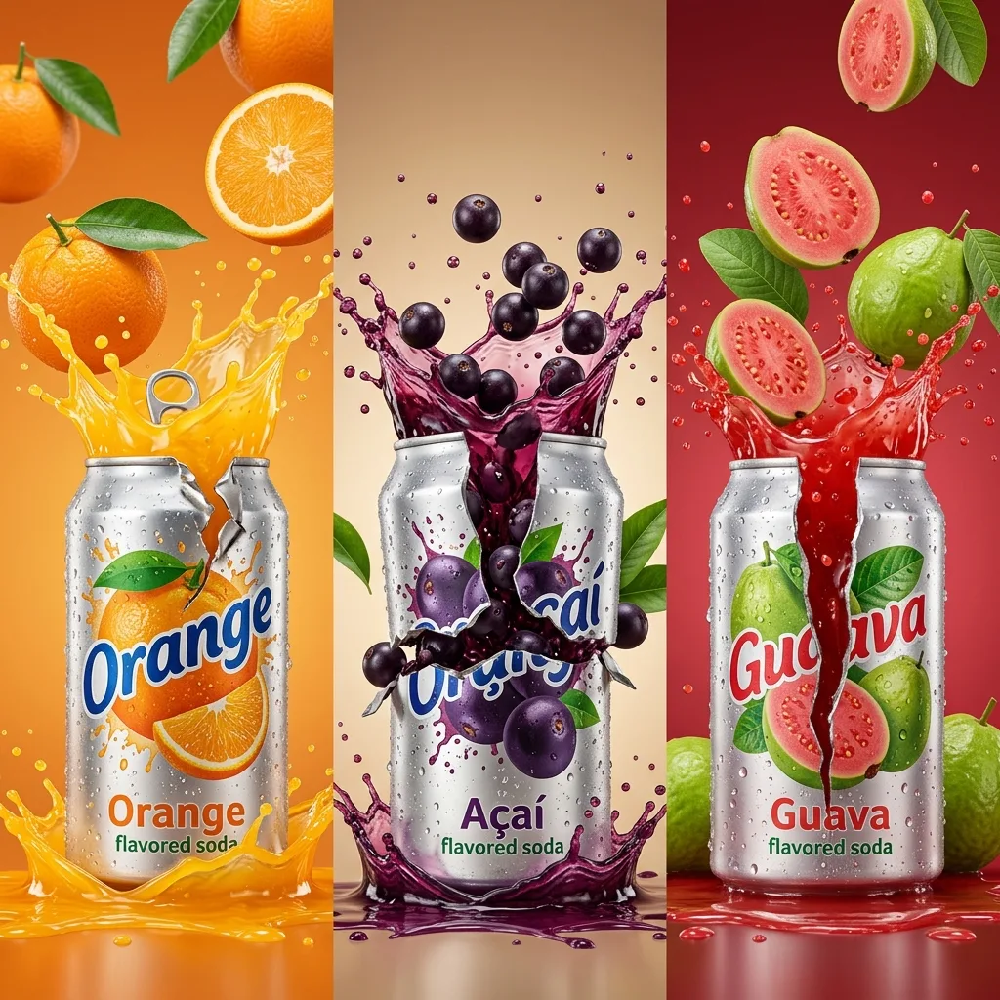

# 3:4 , image type

[← Back to the collection](../../README.md) · Category: [Food & Drink](../../gallery/food-drink.md) · Model: `Vinano Image v2` · ID: `vn-01361`

<a href="https://vinano.ai?utm_source=github&utm_medium=readme&utm_campaign=awesome-image-video-prompts-updating&utm_content=prompt-page-image"></a>

<sub>Preview generated with <a href="https://vinano.ai?utm_source=github&utm_medium=readme&utm_campaign=awesome-image-video-prompts-updating&utm_content=prompt-page-caption">vinano.ai</a></sub>

## Prompt

```text
{
 "global_settings": {
 "resolution": "8K UHD",
 "aspect_ratio": "3:4",
 "image_type": "AI-edited hyper-realistic commercial product photography",
 "camera": {
 "focus": "ultra-sharp center focus",
 "depth_of_field": "shallow DOF soft background falloff",
 "angle": "straight-on frontal view",
 "lens": "macro-commercial lens look"
 },
 "lighting": {
 "style": "studio lighting",
 "key_light": "strong frontal soft light",
 "rim_light": "subtle edge highlights on fruits and splashes",
 "reflections": "specular highlights on liquid droplets and metal can"
 },
 "textures": ["highly detailed aluminum can surface",
 "realistic liquid physics",
 "sharp fruit skin texture",
 "visible condensation droplets"],
 "quality_flags": ["extreme detail",
 "true-to-life photorealistic",
 "AI-enhanced clarity",
 "no motion blur",
 "clean background"]
 },

 "Module_1_Image_1_Style_Orange": {
 "subject": "Orange flavored soda can",
 "can_details": {
 "material": "metal aluminum",
 "condition": "top torn open jagged sharp cracks",
 "crack_position": "irregular split at the top rim, metal bent outward",
 "surface": "covered water droplets and condensation"
 },
 "fruit_elements": {
 "whole_oranges": "multiple whole oranges floating behind and above the can",
 "orange_slice": "one visible half-cut orange slice near the top center",
 "leaves": "green citrus leaves attached to some oranges"
 },
 "liquid_effects": {
 "splash_color": "bright orange liquid",
 "motion": "liquid bursting upward and outward from inside the can",
 "droplets": "numerous suspended droplets frozen mid-air",
 "base_splash": "orange liquid pooling and splashing at the bottom"
 },
 "background": {
 "color": "solid warm orange",
 "gradient": "slight tonal variation, no patterns"
 }
 },

 "Module_2_Image_2_Style_Acai": {
 "subject": "Açaí flavored soda can",
 "can_details": {
 "material": "metal aluminum",
 "condition": "can split horizontally into two broken sections",
 "cracks": "jagged tearing edges visible sharp metal folds",
 "surface": "covered condensation droplets"
 },
 "fruit_elements": {
 "acai_berries": "multiple dark purple berries erupting from inside the can",
 "berry_motion": "berries floating upward and outward",
 "leaves": "few green leaves visible on sides"
 },
 "liquid_effects": {
 "splash_color": "deep purple liquid",
 "motion": "explosive splash radiating outward",
 "droplets": "fine droplets suspended in air"
 },
 "background": {
 "color": "warm beige to light brown gradient",
 "tone": "soft neutral backdrop"
 }
 },

 "Module_3_Image_3_Style_Goiaba_Guava": {
 "subject": "Guava flavored soda can",
 "can_details": {
 "material": "metal aluminum",
 "condition": "vertical split down the center of the can",
 "cracks": "uneven torn edges exposing inside",
 "surface": "visible water droplets and moisture"
 },
 "fruit_elements": {
 "guava_halves": "multiple guava halves pink interiors",
 "whole_guavas": "several whole green guavas around the can",
 "leaves": "green guava leaves scattered"
 },
 "liquid_effects": {
 "splash_color": "red guava juice",
 "motion": "juice bursting upward and sideways",
 "droplets": "dense red droplets suspended mid-air"
 },
 "background": {
 "color": "solid deep red",
 "tone": "high contrast fruit and liquid"
 }
 }

Preserve realistic proportions and depth for a confident, professional finish.
```

## Try it on vinano.ai

1. Copy the prompt above.
2. Open **[vinano.ai](https://vinano.ai?utm_source=github&utm_medium=readme&utm_campaign=awesome-image-video-prompts-updating&utm_content=prompt-page-try)**, paste it into the image generator and pick a model.
3. Swap any placeholders (brand, product, city, person…) for your own details, then generate.

More prompts like this: [Food & Drink gallery](../../gallery/food-drink.md) · [all categories](../../README.md#contents)
