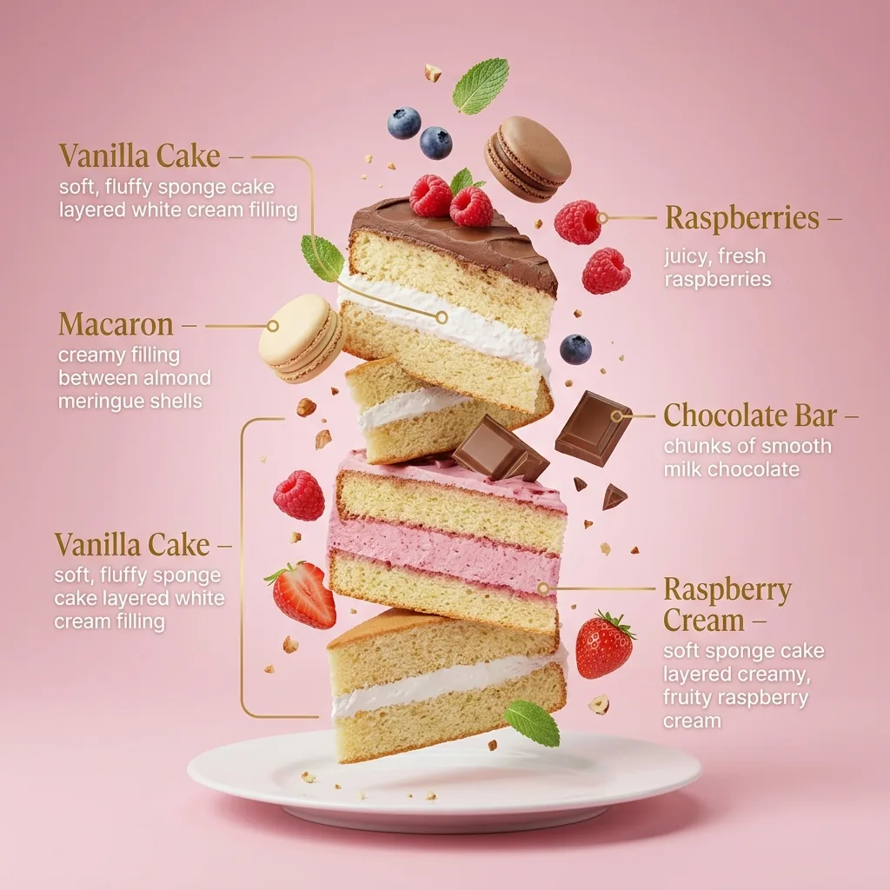

# 3:4 , camera style

[← Back to the collection](../../README.md) · Category: [Food & Drink](../../gallery/food-drink.md) · Model: `Vinano Image Pro` · ID: `vn-01365`

<a href="https://vinano.ai?utm_source=github&utm_medium=readme&utm_campaign=awesome-image-video-prompts-updating&utm_content=prompt-page-image"></a>

<sub>Preview generated with <a href="https://vinano.ai?utm_source=github&utm_medium=readme&utm_campaign=awesome-image-video-prompts-updating&utm_content=prompt-page-caption">vinano.ai</a></sub>

## Prompt

```text
{
"global_settings": {
"resolution": "8K ultra high definition",
"aspect_ratio": "3:4",
"camera_style": "studio food photography filmic, cinematic lighting",
"depth_of_field": "shallow depth of field, sharp subject, soft background",
"lighting": "soft directional key light, subtle rim light, controlled highlights",
"style": "hyper-realistic food illustration editorial infographic overlays",
"composition_rules": ["no zoom",
"no crop",
"center-weighted vertical composition",
"floating elements frozen in motion"],
"text_design": {
"ingredient_name_color": "metallic gold",
"ingredient_description_color": "pure white",
"font_style": "elegant serif for titles, clean sans-serif for descriptions",
"indicator_lines": "long, thin, smooth golden lines rounded corners"
}
},

"module_1_image_1_style": {
"scene_description": "A vertical stack of assorted cake slices floating above a white ceramic plate against a soft pink gradient background.",
"background": {
"color": "soft pastel pink",
"texture": "smooth gradient",
"lighting": "even, studio-lit, no harsh shadows"
},
"main_subjects": ["multiple layered sponge cake slices",
"white whipped cream layers",
"raspberry cream layer",
"chocolate cream topping"],
"visible_ingredients": ["vanilla sponge cake",
"whipped cream",
"raspberries",
"blueberries",
"strawberries",
"macarons (vanilla and chocolate)",
"chocolate bar pieces",
"mint leaves",
"small nut fragments"],
"motion_elements": ["floating fruits",
"floating macarons",
"crumbs suspended in air"],
"text_labels": ["Vanilla Cake – soft, fluffy sponge cake layered white cream filling",
"Macaron – creamy filling between almond meringue shells",
"Raspberries – juicy, fresh raspberries",
"Chocolate Bar – chunks of smooth milk chocolate",
"Raspberry Cream – soft sponge cake layered creamy, fruity raspberry cream"]
},

Emphasise material texture and natural light so the final frame feels tactile and premium.
```

## Try it on vinano.ai

1. Copy the prompt above.
2. Open **[vinano.ai](https://vinano.ai?utm_source=github&utm_medium=readme&utm_campaign=awesome-image-video-prompts-updating&utm_content=prompt-page-try)**, paste it into the image generator and pick a model.
3. Swap any placeholders (brand, product, city, person…) for your own details, then generate.

More prompts like this: [Food & Drink gallery](../../gallery/food-drink.md) · [all categories](../../README.md#contents)
