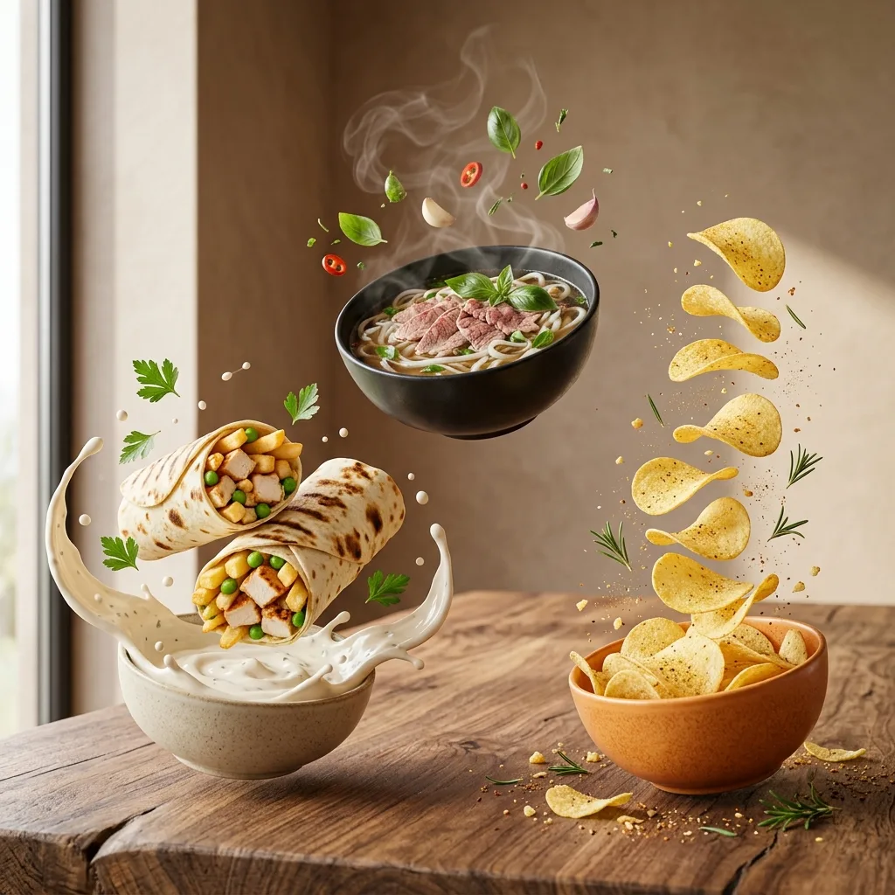

# 3:4 , image quality

[← Back to the collection](../../README.md) · Category: [Food & Drink](../../gallery/food-drink.md) · Model: `Vinano Image v2` · ID: `vn-01371`

<a href="https://vinano.ai?utm_source=github&utm_medium=readme&utm_campaign=awesome-image-video-prompts-updating&utm_content=prompt-page-image"></a>

<sub>Preview generated with <a href="https://vinano.ai?utm_source=github&utm_medium=readme&utm_campaign=awesome-image-video-prompts-updating&utm_content=prompt-page-caption">vinano.ai</a></sub>

## Prompt

```text
{
 "global_settings": {
 "resolution": "8K",
 "aspect_ratio": "3:4",
 "image_quality": "ultra-high definition",
 "sharpness": "extreme",
 "lighting_quality": "studio-grade filmic, cinematic lighting",
 "render_style": "hyper-realistic AI-edited food photography",
 "noise": "none",
 "text_or_logos": "none",
 "focus": "tack-sharp foreground controlled depth"
 },

 "Module_1_Image_1_Style": {
 "subject": "two grilled tortilla wraps",
 "composition": {
 "main_action": "wraps floating above a bowl of sauce",
 "orientation": "one wrap stacked diagonally over another",
 "perspective": "slightly low-angle, centered composition"
 },
 "food_details": {
 "wrap_texture": "lightly grilled tortilla golden brown char spots",
 "filling_visible": ["diced cooked chicken",
 "golden french fries",
 "green peas"],
 "sauce": {
 "type": "thick creamy white sauce",
 "motion": "large splash forming curved arcs",
 "bowl_material": "ceramic",
 "bowl_color": "light beige"
 }
 },
 "motion_elements": ["suspended sauce droplets",
 "floating parsley leaves"],
 "background": {
 "color": "dark warm brown gradient",
 "texture": "smooth, studio backdrop"
 },
 "surface": "wooden tabletop visible at bottom",
 "mood": "dynamic, indulgent, dramatic food motion"
 },

 "Module_2_Image_2_Style": {
 "subject": "potato chips in a bowl",
 "composition": {
 "main_action": "chips flying upward above the bowl",
 "distribution": "evenly spaced mid-air chips forming a vertical cascade",
 "camera_position": "eye-level close-up"
 },
 "food_details": {
 "chips_texture": "thin, crispy, lightly curved",
 "chips_color": "golden yellow seasoning speckles",
 "bowl": {
 "material": "ceramic",
 "color": "warm orange",
 "fill_state": "bowl partially filled chips"
 }
 },
 "seasoning_elements": ["fine spice dust",
 "small crumbs",
 "rosemary sprigs floating"],
 "background": {
 "color": "warm orange gradient",
 "lighting": "soft diffused highlights on chips"
 },
 "ground_details": ["scattered crumbs",
 "spice particles",
 "rosemary pieces"],
 "mood": "energetic, crunchy, commercial snack photography"
 },

 "Module_3_Image_3_Style": {
 "subject": "beef noodle soup in a bowl",
 "composition": {
 "main_action": "bowl floating in mid-air",
 "camera_angle": "slightly elevated front angle",
 "framing": "centered wide negative space"
 },
 "food_details": {
 "bowl_color": "dark matte black",
 "broth": "clear brown liquid",
 "noodles": "white flat noodles",
 "protein": "thin slices of raw or lightly cooked beef",
 "herbs": ["green basil leaves"]
 },
 "floating_elements": ["basil leaves",
 "chili slices",
 "garlic cloves",
 "herb fragments"],
 "steam": {
 "visibility": "clearly visible",
 "shape": "soft swirling trails",
 "opacity": "semi-transparent"
 },
 "background": {
 "color": "soft teal gradient",
 "texture": "clean studio backdrop"
 },
 "mood": "fresh, aromatic, premium culinary presentation"
 },

Emphasise material texture and natural light so the final frame feels tactile and premium.
```

## Try it on vinano.ai

1. Copy the prompt above.
2. Open **[vinano.ai](https://vinano.ai?utm_source=github&utm_medium=readme&utm_campaign=awesome-image-video-prompts-updating&utm_content=prompt-page-try)**, paste it into the image generator and pick a model.
3. Swap any placeholders (brand, product, city, person…) for your own details, then generate.

More prompts like this: [Food & Drink gallery](../../gallery/food-drink.md) · [all categories](../../README.md#contents)
