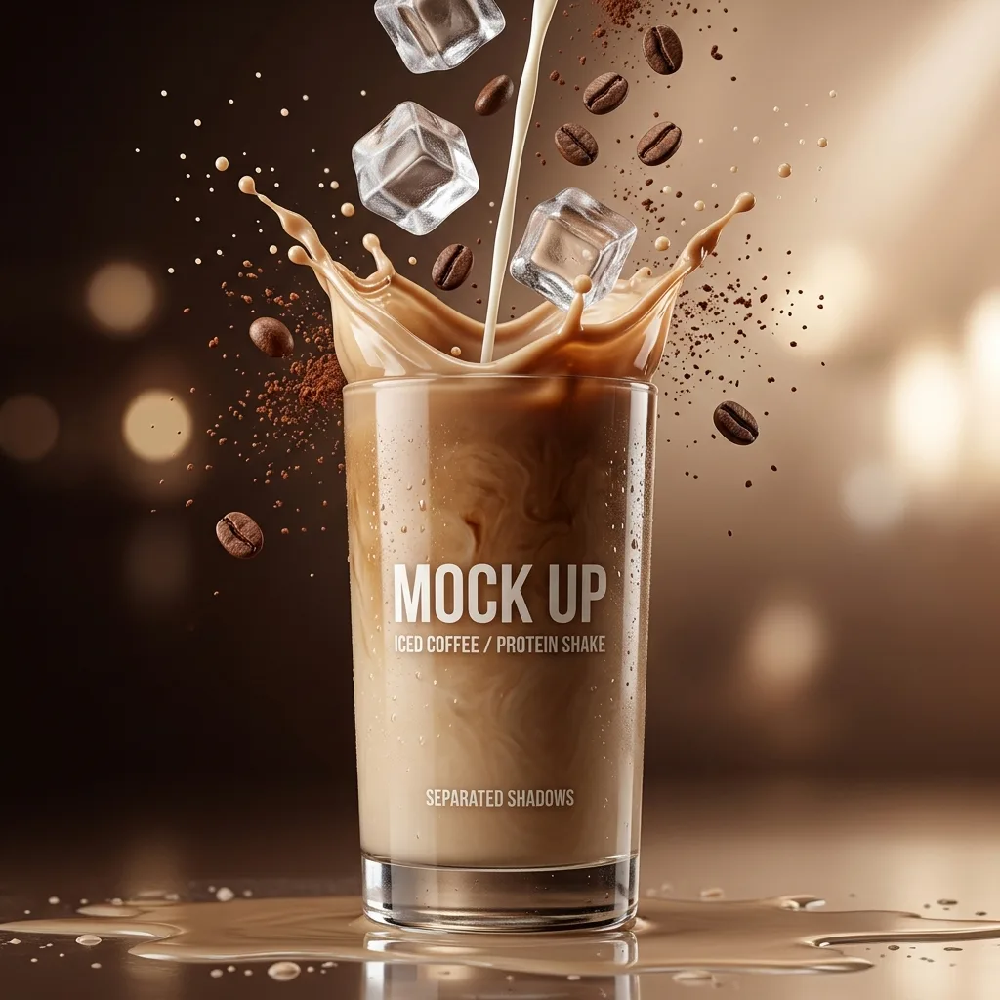

# AI-edited commercial beverage photography

[← Back to the collection](../../README.md) · Category: [Food & Drink](../../gallery/food-drink.md) · Model: `Vinano Image v2` · ID: `vn-01375`

<a href="https://vinano.ai?utm_source=github&utm_medium=readme&utm_campaign=awesome-image-video-prompts-updating&utm_content=prompt-page-image"></a>

<sub>Preview generated with <a href="https://vinano.ai?utm_source=github&utm_medium=readme&utm_campaign=awesome-image-video-prompts-updating&utm_content=prompt-page-caption">vinano.ai</a></sub>

## Prompt

```text
{
 "master_prompt": {
 "global_settings": {
 "resolution": "8K ultra-high-definition",
 "aspect_ratio": "3:4 vertical",
 "style": "hyper-realistic AI-edited commercial beverage photography",
 "sharpness": "extreme clarity, micro-detail visibility",
 "lighting_quality": "cinematic studio lighting controlled highlights and shadows",
 "motion_freeze": "high-speed capture, frozen liquid splashes and particles",
 "noise": "none",
 "artifacts": "none"
 },

 "module_1_glass_beverage_style": {
 "subject": {
 "type": "transparent glass",
 "glass_style": "tall cylindrical glass thick base",
 "surface_details": "cold condensation droplets on outer glass surface",
 "fill_level": "80 percent full",
 "label_text_visible": ["mock up",
 "iced coffee / protein shake",
 "SEPARATED SHADOWS"]
 },

 "liquid_and_layers": {
 "beverage_type": "iced latte or chocolate protein shake",
 "liquid_color": "rich coffee brown or creamy cocoa",
 "layering": "soft milk-to-coffee gradient subtle swirls",
 "texture": "smooth, thick, glossy, realistic viscosity"
 },

 "motion_and_splash": {
 "action": "liquid splash erupting from inside the glass",
 "splash_behavior": "curved arcs rising above rim suspended droplets",
 "droplet_detail": "micro droplets frozen mid-air sharp definition"
 },

 "floating_elements": {
 "ice_cubes": "large clear ice cubes rotating in mid-air",
 "coffee_beans_or_cocoa": "roasted coffee beans or cocoa powder particles floating",
 "cream_stream": "thin stream of milk or cream pouring into glass"
 },

 "pose_and_camera": {
 "position": "centered hero composition",
 "angle": "three-quarter close-up",
 "camera_feel": "slightly low angle for premium, powerful presence"
 },

 "background": {
 "color_palette": "deep espresso brown fading into warm beige highlights",
 "bokeh": "soft cinematic bokeh lights warm glow",
 "atmosphere": "luxurious, indulgent, high-end café mood"
 },

 "surface_and_reflection": {
 "base": "wet reflective surface subtle liquid pooling",
 "shadow_style": "clean, soft separated shadow beneath glass",
 "reflection_quality": "controlled highlights along glass edges"
 }
 }
 }
}

Render with rich micro-detail while keeping the layout uncluttered and intentional.
```

## Try it on vinano.ai

1. Copy the prompt above.
2. Open **[vinano.ai](https://vinano.ai?utm_source=github&utm_medium=readme&utm_campaign=awesome-image-video-prompts-updating&utm_content=prompt-page-try)**, paste it into the image generator and pick a model.
3. Swap any placeholders (brand, product, city, person…) for your own details, then generate.

More prompts like this: [Food & Drink gallery](../../gallery/food-drink.md) · [all categories](../../README.md#contents)
