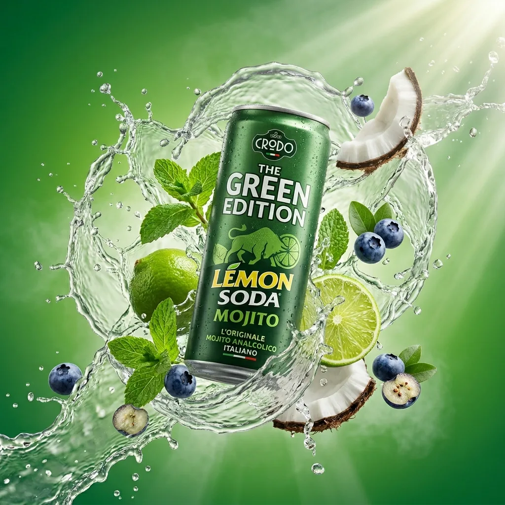

# 3:4 , quality

[← Back to the collection](../../README.md) · Category: [Food & Drink](../../gallery/food-drink.md) · Model: `Vinano Image v2` · ID: `vn-01377`

<a href="https://vinano.ai?utm_source=github&utm_medium=readme&utm_campaign=awesome-image-video-prompts-updating&utm_content=prompt-page-image"></a>

<sub>Preview generated with <a href="https://vinano.ai?utm_source=github&utm_medium=readme&utm_campaign=awesome-image-video-prompts-updating&utm_content=prompt-page-caption">vinano.ai</a></sub>

## Prompt

```text
{
 "global_settings": {
 "resolution": "8K ultra high definition",
 "aspect_ratio": "3:4",
 "quality": "hyper-realistic commercial product photography",
 "focus": "sharp foreground, controlled depth of field",
 "lighting_style": "cinematic studio lighting volumetric light rays",
 "motion": "frozen action splash photography",
 "render_style": "AI-edited, ultra-detailed, advertising-grade"
 },

 "module_1_purple_acai_style": {
 "primary_subject": {
 "object": "slim aluminum energy drink can",
 "orientation": "slightly tilted clockwise, floating mid-air",
 "surface": "matte metallic purple fine water droplets",
 "branding": {
 "text_visible": ["THE PURPLE EDITION", "Açaí Berry", "ENERGY DRINK"],
 "graphics": "stylized bull illustration in white"
 }
 },
 "background": {
 "color": "deep purple gradient",
 "lighting": "bright diagonal light rays from upper right",
 "atmosphere": "misty fine water particles"
 },
 "surrounding_elements": {
 "fruits": [{
 "type": "blueberries",
 "state": ["whole", "one halved"],
 "texture": "glossy skin, visible pulp on cut fruit"
 }],
 "leaves": "small green leaves attached to berries",
 "liquid": "clear water splashes forming arcs around can"
 },
 "motion_details": {
 "water": "dynamic splash trails frozen mid-air",
 "droplets": "micro droplets suspended around subject"
 },
 "color_palette": ["purple", "violet", "deep blue", "white", "fresh green"]
 },

 "module_2_white_coconut_berry_style": {
 "primary_subject": {
 "object": "slim aluminum energy drink can",
 "orientation": "slightly tilted counter-clockwise, floating",
 "surface": "white metallic finish condensation droplets",
 "branding": {
 "text_visible": ["THE WHITE EDITION", "Coconut & Berry", "ENERGY DRINK"],
 "graphics": "bull illustration in gray"
 }
 },
 "background": {
 "color": "sky blue gradient",
 "lighting": "strong sunlight beams from upper right",
 "atmosphere": "clean, airy, refreshing"
 },
 "surrounding_elements": {
 "fruits": [{
 "type": "blueberries",
 "state": "whole",
 "texture": "smooth, reflective skin"
 },
 {
 "type": "coconut",
 "state": "broken slices",
 "texture": "white flesh dark brown shell"
 }

 "ice": {
 "form": "transparent ice cubes",
 "detail": "sharp edges, internal cracks visible"
 },
 "liquid": "clear water splashes"
 },
 "motion_details": {
 "water": "curved splash paths wrapping around can",
 "ice": "suspended mid-air subtle rotation"
 },
 "color_palette": ["white", "light blue", "cyan", "natural brown", "cool gray"]

 "module_3_green_lemon_mojito_style": {
 "primary_subject": {
 "object": "tall soda can",
 "orientation": "tilted slightly clockwise, floating",
 "surface": "dark green metallic body lighter green label",
 "branding": {
 "text_visible": ["LEMON SODA", "MOJITO", "L’ORIGINALE MOJITO ANALCOLICO ITALIANO"],
 "logo": "CRODO emblem at top
 "background": {
 "color": "vibrant green gradient",
 "lighting": "intense sun flare from upper right"
 },
 "surrounding_elements": {
 "fruits": [{
 "type": "lime",
 "state": ["whole", "sliced wedge"],
 "texture": "visible citrus pulp, glossy rind"
 }],
 "leaves": "fresh mint leaves visible veins",
 "liquid": "sparkling water splashes"
 },
 "motion_details": {
 "water": "explosive splash bursts around can",
 "droplets": "dense spray of fine droplets"
 },
 "color_palette": ["lime green", "dark green", "yellow-green", "white"]
 }

Aim for an editorial, design-driven look with deliberate negative space.
```

## Try it on vinano.ai

1. Copy the prompt above.
2. Open **[vinano.ai](https://vinano.ai?utm_source=github&utm_medium=readme&utm_campaign=awesome-image-video-prompts-updating&utm_content=prompt-page-try)**, paste it into the image generator and pick a model.
3. Swap any placeholders (brand, product, city, person…) for your own details, then generate.

More prompts like this: [Food & Drink gallery](../../gallery/food-drink.md) · [all categories](../../README.md#contents)
