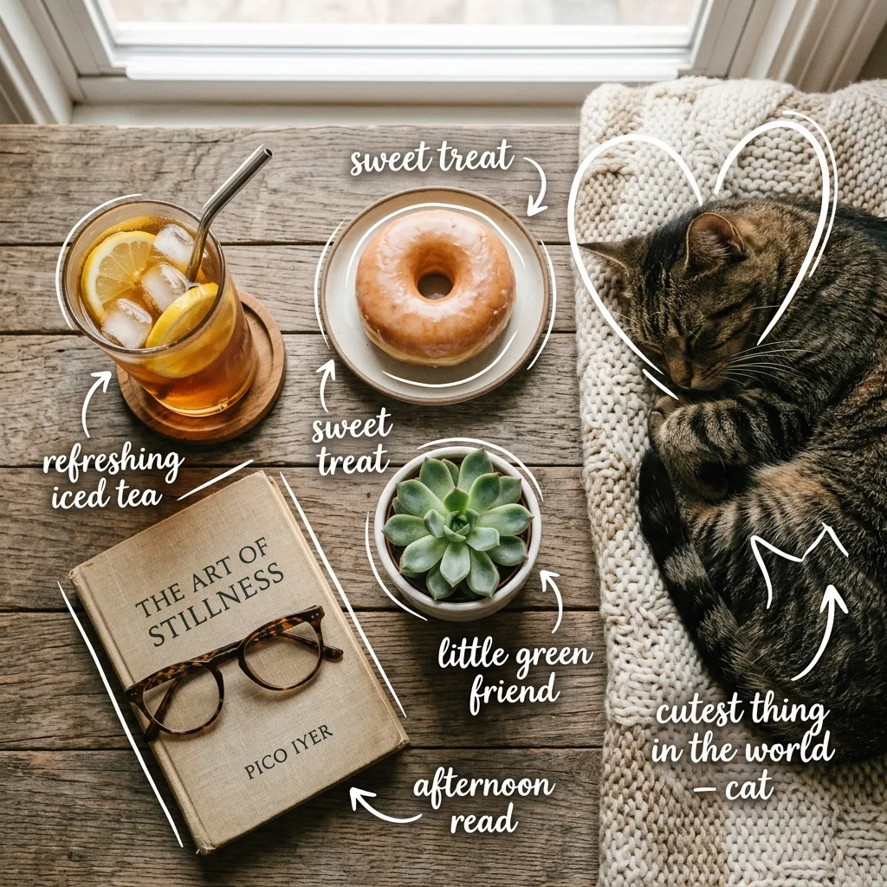

# Top-down flat lay on a rustic wooden table, cozy

[← Back to the collection](../../README.md) · Category: [Food & Drink](../../gallery/food-drink.md) · Model: `Vinano Image v2` · ID: `vn-01398`

<a href="https://vinano.ai?utm_source=github&utm_medium=readme&utm_campaign=awesome-image-video-prompts-updating&utm_content=prompt-page-image"></a>

<sub>Preview generated with <a href="https://vinano.ai?utm_source=github&utm_medium=readme&utm_campaign=awesome-image-video-prompts-updating&utm_content=prompt-page-caption">vinano.ai</a></sub>

## Prompt

```text
Top-down flat lay on a rustic wooden table, cozy aesthetic, soft natural light. A glass of iced tea lemon slices and ice cubes, a glazed donut, a small succulent plant in a white pot, a vintage book, and eyeglasses. A sleeping tabby cat curled on a blanket at the edge. White hand-drawn doodle outlines and arrows around each object playful handwritten labels like “refreshing iced tea,” “sweet treat,” “little green friend,” “afternoon read,” and “cutest thing in the world – cat.” Warm tones, minimal shadows, lifestyle photography, high detail, Instagram aesthetic. Keep edges clean and the overall composition balanced for a polished, gallery-ready result.
```

## Try it on vinano.ai

1. Copy the prompt above.
2. Open **[vinano.ai](https://vinano.ai?utm_source=github&utm_medium=readme&utm_campaign=awesome-image-video-prompts-updating&utm_content=prompt-page-try)**, paste it into the image generator and pick a model.
3. Swap any placeholders (brand, product, city, person…) for your own details, then generate.

More prompts like this: [Food & Drink gallery](../../gallery/food-drink.md) · [all categories](../../README.md#contents)
