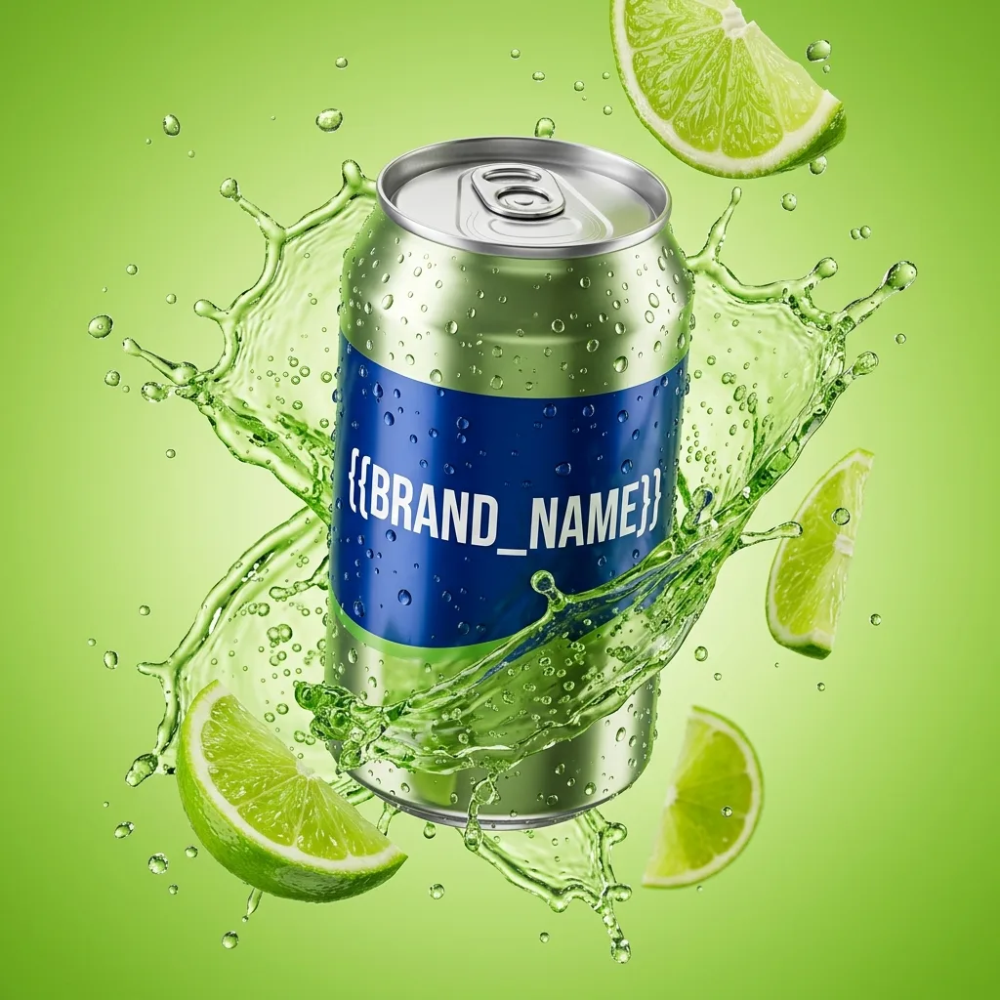

# Carbonated beverage can

[← Back to the collection](../../README.md) · Category: [Food & Drink](../../gallery/food-drink.md) · Model: `Vinano Image v2` · ID: `vn-01399`

<a href="https://vinano.ai?utm_source=github&utm_medium=readme&utm_campaign=awesome-image-video-prompts-updating&utm_content=prompt-page-image"></a>

<sub>Preview generated with <a href="https://vinano.ai?utm_source=github&utm_medium=readme&utm_campaign=awesome-image-video-prompts-updating&utm_content=prompt-page-caption">vinano.ai</a></sub>

## Prompt

```text
{
 "resolution": "8K",
 "style": "hyper-realistic commercial product photography",
 "composition": {
 "subject": "carbonated beverage can",
 "position": "center frame, floating mid-air",
 "orientation": "slightly tilted vertical",
 "framing": "tight hero shot"
 },
 "can_details": {
 "material": "metallic aluminum",
 "top_bottom": "silver visible pull tab",
 "surface": "glossy condensation droplets",
 "label": {
 "text": "{{BRAND_NAME}}",
 "font": "bold uppercase sans-serif",
 "color": "white",
 "background_band": "deep blue",
 "placement": "wrapped around center of can"
 }
 },
 "liquid_effects": {
 "color": "bright green",
 "type": "carbonated liquid splash",
 "motion": "frozen mid-explosion",
 "details": ["semi-transparent fluid",
 "fine droplets suspended in air",
 "dynamic curved splash arcs",
 "visible carbonation bubbles"]
 },
 "fruit_elements": {
 "type": "sliced fruit",
 "motion": "floating around the can",
 "texture": "fresh, juicy, glossy"
 },
 "lighting": {
 "type": "studio lighting",
 "highlights": "strong reflections",
 "shadows": "soft"
 },
 "background": {
 "color": "smooth gradient matching liquid tone",
 "environment": "clean studio backdrop"
 },
 "render_quality": {
 "sharpness": "ultra-sharp",
 "contrast": "high",
 "realism": "true-to-life photorealistic"
 }
}

Keep edges clean and the overall composition balanced for a polished, gallery-ready result.
```

## Try it on vinano.ai

1. Copy the prompt above.
2. Open **[vinano.ai](https://vinano.ai?utm_source=github&utm_medium=readme&utm_campaign=awesome-image-video-prompts-updating&utm_content=prompt-page-try)**, paste it into the image generator and pick a model.
3. Swap any placeholders (brand, product, city, person…) for your own details, then generate.

More prompts like this: [Food & Drink gallery](../../gallery/food-drink.md) · [all categories](../../README.md#contents)
