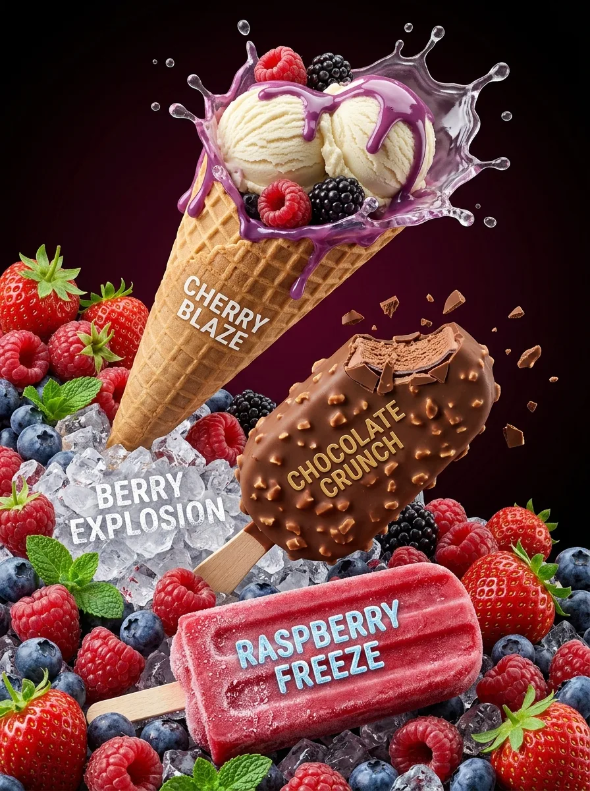

# Master prompt

[← Back to the collection](../../README.md) · Category: [Food & Drink](../../gallery/food-drink.md) · Model: `Vinano Image Pro` · ID: `vn-01406`

<a href="https://vinano.ai?utm_source=github&utm_medium=readme&utm_campaign=awesome-image-video-prompts-updating&utm_content=prompt-page-image"></a>

<sub>Preview generated with <a href="https://vinano.ai?utm_source=github&utm_medium=readme&utm_campaign=awesome-image-video-prompts-updating&utm_content=prompt-page-caption">vinano.ai</a></sub>

## Prompt

```text
{
 "master_prompt": {
 "global_settings": {
 "resolution": "8K ultra high definition",
 "aspect_ratio": "3:4 vertical",
 "image_quality": "extreme sharpness, high dynamic range, professional studio lighting",
 "style": "AI-edited hyperreal food photography",
 "focus": "crisp textures, frozen motion, liquid dynamics, surface details",
 "background_quality": "clean, controlled, noise-free"
 },

 "module_1": {
 "identity": "Image 1 – Ice Cream Cone Purple Splash",
 "subject": {
 "main_object": "waffle cone ice cream",
 "cone": "light brown waffle cone diamond grid texture, matte finish",
 "ice_cream_scoops": [{
 "color": "off-white / vanilla",
 "texture": "creamy visible scoop ridges"
 },
 {
 "color": "off-white / vanilla",
 "texture": "slightly uneven surface, melting edges"
 }],
 "toppings": ["raspberries",
 "blackberries"],
 "sauce": {
 "color": "glossy purple",
 "behavior": "thick liquid splashing outward and downward",
 "coverage": "dripping over scoops and cone"
 }
 },
 "motion": {
 "action": "frozen splash moment",
 "details": "liquid droplets suspended mid-air, see-through splash edges"
 },
 "background": {
 "color": "deep dark maroon / black",
 "style": "studio backdrop subtle gradient"
 },
 "lighting": {
 "type": "high-contrast studio lighting",
 "effects": "specular highlights on sauce and ice cream, shadow depth under cone"
 }
 },

 "module_2": {
 "identity": "Image 2 – Chocolate Ice Cream Bar Bite",
 "subject": {
 "main_object": "chocolate-coated ice cream bar on wooden stick",
 "coating": {
 "exploded_view": false,
 "surface": "milk chocolate coating embedded nut pieces",
 "texture": "rough, uneven, crunchy appearance"
 },
 "bite_detail": {
 "location": "top edge",
 "interior_layers": ["chocolate ice cream",
 "thin darker chocolate layer"],
 "edges": "jagged bite marks"
 },
 "stick": {
 "material": "light wood",
 "finish": "smooth, rounded end"
 }
 },
 "motion": {
 "elements": "small chocolate fragments floating in air",
 "behavior": "scattered outward from the bar"
 },
 "background": {
 "color": "warm brown gradient",
 "style": "clean studio environment"
 },
 "lighting": {
 "type": "directional studio lighting",
 "effects": "strong highlights on chocolate bumps, soft shadows"
 }
 },

 "module_3": {
 "identity": "Image 3 – Red Berry Popsicle Fruits",
 "subject": {
 "main_object": "rectangular red popsicle",
 "surface": {
 "texture": "frosted, icy crystals visible",
 "shape": "rounded corners, vertical grooves"
 },
 "stick": {
 "material": "light wooden stick",
 "visible": true
 },
 "surroundings": ["whole strawberries green tops",
 "blueberries",
 "raspberries",
 "mint leaves",
 "crushed ice pieces"]
 },
 "color_palette": ["bright red",
 "deep blue",
 "fresh green",
 "clear ice"],
 "background": {
 "composition": "entire frame filled fruits and ice",
 "style": "top-down macro food arrangement"
 },
 "lighting": {
 "type": "even bright lighting",
 "effects": "wet shine on fruit skins, crystalline ice reflections"
 }
 },

Emphasise material texture and natural light so the final frame feels tactile and premium.
```

## Try it on vinano.ai

1. Copy the prompt above.
2. Open **[vinano.ai](https://vinano.ai?utm_source=github&utm_medium=readme&utm_campaign=awesome-image-video-prompts-updating&utm_content=prompt-page-try)**, paste it into the image generator and pick a model.
3. Swap any placeholders (brand, product, city, person…) for your own details, then generate.

More prompts like this: [Food & Drink gallery](../../gallery/food-drink.md) · [all categories](../../README.md#contents)
